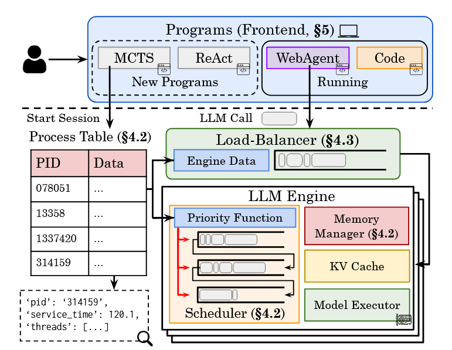

# Agentix: An Efficient Serving Engine for LLM Agents as General Programs

!!! abstract

    **Agentix** 是一个专为复杂 LLM Agent 应用设计的新型推理系统。它的核心贡献在于打破了传统推理引擎“请求级”调度的局限，首次将 Agent 视为具有复杂依赖关系的**“通用程序”**，通过引入**程序级**的全局视野和调度算法，大幅提升了系统的吞吐量和资源利用率

    - **作者**: Michael Luo, Xiaoxiang Shi, Colin Cai, Tianjun Zhang, Justin Wong, Yichuan Wang, Chi Wang, Yanping Huang, Zhifeng Chen, Joseph E. Gonzalez, Ion Stoica
    - **机构**: UC Berkeley, Google DeepMind, Shanghai Jiao Tong University
    - 最早发表在 arXiv 叫 [**Autellix**](https://arxiv.org/abs/2502.13965)，发表在 NSDI 2026 改成了 **Agentix**

---

### Problem

**核心痛点：** 现有的 LLM 推理系统（如 vLLM）是为简单的“聊天机器人”设计的，它们把每一个 LLM 调用都看作是**独立、互不相关**的请求。

但在 **Agentic Program**中，情况完全不同：

1. **程序有结构**：是由一系列有依赖关系的 LLM 调用组成的，动态的执行工作流（**DAG**）
    - **LLM 调用**：Agent 需要反复思考、规划
    - **外部中断**：调用工具（API）、执行代码、甚至等待人类输入。
2. **队头阻塞（Head-of-Line Blocking）**：
    - **请求级阻塞**：一个长请求会堵住后面所有的短请求。
    - **程序级阻塞**：一个长程序（比如 MCTS 搜索）会不断产生新的请求
        - 这些请求因为“新”或者“短”而被传统调度器（如 FCFS，MLFQ）优先处理，结果导致一个本来很短的程序被这个长程序的“后续请求”无限插队，迟迟无法完成。

!!! info "FCFS/MLFQ"

    - **FCFS (First-come-First-serve)**：处理最先到达的 request
    - **MLFQ（Multi-Level Feedback Queue）**：在不知道进程具体运行时间的情况下，通过动态调整优先级，来同时优化**响应时间**和**吞吐量**。
        1. **多级队列**：维护多个优先级不同的队列
        2. **新任务高优先级**：新到达的任务会被放入最高优先级的队列（Q1）的末尾
        3. **时间片与降级**：
            - 调度器优先执行高优先级队列中的任务
            - 每个队列都有一个特定的“时间片”（Time Quantum）。如果一个任务在自己的时间片内没有执行完，它就会被**降级**到下一个低优先级的队列
        4. **反馈机制**：系统通过观察任务的行为来推断其类型，并据此调整其优先级。

---

### Key Idea

!!! tip "核心创新"

    Agentix 的核心创新在于视角的转变：**不再调度“请求”，而是调度“程序”**。
    其核心哲学是：**将“程序”作为调度的第一公民（First-class Citizen）**

为了实现这一点，论文提出了两个关键算法和一个系统机制：

1. **全局进程表（Global Process Table）**：
    - Agentix 为每个运行的 Agent 程序维护一个状态表
    - 记录关键信息：**累计服务时间（Service Time）**、等待时间、所属引擎 ID 等
2. **PLAS 算法（针对单线程程序）**：
    - **思路**：基于“累计服务时间”来定优先级。
    - **逻辑**：一个程序已经消耗的资源越少（Service Time 越短），它的优先级就越高。这能让短程序快速完成，减少平均等待时间。
3. **ATLAS 算法（针对多线程/并行程序）**：
    - **思路**：基于“关键路径（Critical Path）”来定优先级。
    - **逻辑**：在复杂的 DAG 中，决定程序总耗时的是最长的那条路径。ATLAS 会动态估算每个线程在关键路径上的位置，优先执行那些**阻碍程序结束的关键线程**，同时把同一个程序的并行请求打包处理（Gang Scheduling），防止“掉队者”拖慢整体进度。
4. **反饥饿机制（Anti-Starvation）**：
    - 为了防止长程序被饿死，设定了一个阈值 $\beta$。
    - 如果（等待时间 / 服务时间）> $\beta$，强制将该程序提升到最高优先级。

### Workflow

1. **Session Start**：程序通过其提供的 **Stateful API** 交互
    - 程序启动，向后端发送 start_session
    - Agentix 在**进程表**中注册该程序，初始化元数据（PID、Service Time、Waiting Time）
2. **Load Balancing**：为 LLM 调用请求分配 GPU
    - **短请求**：发给最空闲的引擎（负载均衡优先）
    - **长请求**：发给该程序之前运行过的引擎（**Data Locality**，复用 KV Cache）
        - <u>Memory-aware</u>，如果显存不足则路由到其他空闲的 engine 
3. **Program-Aware Scheduler**：request 到达 engine 后，调度器查表
    - 结合程序的“历史表现”计算出一个动态优先级
        - **PLAS**：累加程序的服务时间 $S_{new}=S_{old}+t_{model_time}$
        - **ATLAS**：当一个并行线程完成 LLM 调用后，系统会选择该线程的累计时间与该程序的全局时间中的**较大值**作为新的全局累计时间 $S_{global}=\max({S_{global}, S_{thread} + t_{moodel_time}})$
    - 将请求**离散化入队**
4. **Execution & Update**：调度器会持续地从最高优先级的非空队列中取出请求，打包成一个Batch，交给模型执行器在 GPU 上运行
    - 如果请求在时间片（Quanta）内没跑完，会被降级到低优先级队列
    - 如果请求跑完后，将**本次耗时**加回到进程表的 Service Time 中
    - **Anti-Starvation**：如果 等待时间 / 服务时间> $\beta$，强制将该程序提升到<u>最高优先级</u>
5. **循环或结束**：程序根据输出决定下一步动作，重复上述 2-4 的过程，直到任务完成，发送 `end_session` 注销该 program。

!!! tip

    - **Discrete Queuing**：每个队列设置一个区间，减小排序开销
    - **Demotion**：分配的时间（Quanta）不够会降低优先级
    - **Multi-step Scheduling**：连续运行 N 步后，才统一更新一次状态并进行下一次调度

### Results

论文在 LLaMA-3 (8 B/70 B) 和 Falcon-180 B 上进行了广泛测试，结果非常显著：

1. **吞吐量暴涨**：
    - 相比 SOTA 系统（vLLM），Agentix 的吞吐量提升了 **4-15 倍**。
    - 相比经过优化的 vLLM（开启 Prefix Caching 等），也有 **2-5 倍** 的提升。
2. **延迟显著降低**：
    - 在相同的负载下，Agentix 的平均延迟和尾部延迟（P 95/P 99）都远低于 baselines。
    - 特别是在复杂的 MCTS 工作负载下，优势最明显，因为 ATLAS 算法完美解决了并行任务的同步问题。
3. **线性扩展**：
    - 在多机多卡环境下，Agentix 的负载均衡策略能让系统性能随着 GPU 数量增加而**线性增长**，没有明显的瓶颈。
