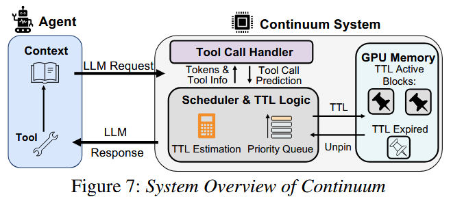

# Continuum: Efficient and Robust Multi-Turn LLM Agent Scheduling with KV Cache Time-to-Live

!!! abstract

    [**Continuum**](https://arxiv.org/abs/2511.02230) 是一个面向 **多轮 Agent 工作负载** 的 LLM serving 系统。它为 KV Cache 引入了 **TTL（Time-to-Live）** 机制：在 Agent 调用工具期间**有选择地把 KV Cache 钉在 GPU 内存**，TTL 到期自动逐出，从而避免"重算 prefill / 排队等待"的累积开销。相比现有系统，平均作业完成时间（JCT）最高降低 **8 倍以上**，同时吞吐量也得到提升

    - **作者**: Hanchen Li, Runyuan He, Qiuyang Mang, Qizheng Zhang, Huanzhi Mao, Xiaokun Chen, Hangrui Zhou, Alvin Cheung, Joseph Gonzalez, Ion Stoica
    - **机构**: UC Berkeley, Stanford, Tensormesh, Tsinghua

---

### Problem

**核心痛点**：传统的 LLM 推理引擎（如 vLLM）是为单次请求设计的，在 decode 结束后就 **释放KV Cache**（end-of-turn eviction）。但对 **Agentic  多轮交互** 存在以下问题：

1. **Turn-based Eviction**：
    - Agent 从推理转向工具调用时，KV Cache 被逐出。
    - 工具执行完、下一轮推理开始时，引擎必须**重算 prefill** 或从 CPU **重新加载 KV**
2. **Per-Turn Queueing Delay**：
    - 即使有 CPU offloading，被逐出的程序回来时仍要**在等待队列里等 GPU 显存释放**才能开始推理。这个排队延迟**随轮数累积**，且离线 profiling 测不出来。
3. **工具调用时长可变**：
    - 工具执行时间呈长尾分布（最慢 10% 的 cd 占 94.1% 延迟）
    - 固定保留策略不稳健：钉太久占满显存、甚至死锁；钉太短又白占显存仍要重算

!!! info "前人工作的不足"

    - **InferCept**：只按 reload 成本决定是否保留，**忽略每轮排队延迟**，也无法适应可变工具时长。
    - **Autellix（PLAS）**：仍用 end-of-turn eviction，完全没考虑多轮 KV 保留。
    - **Pie**：只给接口，不提供保留策略。
    - **Ayo / Alto / Parrot**：假设静态、预先定义好的 DAG，无法处理运行时演化的动态 Agent。

---

### Key Idea

!!! tip "核心创新"

    **把传统缓存系统中的 TTL 思想引入 LLM 推理**：为每个可能复用的 KV Cache 设定一个"存活时间"，到期自动逐出。TTL 值由**代价-收益模型**动态决定，而非固定保留。

论文的关键设计：

1. **KV Cache TTL 机制**：请求结束时若解析出**工具调用**，则把 KV pin在 GPU 上（$\text{TTL} = \tau$）
    - TTL 内工具返回 → 下轮推理直接复用 KV，省去 prefill 和排队延迟
    - TTL 到期 → 自动逐出释放显存，即使预测不准也不会死锁
2. **代价-收益模型（Utility Model）：
    - Pin 住 KV Cache 的**开销**：$\text{Cost}= \dfrac{\text{MemUsage}(r)}{M}\times\tau$
        - 这里的 $\dfrac{\text{MemUsage}(r)}{M}$ 指 request $r$ 占用的显存大小对应几条正常的 request
    - Pin 住 KV Cache 的**收益**：$\text{Benefit} = \text{CacheMissCost} + \text{OutofOrderCost}$
        - 省下的reload/prefill：$\text{CacheMissCost}=\dfrac{\text{MemUsage}(r) \times \text{Prefill-Reload}(r)}{M}$
            - 重新加载的时间里，相当于有 $\text{MemUsage}(r)/M$ 个普通请求被阻塞了
        - 省下的每轮排队延迟：$\text{OutofOrderCost}=\dfrac{T}{M}\times \text{MemUsage(r)}\times \eta$
            - 占用 $\text{MemUsage}(r)$ 个单位显存引发的排队延迟
    - **Best TTL**：$\tau^* = \arg\max_\tau \ P(\tau,f)\times\big[T\cdot\eta+\text{Prefill-Reload}(r)\big]-\tau$
        - $P(\tau,f)$："工具在 $\tau$ 内完成"的概率（由历史工具时长 $S[f]$ 的经验 CDF 估计）
        - $T$：被逐出请求的平均排队延迟（采用滑动窗口计算）
3. **记忆度因子（$\eta$）**：$-\mathrm{Corr}(k,\,N-k)$
    - 计算当前工作量和剩余工作量的相关性，表示**任务进度的可预测性**
    - 完全 memoryless 时 $\eta=0$ 无排队收益；固定长度程序时 $\eta=1$，收益最大
4. **冷启动处理**：记录不足时用固定 TTL；再过渡到全局工具记录；最后才用细粒度经验 CDF
5. **调度优先级**：<u>被抢占状态 > TTL 状态 > 程序级FCFS</u>

---

### Workflow

!!! note "系统流程"

    

    - LLM Request（**OnRequestArrive**）：Agent 把工具执行结果发回给服务器时触发
    - **OnRequestFinish**：LLM 在 GPU 上生成 decode 并输出了完整的 Token 序列时触发
    - 后台轮询：
        - unpin：清理超时的请求
        - schedule：为队列中的 request 分配 GPU

- **Agent 向 Continuum System 发送 LLM Request**：==OnRequestArrive==
    1. 记录到达的时间戳 $t_{arrive}$
    2. 判断请求的类型：
        - **新任务初始化**：为 request 分配 `program_id` 用于后续识别
        - **多轮交互的后续请求**： Tool Call Handler 判定该请求为上一轮工具调用的**后续步骤**，计算上一轮工具调用的**耗时**（两个时间戳相减），并将数据写入历史统计表 $S[f]$
    3. 进入队列：请求被放入等待队列，等待调度器分配 GPU 资源
        - **新任务**：采用简单的分配策略（如 Round-Robin 或 Least-Connections）
        - **旧任务**：根据 program_id 放入同一个 engine
    4. **防死锁机制**：请求入队后，如果发现显存被大量 Pin 住的请求占满，导致新请求无法调度，系统会触发“牺牲机制”，挑选**最新到达的程序**作为受害者强制释放缓存，保证系统不卡死。
- **GPU 完成计算后发出的信号**：==OnRequestFinish==
    - 任务结束：若输出为**最终答案**，直接 unpin 并结束生命周期
    - **工具调用**：若输出包含工具调用指令
        - **解析预测**：Handler 解析出目标工具 $f$，结合历史耗时 $S[f]$、排队延迟 $T$ 、程序的总轮数 $AvgTurns$ 及记忆度 $\eta$，通过暴力枚举计算出**最优 TTL**($\tau^*$)
        - **写入映射表**：将 $\tau^*$ 并存入全局 TTL 映射表 $P$，若 $\tau^*>0$ 则触发 **pin_request**
- **Scheduler 拦截 GPU 释放缓存的指令**：==Request Pinning==
    - Scheduler 拦截常规的 KV Cache 释放指令
    - 将目标 KV block 标记为 pinned，并记录该 request 对应的过期时间 $t_{expire}= t_{now}+\tau$
    - **防死锁机制**: 如果 pin 时发现显存不足，依然会触发“牺牲机制”
- **系统的主循环**：==Schedule & Unpin==
    1. **GC 扫描（Unpin）**：扫描 TTL 映射表，如果某个请求的 TTL 过期（$t_{now} > t_{expire}$）且后续请求还没进入等待队列，系统就会 unpin 并释放它的 KV Cache
    2. **优先级排序**：在等待队列中挑选下一个要执行的请求（**TTL-aware priority*）
        - <u>Preempted status</u>：异常中断（显存不足等）的请求最先执行
        - <u>TTL stauts</u>：KV Cache 存在 GPU 的次优先执行
        - <u>Program-level arrival order</u>：除此之外，先到的程序先执行
    3. **防死锁机制**: 如果发现显存极度紧张，依然会触发“牺牲机制”
    4. **清除标记**：当请求在 GPU 运行后，系统会从 TTL 映射表中移除它的记录。等它再次执行完毕时，又会重新进入 **OnRequestFinish**，开启新一轮的循环。

---

### Results

**实验设置**：

- 模型 Llama-3.1-8B / 70B、Gemma-3-12B；
- 硬件 A100 / H100 / B200；
- 负载 SWE-Bench（~10.9 轮）、BFCL V4（~6.3 轮）、OpenHands（轮数更多）；
- 基线 vLLM、vLLM+LMCache（CPU offloading）、Autellix（PLAS）、InferCept、SGLang、NVIDIA Dynamo。

1. **延迟大幅降低**：
    - 多轮 Agentic 负载平均延迟降低 **1.12×–3.66×**，吞吐提升 **1.10×–3.22×**。
    - Llama-8B 上平均响应时间相比 vLLM 降 **2×**。
    - Tensormesh 内网真实 SWE-Agent 上延迟最高降低 **8.18×**，且 pass rate 更高。
2. **鲁棒性**：
    - **轮数越多优势越大**：轮数 1×→5× 时，基线逐步退化，Continuum 从 1.6× 增至 **3.7×**
    - 对 **batch size / chunk size** 等引擎配置变化**不敏感**
    - 与 **CPU/SSD offloading** 正交兼容，持续优于 InferCept 等 offloading 方案
    - P90/P95 尾部延迟更低
3. **与其他工作的对比**：唯一同时做到 **保留 KV + 建模每轮排队延迟 + 限制保留时长**
4. **开销可忽略**：调度延迟增加 ~1ms（单/双毫秒级），远小于 GPU 执行时间。
5. **扩展应用（RL）**：
    - OpenHands + GLM-4.5 rollout，吞吐 144.9 步/分
    - 超过 vLLM（93.4）与并发工作 ThunderAgent（114.8）
6. **消融**：Program-level FCFS → +Static TTL → +动态 TTL 逐步提升
