# Agent LLM 推理的 KV-cache 管理

!!! abstract

    **KV cache**是 llm 推理时保存的中间结果：它缓存历史 token 在注意力机制中计算出的 **Key** 与 **Value**，使模型生成后续 token 时无需重复处理整段历史上下文。

    它的核心价值是：**以显存/内存空间换取更少的重复计算和更低的推理延迟。**
    
---

## 1. KV-cache Basics

### 1.1 Self-Attention

以下只看一个 attention head、一个 Transformer 层，令 $x_0=\texttt{<BOS>}$ 为起始 token。

每个当前输入 token 都会生成：

$$
q_i=x_iW_Q,\qquad k_i=x_iW_K,\qquad v_i=x_iW_V.
$$

- $q_i$（Query）表示当前位置想查询什么；
- $k_i$（Key）表示位置 $i$ 可被怎样匹配；
- $v_i$（Value）表示位置 $i$ 提供的实际信息。

Decoder 的 **causal mask** 规定位置 $i$ 只能看 $0,\ldots,i$，不能看未来位置。这一点使得旧 token 的结果在后续步骤不会改变。

#### First Token

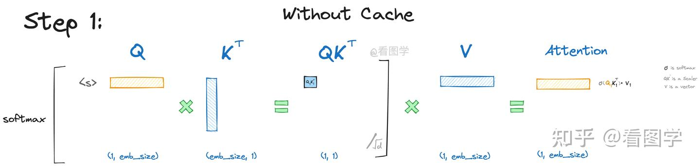

此时序列为 $[x_0]$，注意力分数只有：

$$
[q_0k_0^\top/\sqrt{d_k}].
$$

因此：

$$
o_0= \text{softmax}( [q_0k_0^\top/\sqrt{d_k}])v_0 = v_0
$$

将 $o_0$ 送入后续结构，模型得到第一个生成 token $x_1$。同时，本层得到一份可保存的缓存：

$$
K_{\mathrm{cache}}=[k_0],\qquad V_{\mathrm{cache}}=[v_0].
$$

#### Second Token

!!! warning "Mask Attention"

    不考虑 Mask，正常的计算结果为

    $$
    QK^T=
    \begin{bmatrix}
    q_0k_0^\top/\sqrt{d_k} & q_0k_1^\top/\sqrt{d_k}\\
    q_1k_0^\top/\sqrt{d_k} & q_1k_1^\top/\sqrt{d_k}
    \end{bmatrix}.
    $$

    矩阵的第 $i$ 行表示：第 $i$ 个 token 的 Query 关注所有 Key。但是 Decoder 要求 token **不能看到未来的结果**，因此要用 mask。

##### Without KV cache

系统会把整个序列 $[x_0,x_1]$ 从头送入该层，重新计算 $q_0,k_0,v_0$，再计算 $q_1,k_1,v_1$。加上 causal mask 后，注意力分数矩阵是：

$$
\begin{bmatrix}
q_0k_0^\top/\sqrt{d_k} & -\infty\\
q_1k_0^\top/\sqrt{d_k} & q_1k_1^\top/\sqrt{d_k}
\end{bmatrix}.
$$

第一行得到 $o_0=v_0$；第二行是预测 $x_2$ 所需的结果：

$$
\begin{align}
[\alpha_{10},\alpha_{11}]&=
\operatorname{softmax}\left(
\left[q_1k_0^\top/\sqrt{d_k},\ q_1k_1^\top/\sqrt{d_k}\right]
\right).
\\
o_1&=\alpha_{10}v_0+\alpha_{11}v_1,
\end{align}
$$

其中 $q_0,k_0,v_0$ 和 $o_0$ 都与上一步相同，却被重新计算了一遍。

##### With KV cache

系统直接读取上一轮缓存 $[k_0]$、$[v_0]$，只为新 token $x_1$ 计算 $q_1,k_1,v_1$，然后追加：

$$
K_{\mathrm{cache}}=[k_0;k_1],\qquad
V_{\mathrm{cache}}=[v_0;v_1].
$$

只需计算当前的一行：

$$
o_1=\operatorname{softmax}\left(
\frac{q_1[k_0;k_1]^\top}{\sqrt{d_k}}
\right)[v_0;v_1].
$$

#### Third Token

模型已用 $o_1$ 预测出 $x_2$。为了预测 $x_3$：

- **不使用 cache**：重新处理三个 token，得到一个 $3\times3$ 的下三角注意力矩阵；其中前两行正是上一轮已经算过的内容。
- **使用 cache**：读取 $[k_0;k_1]$ 和 $[v_0;v_1]$，只计算新 token 的 $q_2,k_2,v_2$，并追加到缓存。
新的 attention 输出为：

$$
\begin{align}
[\alpha_{20},\alpha_{21},\alpha_{22}]&=
\operatorname{softmax}\left(
\left[q_2k_0^\top/\sqrt{d_k},\ q_2k_1^\top/\sqrt{d_k},\ q_2k_2^\top/\sqrt{d_k}\right]
\right)\\
o_2&=\alpha_{20}v_0+\alpha_{21}v_1+\alpha_{22}v_2.
\end{align}
$$

缓存随之增长为：

$$
K_{\mathrm{cache}}=[k_0;k_1;k_2],\qquad
V_{\mathrm{cache}}=[v_0;v_1;v_2].
$$

#### Conclusion

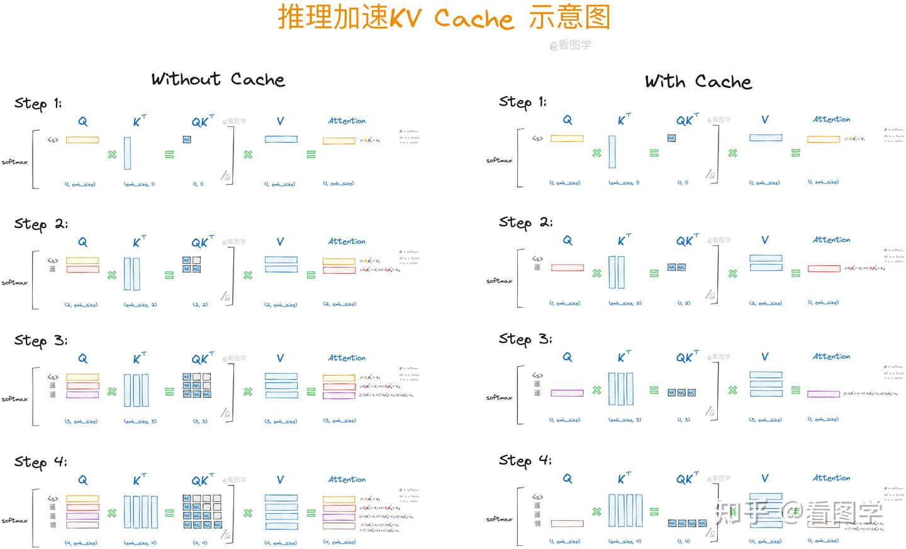

因为 causal mask，新增 $x_2$ 不会改变 $x_0,x_1$ 原来的可见上下文；所以旧的 K、V 仍然有效，可以继续复用。每一步只增加一个新的 K/V 对：

$$
KV\ Cache=\{(k_0,v_0),(k_1,v_1),\ldots,(k_t,v_t)\}.
$$

Q 只用于当前行的查询，计算完通常不再使用；K、V 会被后续每一个 token 反复读取，因此只缓存 K 和 V。

---

### 1.2 Reasoning

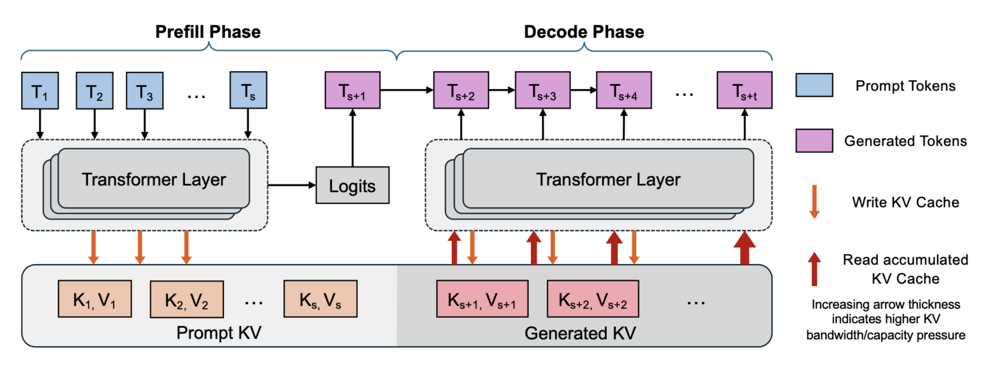

### Prefill

**模型首次读取完整输入 prompt 的阶段**

- 例如，用户提交一篇长文档，模型会==并行处理==全部输入 token，并计算 K、V。
- 常用指标：**TTFT（Time to First Token，首 token 延迟）**。

### Decode

**模型之后逐 token 生成回答的阶段**

- 生成一个新 token，只需计算该 token 的新 Q、K、V，并读取已有 KV cache 计算 attention。
- 计算后把新生成的 K、V 写入 KV cache

---

### 1.3 Cost & Benefit

KV Cache 占用显存的估算方式：

$$
M_{KV}=2 \cdot L \cdot n_{kv} \cdot d \cdot T \cdot b
$$

- $2$：对应 K 与 V
- $L$：层数
- $n_{kv}$：KV head 数（每一层 attention 里 Key/Value 注意力头的数量）
- $d$：每个 head 的维度
- $T$：序列长度，即**当前上下文长度**
- $b$：每个元素所占字节数（FP16/BF16 通常为 $2$，FP32 为 $4$）。

!!! info "KV cache 的优化方向"

    $$
    \text{KVCache大小=层数×每层KV数量×每个KV大小×token数量}
    $$

    |方法|参数|
    |---|---|
    |GQA|降低 $n_{kv}$ |
    |KV Quantization|降低 $b$ |
    |PagedAttention|优化存储方式|
    |Compression|减少有效 $T$ |

## 2. KV-cache Optimization

| 层次           | 解决问题    | 例子                         |
| ------------ | ------- | -------------------------- |
| 算法层          | 减少计算量   | 量化、投机解码、Sparse Attention   |
| Kernel层      | 提高GPU效率 | FlashAttention、GEMM        |
| ==Runtime层== | 管理执行过程  | Batching、调度、PagedAttention |
| ==Serving层== | 多机部署    | P/D解耦、KV传输、分层存储            |

### 2.1 Classification

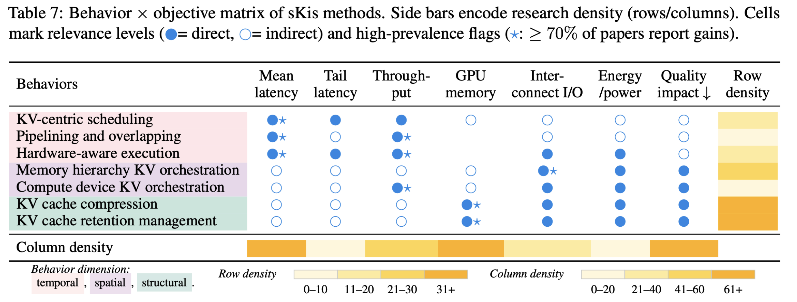

- **颜色条**表示论文的关注程度

!!! info "各 Behavior 的含义"

    1. KV-centric scheduling：请求来了优先分配已有需要的 KV 的 GPU
    2. Pipelining and overlapping：加载和计算 KV 同时进行
    3. Hardware-aware execution：决定 KV 放哪里（GPU HBM / GPU DRAM / SSD）
    4. Memory hierarchy KV orchestration：GPU->CPU->SSD，KV cache 如何移动
    5. Compute device KV orchestration：决定哪个 GPU 服务哪个请求
    6. KV cache compression：压缩 KV 的大小
    7. KV cache retention management：保留/淘汰哪些 KV

KV Cache 优化可以从三个维度理解：==Structural、Spatial、Temporal==

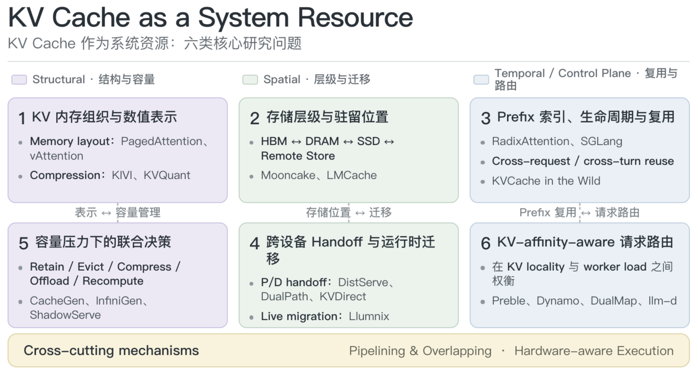

### 2.2 Workflow

现代服务架构**将控制决策和数据路径分离**：

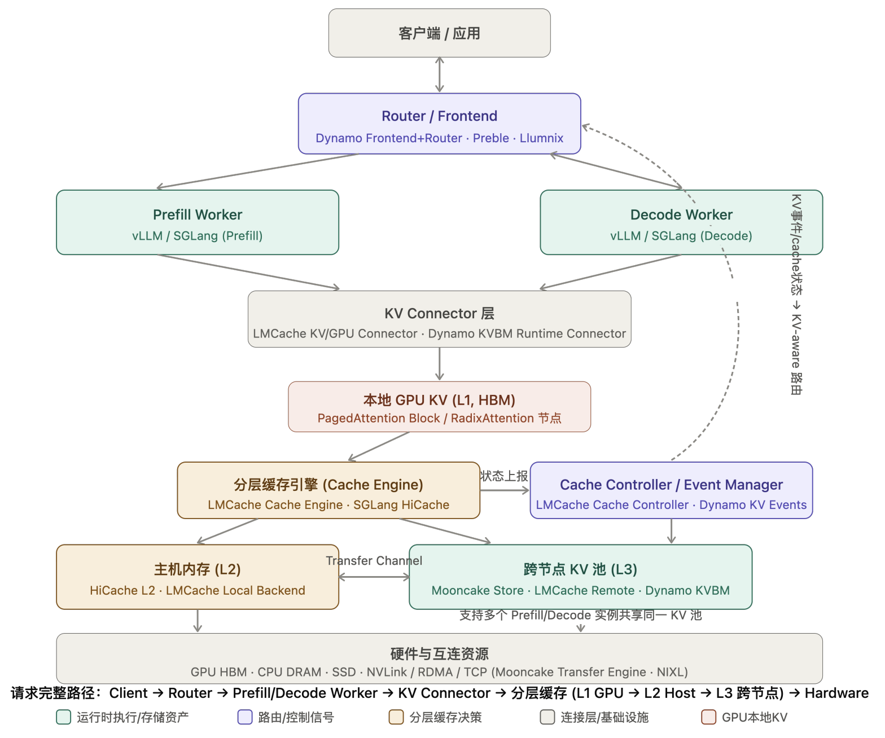

**请求路径**如下：

1. Client 发送请求。
2. Router 检查缓存状态，发现某节点已有部分上下文，将请求路由至对应的 Decode Worker。
3. Worker 通过 KV Connector 尝试获取 KV 数据。
4. 先在 L1 GPU 找；如果 miss，则通过 Cache Engine 从 L2 Host Memory 或 L3 跨节点池拉取数据。
5. 数据加载回 GPU 后，进行推理计算。
6. 新生成的 KV 数据可能会根据策略被保存回 L2 或 L3，供后续请求复用。

#### Router

**接收外部请求，并根据当前集群状态进行调度。**

- 支持 KV-aware 路由。它会感知后端 Worker 的缓存状态。如果某个 Worker 已经缓存了用户的历史上下文（KV Cache），路由器会优先将新请求分配给该 Worker，从而跳过重复的 Prefill 计算。
- 代表技术： Dynamo Frontend, Preble, Llumnix。

#### KV Connector

**推理引擎（vLLM/SGLang）与底层存储系统之间的“翻译官”。**

- 拦截推理引擎产生的 KV 数据，并传输给下层的缓存系统，实现了<u>计算框架与存储后端的解耦</u>。
- 代表技术： LMCach KV/GPU Connector, Dynamo KVBM Runtime Connector。

---

## 3-1. Structural Optimization

### 1. 内存组织（Paged Attention）

**以 page/block 为基本单位，进行 KV 管理，例如 PagedAttention/vAttention**

!!! warning "Problem"

    在实际请求中，不同请求长度差异巨大，这会造成==显存碎片（memory fragmentation）==。

    **PagedAttention**(Kwon et al., Efficient Memory Management for Large Language Model Serving with PagedAttention, SOSP 2023.) 借鉴**虚拟内存 + 分页机制**，把 KV cache 拆成：
    <u>Logical KV cache -> KV map table -> Physical KV blocks</u>

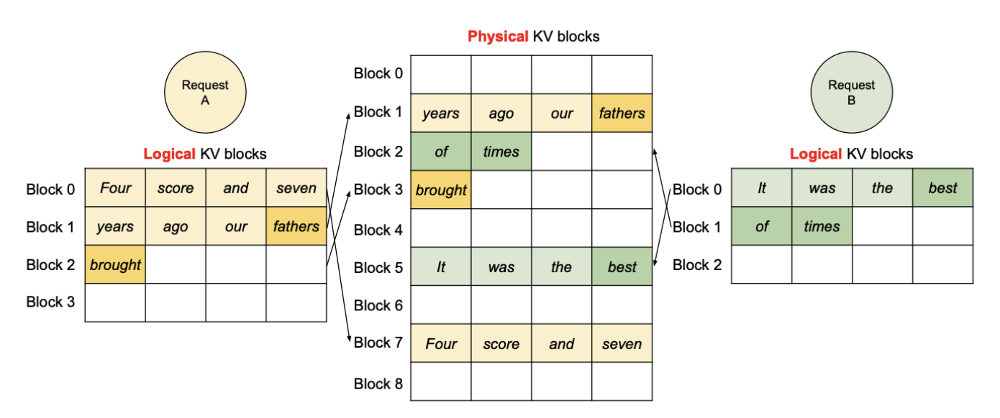

- 把 KV 切成固定大小的 block；使用 block table 映射逻辑位置和物理位置；
- 实现按需分配，减少显存浪费；支持动态增长
- 支持多个请求共享 block

### 2. 数值表示（MosaicKV）

**针对 Key/Value 在 token、head、channel 维度进行选择性压缩。**

!!! warning "Problem"

    已有方法通常只压缩 sequence 或 channel 一个维度；直接二维压缩可能带来明显的 ACU loss。

    **MosaicKV**(Qiang et al., MosaicKV: Serving LongContext LLM with Dynamic TwoD KV Cache Compression, arXiv 2026) 提出了一种**动态二维压缩**方法。

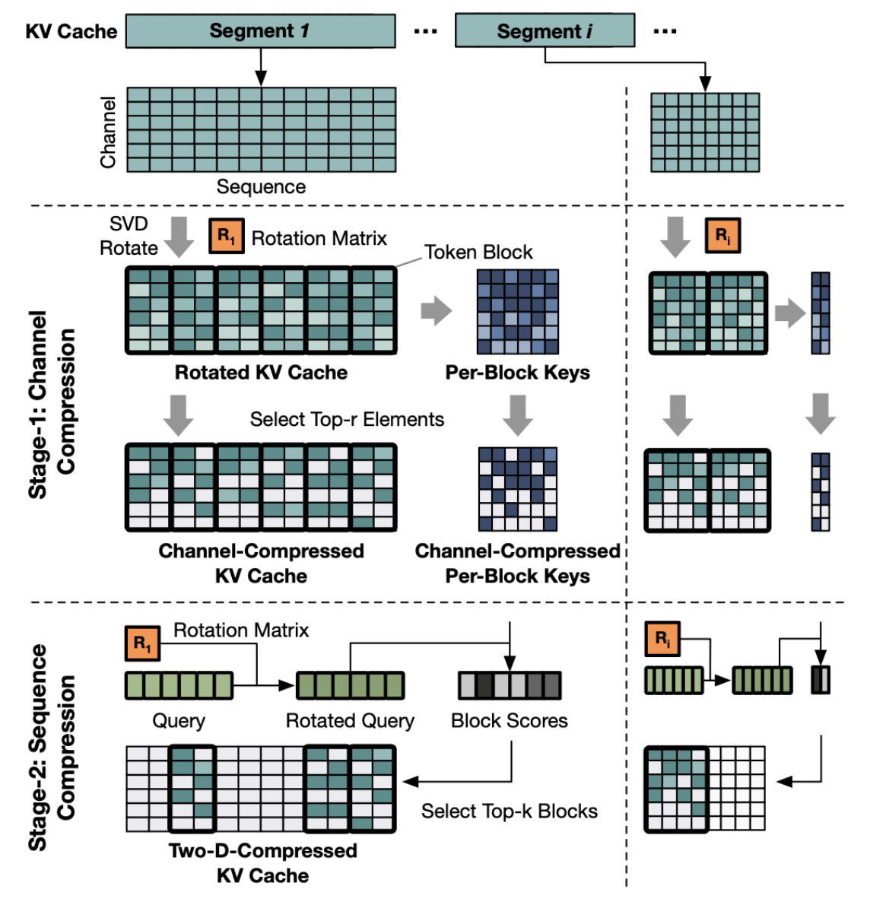

##### Step 0：划分 Segment

将原始 KV Cache 划分为若干个 **segment**，每个 segment 拥有独立的旋转矩阵与保留策略。

#### Stage-1：Channel Compression

##### Step 1

对某 segment 的键矩阵 $K_i\in\mathbb{R}^{T_i\times d}$ 做 SVD 分解：

$$
K_i = U_i\Sigma_i  V_i^T
$$

取 $R_i =V_i$ 作为正交旋转矩阵。用 $R_i$ 旋转 Key 和 Value，得到 **Rotated KV Cache**：

$$
K'_i = K_iR_i,\quad V'_i = V_iR_i
$$

!!! info

    旋转把 Key 变换到**以主成分为轴**的空间，使信息集中到少数维度。由于旋转是正交变换，有 $Q'K'^T=QK^T$，注意力分数本身不变；但它让后续按 channel 丢弃信息时损失最小。

##### Step 2

每个 token/vector 独立选择 top-r elements，得到 **Channel-Compressed KV Cache**

- 效果：每个 token 的维度由 $d$ 降至 $d'$（$d'<d$），序列长度不变。

##### Step 3

1. 将 token 划分为若干 block；
2. 用 block 内 token 的 Key 构造一个代表性 Key（per-block key）；
3. 对这些 per-block key 进行压缩，得到 **Channel-Compressed per-block keys**（$K_b$）

#### Stage-2：Sequence Compression

##### Step 4

对新到的 query 施加与 Key 相同的旋转，得到 $Q'$。

##### Step 5

用 $Q'$ 与 $K_b$ 计算每个 block 的重要性分数：

$$
score_b = Q'K_b^T
$$

仅保留分数最高的若干 block，其对应的 K、V 构成最终输出 $\hat{K},\hat{V}$。

因此 $\hat{K},\hat{V}$ 只包含：

- Stage-1 保留的重要 channel（维度方向压缩）；
- Stage-2 保留的重要 token block（序列方向压缩）
即在 **channel × sequence 两个维度上**实现二维压缩。

### 3. 保留决策（SAECache）

**根据上下文结构和未来访问概率决定 Retain / Compress / Offload / Recompute。**

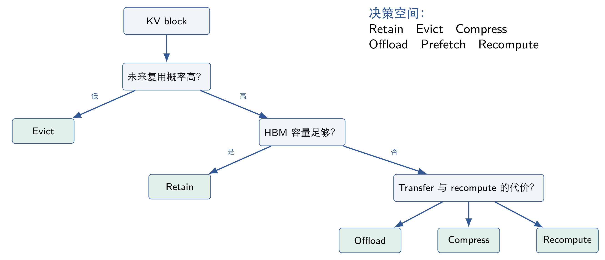

!!! warning "Problem"

    传统 LRU 认为所有 KV block 都一样重要，但实际上不同 token 类型的复用价值差异巨大。比如 system prompt、用户历史、工具输出、模型回答、CoT 的 reuse probability 不同。

    **SAECache** (Fang et al., Not All Tokens Are Worth Caching: Learning Semantic-Aware Eviction for LLM Prefix Caches, arXiv 2026) 采用<u>按 token 类型驱动驱逐</u>。 

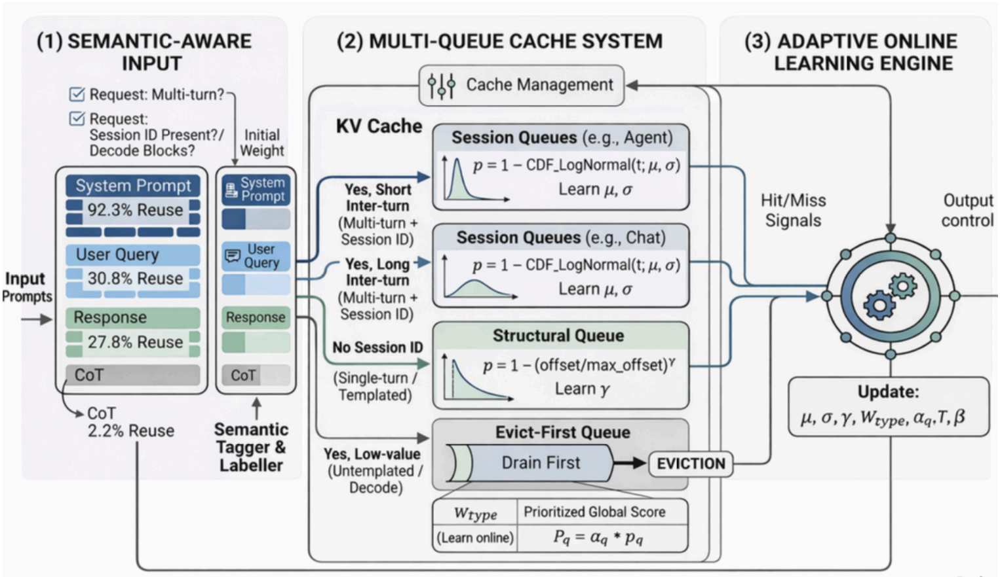

- **Semantic-Aware Input**
    - 对 token 分类（system prompt, user query, response, CoT, tool output）
    - 可以看到不同 token 类型的 reuse rate 相差很大
- **Multi-Queue Cache System**：设置多个队列，不同类型的 token 采用不同的策略
    1. <u>Queue1：Session Queue（Agent）</u>
       保存 Agent / Tool-use 场景 KV，下次可以复用。
    2. <u>Queue2：Session Queue（Chat）</u>
       用于处理多轮对话，用 Inter-turn survival probability 判断对话持续时间和跨度。
    3. <u>Queue3：Structural Queue</u>
       处理模块化请求，有些提示词高度复用，因此需要保留。
    4. <u>Queue4：Evict-First Queue</u>
       存放低价值 KV，大多为一次性的内容，几乎不会被复用。
- **Adaptive Online Learning Engine**
    - 通过在线学习调整策略，掌握不同 token 的权重类型 $w_{type}$，时间衰减系数等
    - 最终通过 eviction score 来判断哪些 token 最先被驱逐

---

## 3-2 Spatial Optimization

!!! question "一个 KV block 应该驻留在 HBM、CPU DRAM、SSD，还是远端存储？"

    - Placement：决定数据初次生成时存在哪，显存不足时哪些旧数据应该被卸载
    - Handoff：指在 Prefill 完成后，将生成的 KV Cache 传输给 Decode Worker 的过程
    - Migration：将运行中的请求与状态转移到另一实例，用于负载均衡或故障恢复

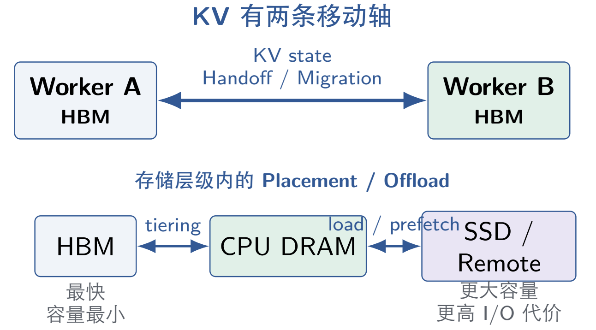

### Mooncake

!!! abstract

    传统 LLM Serving 以 GPU 为中心，而 **Mooncake（Qin Et al., Mooncake: A KVCache-centric Disaggregated Architecture for LLM Serving, ArXiv 2024.）** 认为 KV Cache 才是长上下文服务中的核心资源，因此重新设计系统，让 KV Cache 成为调度和资源管理的中心。

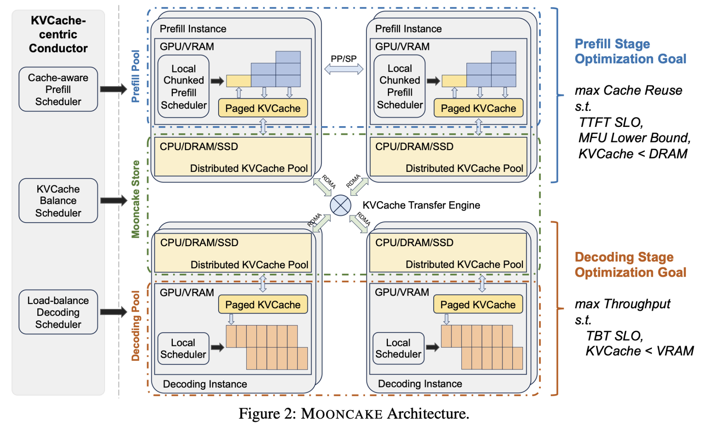

- Mooncake 拆成 prefill cluster 和 decode cluster 两个集群
    - Prefill cluster 完成 prefill 后把 KV 上传至 KV Cache Pool
    - Decode cluster 工作时可以从 KV Pool 中读取数据
- KVCache-centric Conductor
    - Cache-aware Prefill Scheduler：决定请求交给哪个 Prefill GPU 执行
    - KVCache Balance Scheduler：管理整个 KV Cache Pool 的分布
    - Load-balance Decoding Scheduler：决定请求进入哪个 Decode GPU
- Distributed KV Cache Pool
    - 三级存储：GPU memory -> CPU DRAM -> SSD
- KV Transfer Engine
    - 负责 KV 在 GPU, CPU, SSD, Network 之间的数据传输

### LMCache

!!! abstract

    **LMCache** (Liu et al., LMCache: An Efficient KV Cache Layer for EnterpriseScale LLM Inference, arXiv 2025) 将 KV Cache 从 LLM 推理引擎内部的临时状态，抽象成一个独立的缓存层，使不同请求、不同推理引擎、不同存储设备之间可以共享和复用 KV Cache。

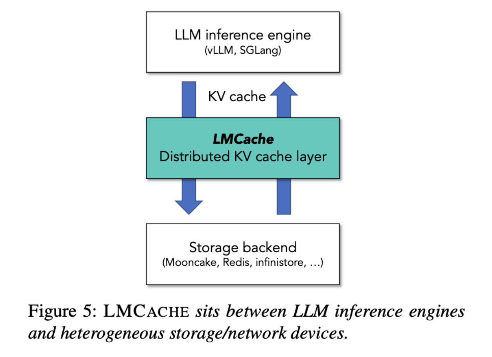

- 第一层：**LLM Engine Interface**
    - 负责生成 KV，不需要知道 KV 存放在哪里
    - LMCache 通过统一的接口来管理 KV
- 第二层：**LMCache Distributed KV Cache Layer**
    - 负责 KV extraction，KV reuse 和 KV movement
- 第三层：**Storage Backend**
    - 负责存放 KV，利用 Mooncake、Redits 等存储结构

### EcoServe

!!! info

    **EcoServe** (Du et al., Efficient LLM Serving on Commodity GPU Clusters with Data-Reduced Cross-Instance Orchestration, OSDI 2026) ：在普通 GPU 集群上，高效部署长上下文 LLM 服务，通过改进 Prefill/Decode 分离方式，减少 KV Cache 跨实例传输开销。

    
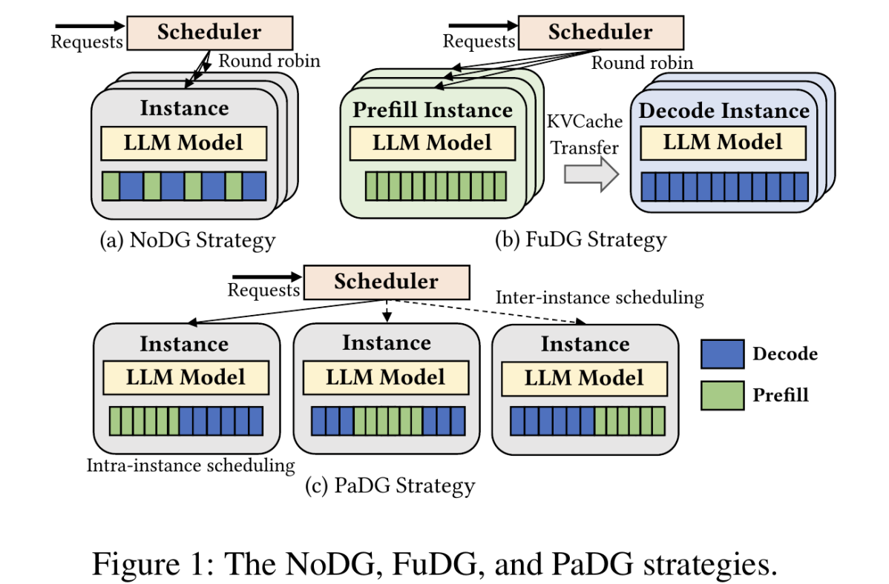

    - NoDG（No Disaggregation）：KV Cache 不需要跨机器移动，但 Prefill 会干扰 Decode
    - FuDG（Full Disaggregation）：Prefill 不影响 Decode，但 KV Cache 要跨实例传输
    - ==PaDG==（Partially Disaggregated Generation）：本文的创新点

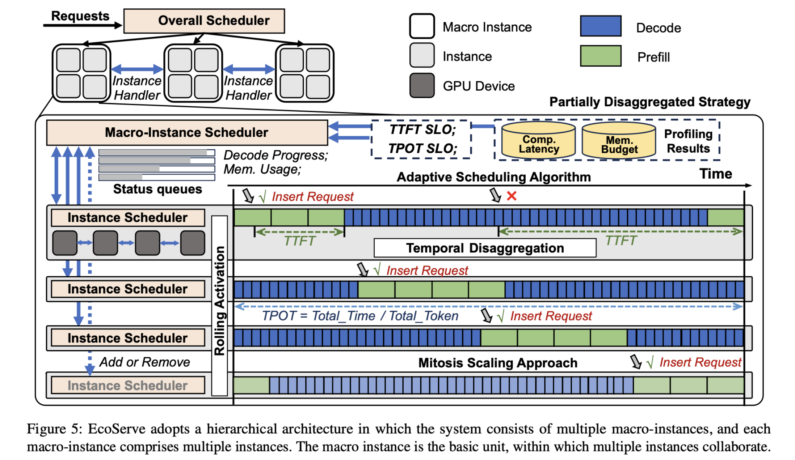

- **Overall Scheduler** 负责接收用户请求，把请求分配给合适的 Macro Instance
    - **Profiling Results** 提前测量耗时，便于调度
- EcoServe 把 **Micro Instance** 作为最小的推理实例
    - 每个 Micro Instance 内包含多个 Instance
    - EcoServe 在一个 Macro Instance 内协调：哪个 Instance 做 Prefill，哪个做 Decode
- **Macro-instance Scheduler** 负责一个 Macro Instance 内多个 Instance 如何协作
    - Temporal Disaggregation：把 prefill 和 decode 分开来进行
    - Rolling Activation：不让所有 Instance 同时处于同一种状态，而是轮流切换，便于接受请求
    - Mitosis Scaling Approach：负载增加时可以增加 Macro Instance 中的 instance 数量

### KV Datapath

!!! abstract

    **DualPath**(Wu et al., DualPath: Breaking the Storage Bandwidth Bottleneck in Agentic LLM Inference, arXiv 2026) 是在 P/D Disaggregation之后，解决<u>当 KV Cache 已经放到外部存储后，如何更高效地把 KV Cache 加载回来？</u>

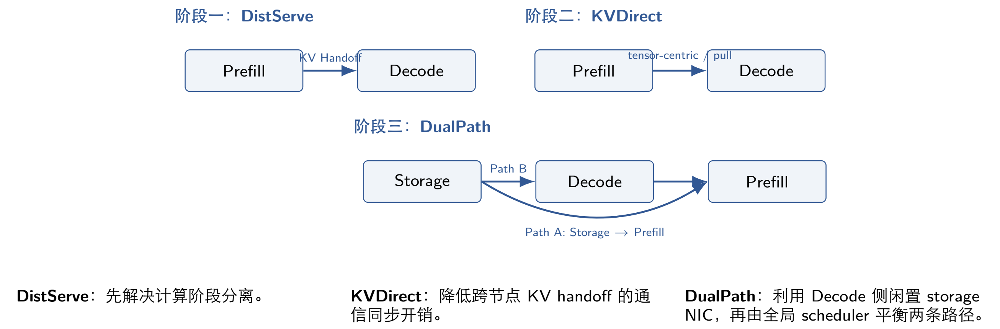

- **DistServe**：Prefill 主动把 KV Cache 传给 Decode
    - 解决了 Prefill-Decode interference，但<u>通信开销大</u>且<u>跨节点扩展困难</u>
- **KVDirect**：Decode 主动从 Prefill 拉取数据
    - 减少 KV handoff 通信开销，可以增加并行减少 GPU 空闲
- **DualPath**：引入 Storage 存放 KV
    - PathA：prefill 直接从 storage 中读取 KV
    - PathB：decode 帮忙读取 KV，再传输给 prefill

### Llumnix

!!! abstract

    **Llumnix**(Un et al., Llumnix: Dynamic Scheduling for Large Language Model Serving, OSDI 2024) <u>让正在运行的 LLM 请求可以像操作系统进程一样迁移</u>，通过 KV Cache 实现负载均衡。

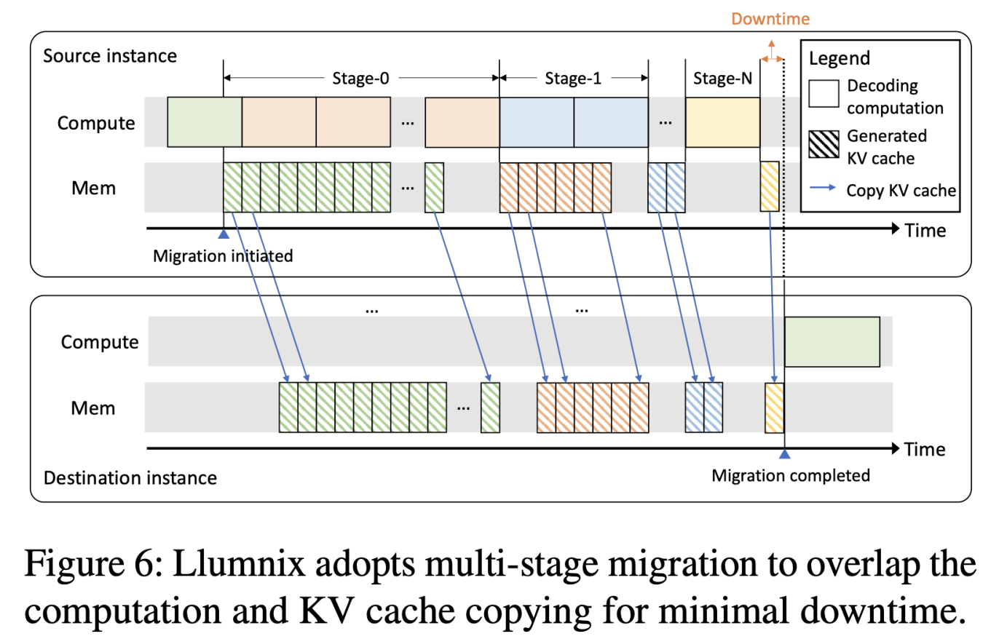

!!! question

    LLM 请求刚来的时候，不知道它未来会占多少资源，所以一开始把它分配到某个 GPU 后，随着生成过程进行，最初的调度可能会不合理。负载均衡还会把空闲显存分散

- ==Multi-stage Migration==：利用 decode 阶段 append-only，让 KV copy 和 Decode 计算重叠
    - 复制 KV 和 request 的同时，源端继续生成 token
    - 只剩最后一个 token 的 KV 时，暂停一个 iteration 并同步最后的增量
- **Virtual Usage**：Llumnix 提出的评估负载指标
    - 把 load balancing（负载均衡）, defragmentation（显存碎片整理）, priority, auto-scaling（自动扩缩容） 统一为实例负载
- **Dynamic Scheduling**
    - Global Scheduler 负责 requset 在 instance 之间的分配和迁移
    - Local Scheduler 负责 instance 内部先执行那个 request

---

## 3-3 Temporal / Control Plane

!!! tip

    在 LLM Serving 中，KV Cache 管理不仅是存储问题，还需要控制平面进行动态决策。首先需要判断当前 request 是否可以复用已有 prefix cache；其次需要在多个 worker 中选择 cache overlap 最大且满足 SLO 的节点；最后需要决定 KV Cache 的生命周期操作，包括 retain、evict、prefetch、load 或者 recompute。这些决策共同决定了系统的缓存效率和推理延迟。

### SGLang

!!! abstract

    ==SGLang==(Zheng et al., SGLang: Efficient Execution of Structured Language Model Programs, arXiv 2023) 提出了**RadixAttention**：把所有请求的 KV Cache 组织成 radix tree（基数树），自动实现 prefix cache reuse。

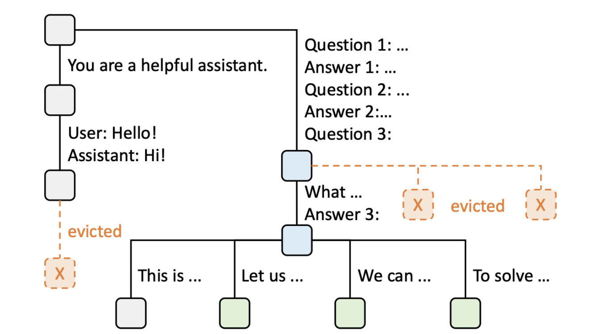

### Router Conflict

!!! abstract

    LLM Serving 中请求路由（Router）的核心矛盾：
    <u>到底应该优先考虑 KV Cache 命中，还是优先考虑负载均衡。</u>

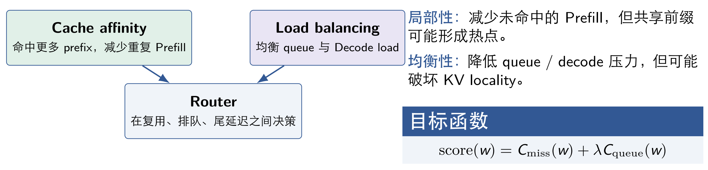

### Preble

!!! abstract

    **Preble: Efficient Distributed Prompt Scheduling for LLM Serving (ICLR 2025)** 解决的问题是：在多 GPU / 多实例 LLM Serving 中，如何同时利用 Prefix KV Cache 复用，又避免因为请求集中到某个节点导致负载不均。

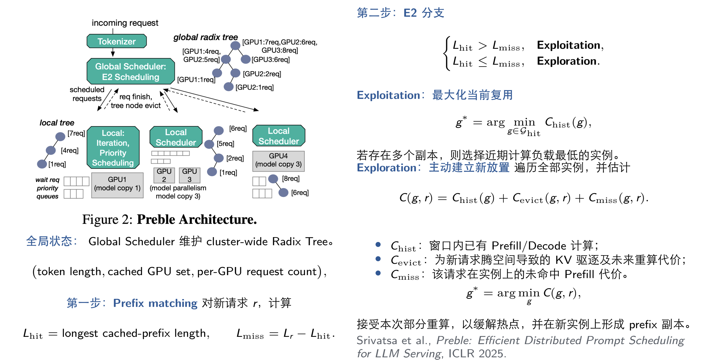

**Global Scheduler**：用于跨 GPU 调度，以及维护 global radix tree
**Local Scheduler**：负责管理单个 GPU，负责本地执行

1. Prefix matching：用于计算对于 request $r$，不同  GPU 的计算开销
2. E2 Scheduling
    - Exploitation：最大化当前复用 KV，在<u>有 cache hit 的 GPU 中选择历史负载最低的</u>。
    - Exploration：寻找合适的存放位置，考虑<u>历史负载、eviction cost 以及 cache miss cost</u>

### LMETRIC

!!! abstract

    **LMetric: Simple is Better — Multiplication May Be All You Need for LLM Request Scheduling**（OSDI 2026）：不要设计复杂的 KV Cache + 负载权重调度公式，一个简单的乘法 score 就可以同时解决 KV Cache 命中和负载均衡问题。

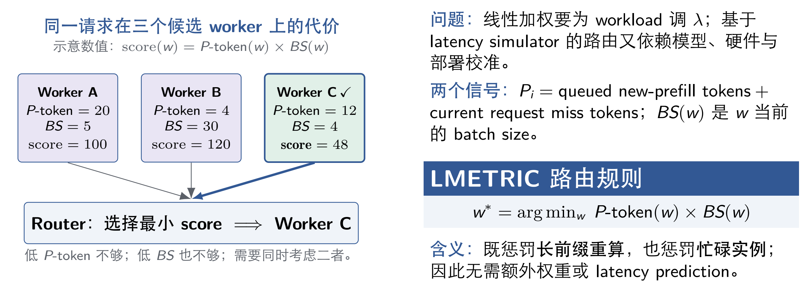

使用乘法：

$$
\begin{align}
score(w)&=P-token(w)\times BS(w) \\
w^* &=argmin_w P-token(w) \times BS(w)
\end{align}
$$

- $P-token$：需要重新 prefill 的 token 数
- $BS$：worker 当前的 batch size
即选择 score 最小的 worker，这样可以有效<u>避免超参数调节</u>。

## 4. Summary

**LLM Serving 中 KV Cache 优化的两个主要方向：**

1. **Pipelining & Overlapping**
    - 让 KV Cache 的搬运过程和计算过程并行
    - 代表：CacheGen、Llumnix、DualPath
2. **Hardware-aware Execution**
    - 核心思想：根据网络、NIC、存储拓扑选择最佳 KV Cache 路径
    - 代表：DualPath、Mooncake

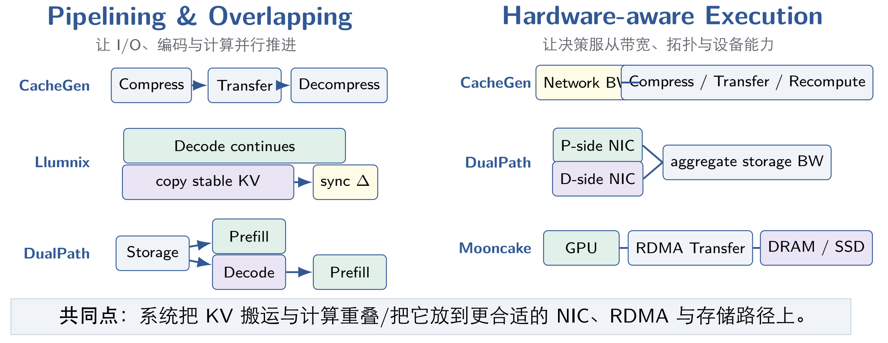

| 层次                 | 论文                          | 核心创新点                                                                                             | 主要优化方向                                                         | 与其他工作的比较                                                                     |
| ------------------ | --------------------------- | ------------------------------------------------------------------------------------------------- | -------------------------------------------------------------- | ---------------------------------------------------------------------------- |
| Structural：内存组织    | **vLLM / PagedAttention**   | 借鉴虚拟内存，将逻辑 KV 序列映射到固定大小的非连续物理 block，并用 block table 管理。                                            | 降低显存内外部碎片；按需增长；支持 prefix block 共享。                             | 解决“KV 怎样放得紧凑”，是底层内存机制；不决定 KV 应保留多久、放在哪个存储层或路由到哪张 GPU。                        |
| Structural：压缩      | **MosaicKV**                | 先用正交旋转集中通道信息，再进行 channel 压缩；随后按 query 选择重要 token block，实现 channel × sequence 二维动态压缩。              | 同时降低每个 token 的 KV 维度和参与 attention 的 token 数。                   | 相比只沿 sequence 或 channel 压缩的方法更全面，但属于近似压缩，需权衡精度；与 PagedAttention 的无损内存组织正交。   |
| Structural：驱逐      | **SAECache**                | 按 system prompt、user query、tool output、response、CoT 等语义类型划分多队列，并通过在线反馈学习 token/queue 权重和时间衰减。     | 预测 block 的未来复用价值，优化 prefix-cache retention / eviction，降低 TTFT。 | 相比 LRU/LFU 不再把所有 block 等价处理；相比 Continuum 的程序级 TTL，它更细粒度地回答“缓存哪些 token”。      |
| Spatial：分层架构       | **Mooncake**                | 以 KV cache 为中心重构 P/D 解耦架构，引入 KVCache-centric Conductor、分布式 KV pool 和专用传输引擎。                       | 在 GPU、CPU、SSD 和网络间统一放置、复用和传输 KV。                               | 是宏观系统架构；LMCache偏缓存层抽象，Strata/DualPath偏具体 I/O 路径优化，三者可作为 Mooncake 式架构的不同实现组件。 |
| Spatial：缓存抽象       | **LMCache**                 | 将 KV 从单个推理引擎内部状态提升为独立、可共享的缓存层，通过 connector 对接推理引擎和多种存储后端。                                         | 跨请求、跨引擎和跨设备复用 KV；解耦计算与存储。                                      | 比 Mooncake 更模块化、更像通用缓存中间件；自身不是完整的全局调度策略，通常需要路由器和底层存储共同工作。                    |
| Spatial：P/D 部署     | **EcoServe**                | 提出 PaDG（部分解耦生成）、rolling activation 和 macro/micro-instance 编排，在 NoDG 与完全 P/D 解耦之间折中。               | 减少跨实例 KV handoff，同时降低 prefill 对 decode 的干扰。                    | NoDG 无传输但干扰大，FuDG 隔离好但传输重；EcoServe选择中间点，重点是普通 GPU 集群上的计算实例编排。                |
| Spatial：KV 数据路径    | **DualPath**                | 在外部存储基础上提供两条 KV 加载路径：Prefill 直接读取，或 Decode 协助读取后转发，并按瓶颈选择路径。                                      | 打破 P/D 解耦后存储和网络带宽瓶颈，重叠 KV 加载与计算。                               | 相比 Mooncake的整体架构更聚焦 data path；相比 Strata的 I/O 聚合，更强调跨角色、跨节点的路径协同。             |
| Spatial：在线迁移       | **Llumnix**                 | 利用 decode 阶段 KV append-only 的性质进行多阶段 live migration，大部分复制与生成重叠，最后只同步增量。                           | 负载均衡、显存碎片整理、优先级和扩缩容。                                           | 与 Preble 的“请求到达时选节点”不同，Llumnix能在运行中修正错误放置；代价是迁移流量和短暂停顿。                      |
| Temporal：prefix 复用 | **SGLang / RadixAttention** | 用 radix tree 统一组织不同请求的共享前缀及其 KV，使 prefix match、插入、共享和驱逐成为运行时原语。                                   | 自动发现并复用公共 prefix，减少重复 prefill。                                 | 提供 prefix cache 的数据结构基础；Preble在其上增加跨 GPU 全局调度，SAECache进一步改进驱逐价值判断。           |
| Temporal：分布式路由     | **Preble**                  | 维护 global radix tree，并用 E2 调度在 exploitation（利用已有 cache）与 exploration（考虑负载、miss、eviction cost）间切换。 | 平衡跨 GPU prefix locality 与负载均衡。                                 | 比单纯 cache-affinity 更能避免热点；比 LMetric 的乘法分数更复杂、信息更丰富，也更需要状态维护和成本建模。            |
| Temporal：分布式路由     | **LMetric**                 | 使用 $P\text{-token}(w)\times BS(w)$ 的无超参数乘法分数，同时表达 cache miss 计算量与 worker 负载。                      | 简化 KV-aware routing，避免多指标加权和超参数调节。                             | 与 Preble解决同一冲突，但追求最小机制；可解释性和部署简单，表达复杂 eviction / topology 成本的能力较弱。           |
