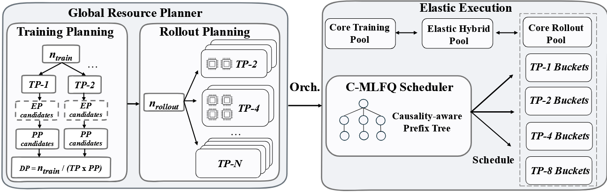

# Libra: Efficient Resource Management for Agentic RL Post-Training

!!! abstract

    [**Libra**](https://arxiv.org/abs/2606.03077) 是一个面向 **Agentic RL Post-Training**的资源管理系统。它解决了两类问题：(1) rollout 阶段的**长尾分布**；(2) rollout 与 training 之间的**跨阶段不平衡**。Libra 引入 **C-MLFQ** 调度器，利用工具返回结果作为因果信号进行路由，并用**全局资源规划器 + 弹性混合池**实现非阻塞的跨阶段 GPU 重分配。在 48×A800 集群上，吞吐最高提升 **3.0×**，奖励收敛速度最快提升 **2.5×**。

    - **作者**: Kaiwen Chen, Xin Tan, Jingzong Li, Hong Xu
    - **机构**: CUHK, Hang Seng University of Hong Kong

---

### Problem

**核心痛点**：在 Agentic RL post-training 中，模型调用外部工具、观察环境反馈并基于累积交互历史生成后续内容，产生了两类问题：

1. **Long-tailed Rollout**：
    - 大多数轨迹在短推理过程中完成，但一小部分长尾序列**主导了 rollout makespan**
        - 实测 R2E-Gym 上最长 10% 的轨迹占总 rollout 时间的 **50%+**
    - 现有系统通过**长度预测**缓解该问题，但在 agentic RL 中工具返回结果的 payload size 和 success/failure 状态才是序列长度的主要因果驱动因素，prompt 本身决定不了最终长度
2. **Cross-stage Imbalance**：
    - Rollout 是 memory/bandwidth-bound，延迟随序列长度**线性增长**；
      Training 是 compute-bound，可以通过 batch **摊销长度的变化**
    - 序列长度分布随着策略改进持续漂移→任何静态 GPU 分配方案都会**逐渐偏离最优**
    - 迭代时间 $T_{iter} = \max(T_{rollout}, T_{train})$，瓶颈是**较慢的那个阶段**，而不是固定的 rollout。

!!! info "关键洞察"

    - **工具返回结果是天然的因果信号**：payload size（大/小）和执行状态（成功/失败）可以直接预示轨迹是否会膨胀。
    - **异构 TP bucket**：不同 TP 度对长短序列各有优势，应在 rollout 集群内部署多种 TP 配置。
    - **跨阶段耦合优化**：不应孤立优化 rollout，而应联合分配 GPU 以最小化 $\max(T_{rollout}, T_{train})$，并随 workload drift 周期性地重新规划。

---

### Key Idea

!!! tip "核心创新"

    Libra 用两大机制分别解决“rollout 内部调度”和“跨阶段资源分配”两类问题：

    1. **C-MLFQ Scheduler**：利用工具返回的因果信号，动态将请求路由到异构 rollout bucket。
    2. **Global Resource Planner + Elastic Hybrid Pool**：周期性地联合优化 rollout/training GPU 分配，并通过非阻塞协议实现弹性重配置。

==Global Resource Planner with Elastic Execution==

- **Hierarchical Search**：
    - **Training 侧**：用 topology-aware decision tree **枚举**可行的 $\text{Dense Model: }(TP, PP, DP)$ 或 $\text{MoE Model: }(TP, EP, PP, DP)$ 组合，逐层剪枝，具体流程如下：
        - $TP$（张量并行度）：
            - **候选值**：只取 $\{1,2,4,8\}$ (TP 需要高频 AllReduce 通信，必须在 NVLink 互联域内完成。一个节点通常有 8 张 GPU，所以 TP 最大为 8)
            - **剪枝条件**：$\text{单卡显存占用} > M_{limit}$ 或 $\text{通信/计算比}>\text{阈值}\alpha$
        - $EP$（仅 MoE，专家并行度）
            - **候选值**：$EP$ 必须能整除总专家数；**约束**：$TP \times EP \leq n_{train}$
            - **剪枝条件**：$\text{All-to-All 通信量/MoE 层计算时间}>\text{阈值}\beta$
        - $PP$（流水线并行度）
            - **候选值**：满足剩余 GPU 数约束的整数
            - **剪枝条件**：流水线气泡率 $\text{Bubble Ratio}=\dfrac{PP-1}{PP+m-1}$ ($m$ 是 micro-batch 数量)
        - $DP$（数据并行度）
            - **计算**：$DP=n_{train}/(TP \times PP)$ 或 $DP=n_{train}/(TP \times EP \times PP)$
            - **合法性检查**：必须整除，否则该路径无效
        - 层层减枝得到策略 $s_{train}$，利用成本模型估算 $T_{\text{train}}(s_{train})$
    - **Rollout 侧**：用**动态规划**求解最优异构 TP 分区 —— 将 $n_{rollout}$ 张 GPU 划分成若干实例，每个实例有不同 TP 度数 $tp \in \{1,2,4,8\}$，目标是最小化 $\text{makespan} = \max (\text{各桶完成时间})$
        - 状态：$dp[g][i]$ = 使用 $g$ 张 GPU 服务前 $i$ 个请求时，可达到的最小 makespan
        - 转移：$dp[g][i] = \min_{tp \in \tau,tp \leq g, 0\leq x \leq i} \max(dp[g-tp][i-x], \text{Cost}(tp, i-x+1, i))$
        - **最优 Rollout 时间**：$T^*_{rollout}=dp[n_{rollout}][L]$；**最优划分方案**：从 $dp[n_{rollout}][L]$ 回溯即可
    - **联合优化**：
        - 外层遍历 $n_{train}$，内层分别求最优 training strategy 和 rollout partition
        - 最终选择 $\max(T_{train}, T_{rollout})$ 最小的配置
- **Periodic Re-planning**：
    - 每隔 $K$ 个 training steps 检查 workload 是否漂移
    - 若 projected gain > reconfiguration cost，则触发重分配
- **Elastic Hybrid Pool**：
    - GPU 集群分为三部分：**Core Training Pool**、**Core Rollout Pool**、**Elastic Hybrid Pool**
    - Hybrid worker 持有完整的 unsharded model weights + optimizer states，进入/退出 training 时不需重塑 tensor/pipeline parallel 拓扑
        - **当 Rollout 是瓶颈时**：切换到 Rollout 模式，扩大生成吞吐
        - **当 Training 是瓶颈时**：切换回 Training 模式，作为额外的 DP 副本加入
    - **Non-blocking Joining**：
        - 每个 train step 结束时，核心池的 Worker 异步保存当前权重和优化器的 snapshot
        - Hybrid worker 通过 RDMA 侧信道发送 zero-gradient placeholder（**零梯度占位符**）加入 All-Reduce，不影响 AllReduce 产生的平均梯度；同时异步加载 snapshot，将状态恢复至和集群的其他成员一致。
    - **Decoupled Communication Domains**：Libra 将通信分为两个独立的平面：intra-replica（NCCL，稳定不重建）与 inter-replica（RDMA，支持成员变更），CPU 管理控制平面，GPU 只执行数据拷贝/reduction。
- **Cost Evaluator**：
    - 规划器（Planner）本身不做任何实际执行，它完全依赖 $CE$ 提供的预测值来做决策
    - **Rollout 侧**：
        - 继承自 Vidur 的部分：
            - **rofiling-guided**：基于实际硬件 profiling 数据建模
            - **Operator-triaged**：按算子类型分别建模（而非端到端黑盒）
        - **修改**：用<u>多项式拟合</u>替代随机森林
    - **Training 侧**：
        - 继承自 Sailor 的部分：
            - **执行图模拟**，**迭代时间预测框架**
        - **修改**：不再用公式估算，而是**逐 micro-batch、逐阶段**地模拟实际执行时间线

==Causality-driven MLFQ（C-MLFQ）==

- **Causality-aware Prefix Tree**：
    - 每个节点代表一个唯一的 tool-call history prefix，key = (prompt_id, ⟨s₁, s₂, ..., sₖ⟩)，其中 $s_i$ 包含“工具类型 + payload size class + 执行状态”。
    - 每个节点存储从该点往后的**剩余长度分布统计**（mean & P90），offline 构建/更新。
    - 运行时 lookup 直接返回完整剩余长度，而非增量预测。
- **三阶段调度流程**：
    1. **Initial Placement**：
        - 所有请求先放入最短 bucket（TP 最小），因为初始 prompt + 早期推理通常很短。
    2. **Per-tool-return Routing**：
        - 每次工具返回后，scheduler 沿前缀树走到对应节点；
        - 仅当 **mean 和 P90 都落入同一个 bucket 范围**时才迁移（保守规则，避免 outlier 驱动的过早迁移）；若到达未见节点则回退到父节点统计量。
    3. **Tree Update**：
        - 每条 rollout 完成后，将轨迹按序列插入树中，为每个访问过的节点记录剩余长度；
        - 为未见状态创建新子节点
        - 更新每个经过节点的剩余长度统计
- **三大优势**：
    - 零在线推理成本（查表远快于模型预测）
    - 自然适应策略漂移（只需离线更新树，无需重训预测器）
    - 更早且果断的迁移（每次工具返回即可决策，一步到位而非渐进式升级）

---

### Workflow

!!! note "系统架构"

    

    Libra 的工作流由两个核心组件驱动：

    - **Global Resource Planner（控制面）**：周期性地联合优化 rollout/training GPU 分配，输出 $P_{rollout}$（异构 TP bucket 配置）和 $S_{train}$（并行策略）。
    - **C-MLFQ Scheduler（数据面）**：根据 Causality-aware Prefix Tree 的路由决策，将请求分发到对应的 TP bucket。

#### 第一阶段：Rollout 请求调度（C-MLFQ）

1. **初始放置**：新请求进入最短 bucket（TP=1），等待首次工具调用。
2. **工具调用暂停**：模型发出 tool-call token → KV cache offload 到 CPU pinned memory
3. **工具返回后路由**：
    - 提取 return state（工具类型 + payload size + 成功/失败），沿前缀树向下走。
    - 读取目标节点的 mean/P90 剩余长度；若两者都落入同一 bucket 范围 → 迁移到该 bucket。
    - 迁移步骤：CPU-side resharding（按 attention-head 维度切分/拼接 KV）→ target GPU reload。
    - 跨节点迁移时比较 transfer vs recompute 代价，选更便宜的方案。
4. **树更新**：轨迹完成后，将其 return-state 序列插入前缀树，为每个节点更新剩余长度统计。

#### 第二阶段：跨阶段资源规划

1. **Workload Profiling**：收集最近 $K$ steps 的序列长度分布，更新 CE 的 polynomial latency models。
2. **Decision Tree Search（Training 侧）**：枚举 $(TP, PP, DP)$ 组合，剪枝后得到候选集 $S_{cand}$，取 $T_{train}$ 最小的策略。
3. **Rollout DP（Rollout 侧）**：给定 $n_{rollout}$ GPUs 和排序后的请求列表，求解最优异构 TP 分区，返回 $T_{rollout}^*$。
4. **联合优化**：遍历所有 $n_{train}$，找到使 $\max(T_{train}, T_{rollout})$ 最小的配置。
5. **触发重分配**：若 projected throughput gain > threshold，启动 Elastic Hybrid Pool 的 non-blocking joining 协议。

#### 第三阶段：弹性执行

- **Rollout → Training**：Hybrid worker fetch snapshot（后台 capture，不阻塞 core training），通过 zero-gradient 协议加入 All-Reduce，加载完成后状态与 core pool 完全一致。
- **Training → Rollout**：context teardown（15ms）+ vLLM activation（10.8s，复用 CUDA graph replay / torch.compile cache）。
- **总开销**：< 3.5% of average step time（454s on R2E-Gym），对整体吞吐影响可忽略。

---

### Results

**实验设置**：

- 平台 48×NVIDIA A800-SXM4-80GB（6 nodes, NVLink 600 GB/s, RoCE 200 Gb/s RDMA）
- 模型 Qwen3-14B / Qwen3-30B-A3B（MoE）
- 数据集 Search-R1（搜索增强推理）、R2E-Gym（软件工程 agent）、DAPO-Math-17K（数学推理）
- 基线 verl-Colocated、verl-Static-Uniform、verl-Greedy-Heuristic、AReaL-Static-Optimal

1. **吞吐显著提升**：
    - Search-R1：Libra ~2700 token/s，高于 AReaL-Static-Optimal **63%**、verl-Greedy-Heuristic **80%**、verl-Colocated **300%**
    - DAPO-Math-17K：+38% / +36.2% / +196%；R2E-Gym：+49% / +83% / +209%
2. **奖励收敛加速**（相同步数下 wall-clock time）：
    - Search-R1：17.9h（比 AReaL 快 **1.6×**，比 verl 基线快 **2.5×**）
    - DAPO-Math-17K：26.7h（**1.39× / 1.93×**）；R2E-Gym：63.2h（**1.5× / 1.85×**）
3. **C-MLFQ 路由质量**：
    - Per-decision accuracy **91.1%**（Oracle 100%，Prediction-Based 65.2%，MLFQ 44.8%）
    - Migration ratio 仅 **8.2%**（Prediction-Based 48.9%），说明因果信号避免了频繁无效迁移
    - Throughput：C-MLFQ 2700 t/s，领先 Prediction-Based **18%**、MLFQ **41%**、Load Balancing **80%**
4. **消融分解**（R2E-Gym，从 verl-Static-Uniform 423 t/s 起）：
    - Planner（homogeneous TP）：+20% → 510 t/s
    - +Heterogeneous TP：+10% → 551 t/s
    - +C-MLFQ：+27% → 666 t/s（最大单项收益）
    - +Elasticity：+15% → 763 t/s（总计 **+80.4%**）
5. **Cost Evaluator Fidelity**：
    - Rollout step-time MAPE：3.1–5.9%（跨序列长度和 TP）
    - Training iteration-time MAPE：Qwen3-14B 2.4–2.6%，Qwen3-30B-A3B 5.0–5.5%
    - End-to-end $T_{iter}$ 预测 MAPE **6.35%**（max 9.30%）
6. **Overhead 分析**：
    - Worker transition < 3.5% step time；KV migration < 733ms（40K tokens cross-node）；Planner search 1.9s（128 GPUs with memoization）
