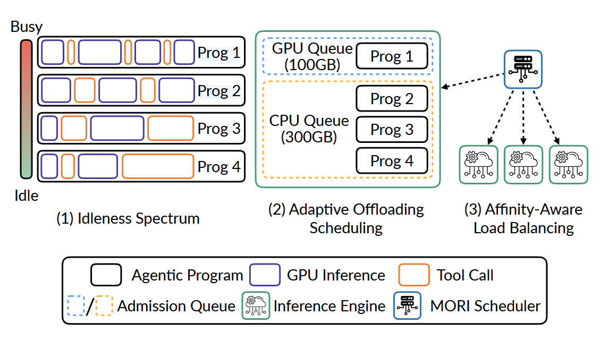
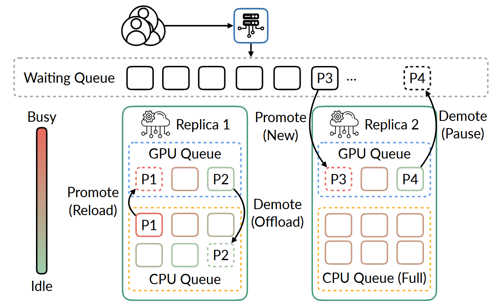

# Idleness is Relative- Exploiting Tool-Call Idle Windows for Offloading in Agentic Systems with MORI

!!! abstract

    [**MORI**](https://arxiv.org/abs/2606.00866) 是一个程序感知的调度系统。它的核心洞察是“**空闲是相对的**”，通过实时追踪程序的相对空闲度，自适应地将**最繁忙**的程序保留在 GPU 显存中，而将**最空闲**的程序卸载到 CPU 内存，从而在 Coding Agent 负载上实现了 20-71% 的吞吐量提升和 18-43% 的首词生成时间（TTFT）降低。

    - **作者**: Tian Xia, Hanchen Li, Zhifei Li, Xiaokun Chen, Hao Kang, Yifan Qiao, Yi Xu, Ion Stoica
    - **机构**: UC Berkeley, Renmin Univ. of China, Stanford, Georgia Tech
    - arXiv: 2606.00866（v1，2026.05）

---

### Problem

**核心痛点**：在智能体服务系统中，GPU 显存很快会被并发程序的 KV Cache 占满。虽然可以将 KV Cache offloading 到 CPU DRAM ，但**何时、该卸载谁**的决策很困难：

1. **工具调用时长巨大差异**：
    - 文件读取数百毫秒，人类反馈或子 Agent 返回却可能需要数分钟
    - 对于短时间的工具调用，Offload 的传输开销比其造成的空闲窗口还大；对长时间的工具调用，不卸载则严重浪费 GPU 显存
2. **现有驱逐策略失效**：
    - **LRU**（SGLang/vLLM 默认）：只看“最近是否活跃”，可能驱逐一个正在进行短暂工具调用的忙程序，而留下一个刚进入数分钟工具静默期的空闲程序。
    - **ThunderAgent**：它根据上下文长度决定 evict，但上下文大小与程序未来是否高频使用 GPU 无关。它可能保留一个长上下文但即将进入长工具调用的程序，而驱逐一个短上下文但即将推理的程序。
    - **TA+Offloading**：ThunderAgent 只做 GPU 侧决策，CPU 侧委托给独立的 LRU 策略。两者缺乏协调，导致即使增加 CPU 容量也不能提升性能。
3. **硬件容量不匹配**：
    - 简单的“busy / idle”二分类无法适应不同的硬件配置（如 GPU HBM 与 CPU DRAM 的比例）
    - 如果分类僵化，会导致某一层级内存溢出，而另一层级却闲置

!!! info "关键发现：Agent 程序的两阶段（Two-Phase）行为"

    尽管单次工具调用不可预测，Agent 程序呈现持久的两阶段交替：

    - **繁忙阶段（Busy Phase）**：连续发出多个短工具调用（读/写文件、轻量 shell），每次数百毫秒到几秒，中间持续回到推理引擎，中位持续 20s。
    - **空闲阶段（Idle Phase）**：被一个长工具调用阻塞（跑测试、等人工审批、等子 Agent 返回），持续数秒到数分钟。

    **关键特性**：阶段转换不频繁（median busy 持续 20s），因此可以用来推断当前阶段。

---

### Key Idea

!!! tip "核心创新"

    **空闲是相对的、连续的**：用滑动窗口计算每个程序的"空闲度"（Idleness $\iota$），将程序排在连续谱系上，自适应地将 GPU/CPU 分区边界与硬件容量匹配，并**粘性放置**避免频繁周转。

1. **窗口化空闲度（Windowed Idleness）**
    - MORI 使用滑动窗口来计算每个程序的“**空闲度**”：$\iota = \dfrac{T_{acting}^{(k)}}{T_{reasoning}^{(k)} + T_{acting}^{(k)}}$
        - $T_{acting}^{(k)}$、$T_{reasoning}^{(k)}$：最近 $k$ 个 reasoning-tool 周期中各自花费的时间（论文中 $k=5$）
        - 这里不考虑 Scheduler 造成的等待时间，只反映程序的**执行时间**
        - $\iota$ 越近 $1$ 越空闲，越近 $0$ 越忙碌
    - **响应性**：当程序刚进入长工具调用时，$\iota$ 会快速上升
    - **鲁棒性**：busy 阶段偶尔遇到单次异常慢的工具调用，会被其他短调用稀释
2. **三队列粘性放置（Sticky Placement with Three Tiers）**
    - MORI 遵循**粘性原则**，程序仅在容量不够才触发降级/升级，避免频繁 Offload/Reload 开销
    1. **GPU 队列**（HBM）：存放最忙碌的程序，它们的 KV cache 直接 GPU 可用
    2. **CPU 队列**（DRAM）：存放较空闲的程序（KV cache 已卸载到此，重启推理需 reload）
    3. **Waiting 队列**：KV cache 被完全丢弃，回来需完整重算 prefill
3. **自适应分层（Adaptive Offloading） 与亲和性路由**：
    - **自适应降级/升级**：
        - **降级**：GPU 显存满时，优先卸载 **Acting 态 + 最高 $\iota$** 的程序
        - **升级**：GPU 有空闲位时，优先排入 **完成工具调用 + 最低 $\iota$** 的程序
        - **CPU 侧准入控制**：CPU 超过容量上限则降级到 Waiting
    - **亲和性感知负载均衡**：
        - 在多副本部署时，MORI 会追踪每个程序的 KV Cache 位于哪个副本的 GPU 或 CPU
        - 当程序从工具调用恢复时，调度器会优先将其路由回持有其缓存的副本
        - MORI 是首个**同时感知 GPU 和 CPU 两层 KV 位置**的调度器
4. **Typed Offloading**：
    - 为了让底层引擎明白调度器的意图，MORI 引入了类型标签（Type Label）：
        1. **busy**，程序优先保留在 GPU
        2. **idle**，程序优先保留在 CPU
        3. **inactive**，程序位于等待序列
    - **反向驱逐优先级（Reversed Priority）**
        - 引擎底层依然使用 LRU，但 MORI 将“类型标签”作为**最高优先级的排序依据**
        - GPU 层逐出顺序：<u>inactive → idle → busy</u>
        - CPU 层反过来：<u>inactive → busy → idle</u>

---

### Workflow

!!! note "系统流程"

    

1. **程序识别与状态追踪 (Program Identification & Tracking)**
    - 客户端为每个 Agent 会话附加一个 program_id（无需额外工具调用标注）
    - MORI 调度器全程追踪每个程序的实时状态：Reasoning/Acting、KV cache 大小、最近的 Reasoning/Acting 间隔时长
2. **空闲度评估（Idleness Evaluation）**
    - 在每次请求完成或调度器的周期性 tick 时触发
    - 利用滑动窗口统计最近 5 个周期的 $T_{reasoning}$ 和 $T_{acting}$ 计算出 $\iota$（排除调度器排队时间）
3. **粘性放置循环（Sticky Placement Loop）**
    调度器以周期性 tick 运行控制循环，根据内存容量和所有程序的 $\iota$，并进行层级调整：
    - **Sticky**：如果当前层级容量未超限，程序留在原地，避免频繁搬运。
    - **Demotion**：GPU 显存超限时，按优先级降级；若 CPU 队列也满，则放入 Waiting 队列
        - Acting 状态优先；且 $\iota$ 最高者优先
    - **Promotion**：GPU 有空位时，按优先级将程序升级回 GPU
        - CPU 中已完成工具调用的优先，Waiting 队列中的次之，新程序最后；且 $\iota$ 最低者优先
4. **类型化卸载协调 （Typed Offloading Coordination）**
   宏观调度器做完决定后，需要底层推理引擎的配合：
    - 调度器把每个程序的类型（busy/idle/inactive）标签传递给引擎 
    - 引擎在底层执行 LRU 时，根据标签的优先级进行反向保护，确保微观执行与宏观决策一致
5. **亲和性路由（Affinity-Aware Routing）**
   当程序准备进行下一次推理时，调度器根据 KV Cache 的**物理位置**进行精准路由：
    - GPU 队列程序：直接路由回原先持有 KV Cache 的副本
    - CPU 队列程序：同样路由回持有 CPU KV cache 的副本，仅需 PCIe 重新加载
    - Waiting 队列程序：采用 Bin-Packing 算法分配，选择最有空余容量的副本
6. **程序终止**：释放程序 ID，从所有队列中移除，清理 KV cache 资源

!!! tip "Scheduler & Engine"

    

    - Scheduler 负责宏观调度，决定 GPU/CPU 中哪些程序需要升降级。
    - Engine 负责“极端情况”：比如在调度器的反应间隙内存爆满，engine 就会采用 LRU 驱逐缓存；程序运行过程中造成内存爆满，engine 在其内部进行微调

---

### Results

**实验设置**：

- 从 Claude Code（claude-sonnet-4-6，high effort）在 SWE-bench Pro 上采集 traces 并回放
- 模型 Qwen-2.5 7B / Qwen-3 30B-A3B（MoE）/ Llama-3.1 70B
- 硬件 H200(80GB 模拟 H100) / H200 / B200；
- 并发 20/50/80 程序
- CPU: GPU 容量比 1:1 和 2:1
- 基线 SGLang Model Gateway、ThunderAgent、ThunderAgent+Offloading

1. **吞吐与延迟大幅改善**：
    - 高并发（80 程序）下，MORI vs TA+Offloading 输出吞吐提升 **20–71%**，TTFT 降低 **18–43%**。
    - 比无 Offloading 系统（SGLang Gateway、ThunderAgent）吞吐高 **1.6–2.1×**。
    - 最大的模型（Llama-3.1 70B on B200）收益最明显：2× CPU 下 MORI 213 tokens/s vs TA+O 124 tokens/s（**+71%**）。
2. **高并发不崩塌**：
    - 80 程序时 TA+O 吞吐出现**非单调下降**（B200 配置：50→80 程序时吞吐从 181 跌回 146），而 MORI 持续单调扩展。
    - 多副本部署（DP=3）：MORI 维持 **99%+ GPU 利用率**，基线仅 59–76%。
3. **亲和性出色**：程序跨副本切换比例从基线 14–15% 降到 **0.3–2.9%**，**<0.04 次切换/程序**。原因是 MORI 同时感知 GPU 和 CPU cache 位置，而 TA/TA+O 一旦程序从 GPU 被驱逐就认为其无缓存、任意分配副本。
4. **稳健性三个层次**：
    - **低并发**时所有带 offloading 的系统性能接近（cache 都容得下） → MORI 不退化。
    - **高并发**时 MORI 持续领先，且额外 CPU 容量对 MORI 有直接受益（TTFT 再降 13%），而 TA+O 反而没用——因为其 CPU 管理是独立 LRU。
    - **调度开销**：MORI CPU 侧增加约 11% 调度延迟（2.3ms），但完全被 GPU 计算掩盖（GPU 推理 32ms > CPU 调度 23.8ms）。
5. **可扩展性**：论文讨论中，MORI 可自然扩展到 SSD 层与跨节点远程 DRAM，异构硬件也可直接复用同样的排名式放置方法。

