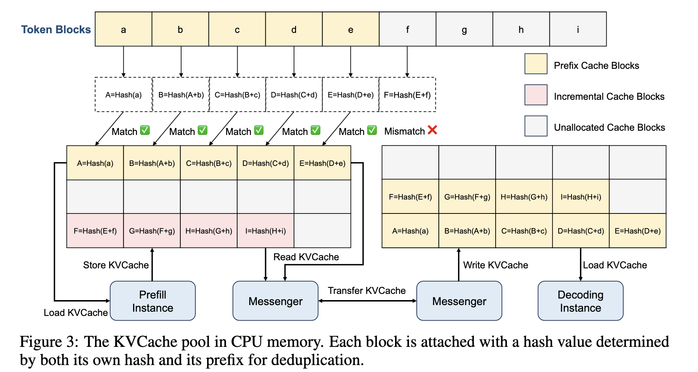
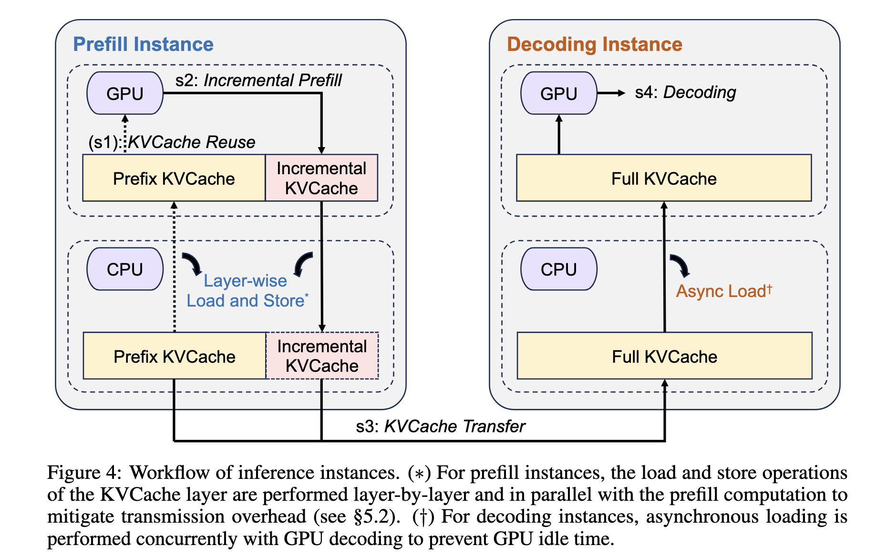
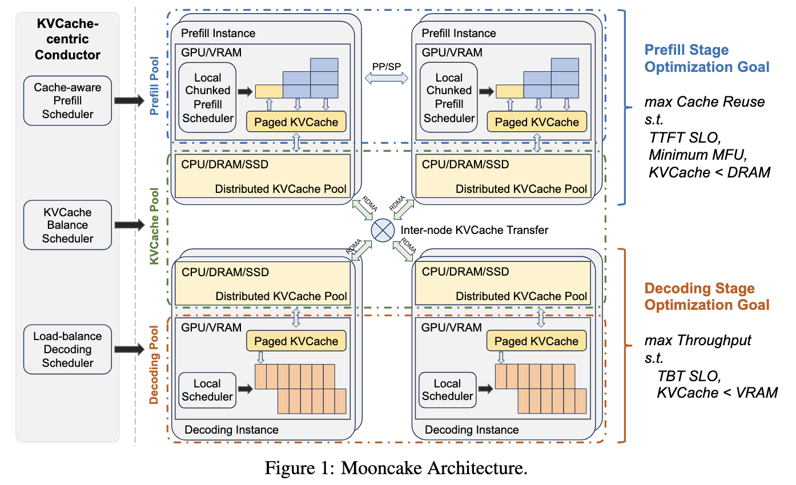

# Mooncake: A KVCache-centric Disaggregated Architecture for LLM Serving

!!! abstract

    [**Mooncake**](https://arxiv.org/abs/2407.00079) 是月之暗面为 **Kimi** 设计的推理平台，提出一种 **KVCache-centric 的 P/D 分离式架构**。它不仅把 GPU 计算节点按阶段拆分，还把集群所有节点的 CPU/DRAM/SSD 资源整合成一个**解耦的全局 KVCache 池**，从而能在不增加硬件的前提下大幅扩展近端缓存容量。系统的核心是 **Conductor**——一个围绕 KVCache 状态进行调度的全局调度器。同时，Mooncake 率先提出了**面向过载场景**的 Early Rejection 策略。模拟实验显示，在满足 SLO 的前提下，吞吐最高提升 **525%**；真实业务部署中，Kimi 能多承载 **75%** 的请求。

    - **作者**: Ruoyu Qin, Zheming Li, Weiran He, Mingxing Zhang, Yongwei Wu, Weimin Zheng, Xinran Xu
    - **机构**: Moonshot AI, Tsinghua University
    - arXiv: 2407.00079v4（2025.09）

---

## Problem

**核心痛点**：LLM 推理工作负载具有**长输入/短输出**、**到达离散**，且对 **TTFT/TBT 两类 SLO** 都有严格要求。要在不扩容 GPU 的前提下提升吞吐率，关键在于 **KVCache 的调度**。

1. **资源受限**：GPU 节点极为昂贵，扩集群难度大，但同一节点的 CPU/DRAM/SSD 大量闲置。Mooncake 把这些资源重新聚合，形成**远大于 HBM 的解耦 KVCache 池**
2. **KVCache 是 LLM serving 调度的中心**：
    - 优化 1：**复用 KVCache** 可以减少重复计算（节省 prefill 算力）
    - 优化 2：**增大 batch** 可以提升 Model FLOPs Utilization（MFU）
    - 但两者其实是对立的——**复用远端 KVCache 会拉长 TTFT**，**增大 batch 会拉长 TBT**；而且这两类 SLO 通常不可同时满足
3. **Prefill 与 Decoding 阶段特性完全不同**：
    - **Prefill**：计算密集、长度敏感（attention 复杂度随长度**平方**增长），主要约束是 **TTFT SLO**
    - **Decoding**：带宽/显存受限、batch 越大吞吐越高，主要约束是 **TBT SLO 与 KVCache < VRAM**
4. **过热请求（High-pressure Demand）**：热门 KVCache 频繁访问 → 需要复制多份到多个节点才能避免网络拥塞
5. **真实 MaaS 场景几乎必然过载**：用户规模飞速扩张，处理容量增速远落后于请求增速，必须有**过载调度**能力

!!! info "与 vLLM 等传统推理引擎的对比"

    - vLLM（continuous batching + PagedAttention）耦合 prefill 和 decoding，长上下文场景下 decoding 易被 prefill 拖慢，且缓存只利用本地 GPU 内存。
    - Mooncake 不仅做阶段解耦，还把缓存做成**全局近 GPU 的资源池**，并显式以 **TTFT/TBT SLO** 作为约束而非仅仅优化利用率。

---

## Key Idea

!!! tip "核心创新"

    **以 KVCache 为中心设计 LLM serving**：把 prefill 与 decoding 分离，再把 KVCache 做成跨节点的全局资源池，并由 Conductor 围绕 KVCache 状态（命中长度、传输代价、负载）做调度。
    同时为过载场景设计了**Early Rejection Based on Prediction**，在请求进入 prefill 之前就用预测的 decoding 负荷判断是否接收，从根本上消除 prefill 浪费。

### 1. KVCache-centric Disaggregated Architecture

#### The KVCache pool in CPU memory

CPU Memory 中的 KV Cache 存储方式：<u>paged blocks</u><div style="text-align: center"></div>

1. **Prefill Instance**：利用链式哈希（Chained Hashing）匹配前缀相同的 prefix cache block
    - 直接传输到 prefill instance，即 GPU 显存中
    - Prefill 节点完成计算后，将新生成的 KVCache（粉块）写回 CPU Memory Pool
2. **Messenger**：负责管理跨机器的数据传输。
    - 利用 RDMA 在不占用 GPU 资源的情况下，直接在 CPU 内存之间搬运数据
    - RDMA 传输数据可以和计算重叠
3. **Decoding Instance**：解码前需要从 CPU 内存池中加载完整的上下文
    - Decoding 节点在生成新 Token 后，也会不断更新和写入 KVCache
    - Decode 工作时需要和产生的 KVCache 都存在 GPU 中

#### Workflow of inference instances

<div style="text-align: center"></div>

当一个 request 完成 tokenization 后，全局调度器 Conductor 会为其选择一个 Prefill 节点和一个 Decoding 节点，并启动以下四个步骤：

1. ==KVCache Reuse==
    - **动作**：选定的 Prefill node 接收 request；request 中包含<u>原始输入、可复用的 prefix cache 的 Block ID、为该请求分配的 full cache 的 Block ID</u>。
    - **核心操作**：Prefill node 根据 prefix node 的 Block ID，通过 Messenger (RDMA 组件) 从远程 CPU 内存 (KVCache Pool) **将 KVCache load 到显存**中，以此“引导”（bootstrap）请求。
    - **调度权衡**：Conductor 在选择 Prefill 节点时，需要同时平衡三个目标：
        1. 尽可能多地复用 KVCache
        2. 平衡不同 Prefill 节点之间的负载
        3. 保证满足 TTFT（首字延迟）SLO
    - **特殊情况：** 如果不存在可复用的前缀缓存，则跳过此步骤。
2. ==Incremental Prefill==
    - **动作**：Prefill node 对剩余未缓存的输入 Token 进行计算，生成新的增量 KVCache
    - **分块流水线机制 (Chunked Pipeline)**：
        - 如果未缓存的输入 Token 数量超过特定阈值（prefill_chunk，通常 > 1000 tokens），Prefill 阶段会被拆分成多个 Chunk，以**流水线**方式执行
    - **目的**：充分利用 GPU 的计算能力，避免单次计算过长导致延迟过高或显存溢出
    - **存储**：新生成的增量 KVCache 会被**存回到 CPU 内存**的 KVCache Pool 中
3. ==KVCache Transfer==
    - **动作**：部署在每个节点上的独立进程 **Messenger** 负责管理和传输缓存
        - 这一步是**异步执行**的，并且与步骤 2（增量预填充）**时间上重叠**
    - **逐层流式传输 (Layer-wise Streaming)：**
        - 不需要等整个 Prefill 算完再传。模型每计算完一层（Layer），Messenger 就立即将该层生成的 KVCache **流式传输**到目标 Decoding 节点的 CPU 内存中
        - 对应 Figure 3：左侧 Messenger 执行 Read KVCache -> Transfer KVCache (通过 RDMA)；右侧 Messenger 执行 Write KVCache
    - **收益**：极大减少了 Decoding 节点等待 KVCache 就绪的时间，进一步压缩端到端延迟
4. ==Decoding==
    - **动作**：当所有 KVCache 都到达 Decoding 节点的 CPU DRAM 后，该请求通过 Load KVCache 进入 GPU，加入下一个 Continuous Batching 批次，开始自回归生成 Token
    - **双重 SLO 检查 (Double-checking)**
        - **预选**：Conductor 在步骤 1 已经根据当时的负载预选了 Decoding 节点，以确保不违反 TBT（字间延迟）SLO。
        - **本地复核**：由于 Prefill 阶段需要耗时，等 KVCache 真正传过来时，Decoding 节点的实际负载可能已经发生了变化。因此，Decoding 节点的**本地调度器会进行二次检查**。
    - **潜在风险**：如果本地复核发现当前负载过高，无法满足 TBT SLO，该请求可能会被拒绝
        - 此时步骤 1-3 消耗的 Prefill 计算资源和网络带宽就全部浪费了。
        - 为了解决这个问题，论文提出了基于负载预测的==早期拒绝策略 (Early Rejection Policy)==

### 2. Chunked Pipeline Parallelism

!!! question

    - context length 从 8K 飙到 128K 甚至 1M，单节点 8 张 GPU 已经放不下；
    - TP>8 就要跨节点 all-reduce，MFU 急剧下降

**传统方式**：

- 方案 A：跨节点 Tensor Parallelism (TP)
    - 把矩阵乘法切到多台机器上；每一层都需要 **2 次 AllReduce**（RDMA）。对于几十层的 LLM，通信量巨大，MFU 断崖式下跌。仅适用于单机 NVLink 环境。
- 方案 B：Sequence Parallelism (SP / Ring Attention)
    - 把输入序列切分到多台机器，每台只算一部分 Token，通过 Ring/Striped 通信交换 KV
    - 比跨节点 TP 通信量少很多，但仍有缺陷：
        - **MFU 仍低于单机 TP**：每层至少一次跨节点通信，无法完全被计算掩盖
        - **与 KVCache 传输争抢带宽**：SP 的通信和 Prefill 完成后向全局 Pool 写 KVCache 的 RDMA 传输共享同一块网卡，互相干扰
        - **弹性差**：要求参与节点数固定，动态扩缩容需要重建全局通信组，Conductor 调度复杂
==Chunked Pipeline Parallelism==：
- 将 $X$ 张卡组织成一个**流水线式的 prefill 节点组**，每个请求输入被切成多个 chunks
- 不同请求的 chunk 同时在 pipeline 不同节点上处理，从而提高了 MFU
- **通信只在流水线阶段边界**发生，利用 RDMA 实现<u>传输和计算的重叠</u>

```text
Time Slot:      T1         T2         T3         T4 
   Node 0:  [ReqA-C0]  [ReqA-C1]  [ReqB-C0]  [ReqA-C2] 
   Node 1:    [idle]   [ReqA-C1]  [ReqA-C2]  [ReqB-C1] 
   Node 2:    [idle]     [idle]   [ReqA-C2]  [ReqB-C2] 
   Node 3:    [idle]     [idle]     [idle]   [ReqA-C3]
```

### 3. Layer-wise Prefill

$$
\text{VRAM 占用成本} = \text{KVCache 大小} (S) \times \text{驻留时间} (T)
$$

- **显存占用**：如果采用 Chunked Prefill 并将 prefill 和 decode 插在一起执行，虽然能减小 TBT，但会导致单个请求的处理时间 T 增加，进而导致 <u>KVCache 在 VRAM 中的总占用成本上升</u>。
- **异步 pipeline**：
    - 将 KVCache 的 tansfer（load/store）与 compute 重叠。即执行第 $N$ 层计算的同时，异步执行第 $N+1$ 层的 KVCache 加载或第 $N−1$ 层的 KVCache 存储，从而隐藏传输延迟。
- **具体流程**：
    1. **异步加载**：在每一层的 Attention 计算开始前，系统在该层 KVCache 的异步加载完成后，**立即触发**下一层 KVCache 的异步加载。
    2. **计算与存储并行**：当该层 Attention 计算完成后，立即**启动**该层 KVCache 的异步存储操作，此时 GPU 继续进入下一层的计算，存储操作在后台进行。
    3. **全局同步**：当所有层的计算都结束后，进程再统一**等待**所有异步存储操作完成。
    4. **调度解耦**：由于传输被有效隐藏，Prefill 节点的调度不再受限于 VRAM 的剩余容量（只要能容纳单个请求即可），仅需考虑 KVCache 分布和 DRAM 大小。

### 4. KVCache-centric Scheduling

- 调度的终极目标不是单纯的“负载均衡”或“缓存命中”，而是**最小化用户的 TTFT**。
- **全局缓存感知：** 必须在全局范围内（跨所有 Prefill 节点）进行缓存块的哈希匹配，综合评估每个节点的“缓存命中带来的计算节省”与“高负载带来的排队惩罚”，从而做出全局最优的路由决策。

$$
\text{TTFT} = \text{Queuing Time}+ \text{Execution Time}+ \text{Transfer Time}
$$

Mooncake 的 Conductor 采用==缓存感知的全局调度算法==，具体步骤如下：

1. **全局哈希匹配 (Global Hash Matching)**：
    - 将新请求的输入 Token 分块，并计算<u>链式哈希键</u>
    - 将算出的哈希键与**所有 Prefill 实例**的缓存键进行逐一比对，计算出每个实例的前缀匹配长度
2. **TTFT 精准预测：**
    - **执行时间预测**：利用基于离线数据训练的预测模型，根据<u>请求总长度和 prefix_len</u>估算计算时间（得益于 Transformer 规则的计算模式，误差极小）。
    - **排队时间预测**：通过累加该实例队列中所有待处理请求的预估 Prefill 时间得出
    - **并行计算**：Conductor 并行计算所有候选实例的 TTFT，其调度计算开销微乎其微
3. **最优路由与 SLO 拦截：**
    - 将请求分配给**预估 TTFT 最短**的实例，并更新该实例的队列和缓存状态。
    - **熔断机制**：如果所有实例的最短预估 TTFT 仍无法满足 SLO 要求，Conductor 会直接拒绝请求，向上层返回 HTTP 429 Too Many Requests，避免系统雪崩。

### 5. Cache Load Balancing

!!! question "Problem"

    - **缓存访问热度极度不均**：在分布式 Prefill 集群中，不同 KVCache 块的访问频率差异巨大。
    - **预测模型失效：** 传统的“收集全局使用量 -> 预测未来热度 -> 提前调度”的方案不可行。因为 MaaS（模型即服务）场景下的工作负载高度动态且增长迅速，无法准确预测未来。
    - **单点热点瓶颈：** 如果热门缓存仅存在于少数节点，当大量请求命中该缓存时，这些节点会因负载过高导致排队，迫使请求转向无缓存节点，从而丧失缓存加速优势。

==基于启发式的自动热点迁移方案（Heuristic-based Automated Hot-spot Migration）==：

1. **主动拉取（Proactive Retrieval）**
    - 当拥有最长前缀匹配的 Prefill 实例负载过高时，Conductor 会将请求转发给备选实例。
    - 若预估的“额外 Prefill 时间”短于“KVCache 传输时间”，备选实例会**主动从原持有者处拉取 KVCache** 并存储在本地。这既服务了当前请求，又完成了热点复制。
2. **阈值控制的重算策略（Threshold-gated Recomputation）**
    - 即使远程有前缀匹配，但如果 <u>最佳远程匹配长度 ≤ 当前本地可复用前缀长度 × 阈值</u>，系统倾向于**直接在本地重新计算**输入 Token。
    - 这一策略避免了低效的短距离传输，同时通过重算在本地生成了新的 KVCache 副本，进一步促进了热点的自动扩散。（注：目前阈值为手动调整，未来计划自适应）。

### 6. Overload-oriented Scheduling

!!! note "background"

    在 MaaS 真实场景里，由于 GPU 供应不足，**主动拒绝部分请求**比让所有人都慢更合理。Mooncake 给出**首个面向解耦架构的过载调度策略**，用预测的最大延迟是否超过阈值来定义负载

- ==早期拒绝策略（Early Rejection Policy）==：
    1. **基于 SLO 的负载定义**
        - 明确定义 $l_{ttft}$ 和 $l_{tbt}$ ​ 分别为 TTFT 和 TBT 的 SLO 约束值。
        - **Prefill 负载判定**：若实例上预测的最大 TTFT > $l_{ttft}$，则视为 Prefill 过载
        - **Decoding 负载判定**：若实例上预测的最大 TBT > $l_{tbt}$，则视为 Decode 过载
    2. **两阶段独立准入决策**
        - **决策一**：当新请求到达时，根据 Prefill 实例的负载状态决定是否接受该请求
        - **决策二**：当 Prefill 完成后，根据 Decoding 实例的负载状态决定是否继续执行解码
    3. **配套机制**：为了解决早期拒绝可能带来的负载波动问题，并提高 Decoding 阶段负载预测的准确性，系统还需要引入**生成长度预测（Generation Length Prediction）** 机制
- **Load Fluctuation**：只基于当前 decoding 负载做调度，会出现四个阶段的反相波动：
    1. prefill/decoding 都低 → 接收大量请求
    2. prefill 完成后的请求进入 decoding → decoding 满 → 拒绝后续 → prefill 负载降低
    3. 无新请求意味着 decoding 持续完成请求 → decoding 负载下降
    4. decoding 腾出空间 → prefill 又接受大量请求 → **再次涌入 decoding**
- ==Early Rejection Based on Prediction==：<u>System-level 预测</u>
    - 采用了一个基于**均匀解码时长假设 ( $t_d$ ​ )** 的流量平衡模型来预测未来负载：
    1. **设定基准参数**：
        - 设每个请求在 Decoding 阶段的平均驻留时间为固定值 $t_d$ 
        - 该值可通过历史数据统计得出
    2. **计算未来新增量 (Inflow)**：
        - 根据当前 Prefill 实例的处理速率，估算在时刻 $t$ 能完成 Prefill 并准备进入 Decoding 的请求数量（代表了未来 $t$ 时刻 Decoding 端的“<u>入口流量</u>”）
    3. **计算未来释放量 (Outflow)：**
        - 检查当前所有正在 Decoding 的请求，筛选出那些“$t_{start}+t_d\leq t$ ​”的请求
        - 这些请求预计在时刻 $t$ 之前就会完成并离开系统
        - 这代表了未来 $t$ 时刻 Decoding 端的“<u>出口流量</u>”
    4. **未来负载预测**：
        -  $\text{Predicted Load}_t=\dfrac{(\text{Current Batch}−\text{Outflow}_t+\text{Inflow}_t)\times Avg\text{TBT}}{l_{tbt}}$
        - 用预测的 Batch 大小乘以平均 TBT，再除以 SLO 阈值 $l_{tbt}$ ​ ，得到归一化的负载比率。 
    5. **决策应用**：Conductor 使用 $\text{PredictedLoad}_t$ 进行 Early Rejection 的判断

---

## Workflow

!!! note "系统架构"

    <div style="text-align: center"></div>

### 阶段 0：Conductor 全局调度

目标：根据<u>缓存命中 + 预测时间 + SLO</u>进行全局最优决策，输出调度二元组 $(p, d)$（prefill, decode）

1. **前缀匹配（Prefix Matching）**  
    - 对 request 按块大小 $B$ 计算链式哈希键（Chained Hash Keys）
    - 遍历所有 Prefill 实例确定**最佳前缀匹配长度**（best_prefix_len）及**最佳匹配实例**（best_matched_instance）
2. **TTFT 预测与准入判定**：
    - $T_{\text{prefill}}$：基于**离线测试数据**训练的预测模型，按请求长度和 prefix_len 进行估算（误差极小）
    - $T_{\text{queue}}$：该实例队列中**待处理**请求的预估 prefill 时间之和
    - **准入判定**：若 $T_{\text{prefill}} + T_{\text{queue}} \le \text{TTFT SLO}$，则将该实例*纳入候选*；否则进入后续的 cache-load balancing 分支，额外评估 $T_{\text{transfer}} + T_{\text{queue}} + T_{\text{prefill}}$
3. **Hot-spot Migration（Cache Load Balancing）**：
    - **远程复制**：若最佳实例过载，且额外 Prefill 时间 > KVCache 传输时间，则将请求调度至备选实例，并从最佳实例远程复制对应的 KVCache 到本地。
    - **本地重算**：若远端命中长度 ≤ 本地复用长度 × kvcache_balancing_threshold，直接进行本地重算。计算完成后该实例自然持有这份 KVCache 副本，实现热点数据的自动扩散。
4. **Decoding 预选**：Conductor 调用 SelectDecodingInstance( ) 进行预分配，如果预测的 TBT 超过了 SLO，直接拒绝或重选
5. **决策返回**：所有候选均不满足 SLO 则返回 **HTTP 429 Too Many Requests**

### 阶段 1：KVCache Reuse

目标：用 prefix cache **引导 (bootstrap)** 请求，跳过对已缓存 prefix 的重复计算

1. **请求接收与解析**：
    - Prefill 实例收到请求，包含(input tokens, reusable prefix block IDs, full cache block IDs)
    - 无任何可复用 prefix cache 时<u>跳过本步骤</u>，直接进入阶段 2 对全量 tokens 做 prefill
2. **跨节点缓存加载（Remote Cache Load）**：
    - 借助 **Messenger** 服务（基于 GPUDirect RDMA），从远端 CPU 内存池将 prefix block IDs 指向的 KVCache 加载到本地 GPU 显存
    - 完成后请求即被 prefix cache "引导"，可立即进入阶段 2 的增量 prefill
3. **三目标权衡（Three-Objective Trade-off）**：Conductor 选择 prefill 实例时同步满足
    1. **最大化 KVCache 复用**：减少 prefix prefill 算力
    2. **不同 prefill 节点之间的负载均衡**
    3. **保证 TTFT SLO**

### 阶段 2：Incremental Prefill

目标：在 prefix cache 基础上完成 prefill，并持续流式输出**增量 KVCache**

1. **增量计算（Incremental Computation）**：Prefill 实例对<u>未缓存的 token</u>进行注意力计算，生成新的增量 KVCache
2. **分块流水线（Chunked Pipeline Parallelism, CPP）
    - **触发**：若未缓存 token 数 > prefill_chunk，将请求切分为多个 chunk
    - 多节点组成**流水线节点组**，不同 chunk 在不同节点上<u>并行 / 流水线</u>处理
    - 阶段边界通信量小 → 与 KVCache transfer 重叠，**不抢占网络**
3. **逐层异步 load/store（Layer-wise Prefill）**：与 prefill 计算**完全重叠**，显著降低长上下文延迟
    1. **加载第 $N$ 层 KVCache**：第 $N$ 层 attention 开始前，发射 cudaMemcpyAsync 从CPU加载
    2. **第 $N$ 层 attention 计算**：模型在该层做 attention / MLP
    3. **写回第 $N$ 层 KVCache**：attention 完成后，发射异步存储回 CPU
    4. **全局同步**：所有层计算结束后，等待所有异步存储完成
4. **效果**：cudaMemcpyAsync 与 prefill 计算**完全重叠** → 显著降低长上下文延迟；同时**放宽 prefill 实例的 VRAM 约束**
5. **增量 KVCache 落盘**：新生成的增量 KVCache 写回 CPU 内存池 → 供后续请求复用

### 阶段 3：KVCache Transfer

目标：把阶段 2 生成的增量 KVCache **层粒度流式**送往目标 decoding 节点 CPU DRAM

1. **Messenger 进程部署**：每个 inference 实例内部署一个独立的 Messenger 进程（**GPUDirect RDMA**，不占 GPU 计算资源）
2. **跨节点信号触发**：Messenger 接收来自本节点的信号 → 启动<u>跨机高速 KVCache transfer</u>（无需 GPU 介入）
3. **异步并行执行**：与阶段 2 的 incremental prefill **完全重叠**，边算边传
4. **Layer-wise 流式传输**：模型每算完一层 → Messenger 立即将该层 KVCache 流式发往目标 decoding 节点 CPU 内存，**无需等待整个 prefill 完成**
5. **源 / 宿端流程**：
    - **Source**：Read KVCache → Transfer KVCache（RDMA）
    - **Destination**：Write KVCache → 全部到位后统一 Load 到 GPU
    - ⇒ 极大缩短 decoding 节点等待 KVCache 就绪的时间

### 阶段 4：Decoding

目标：所有 KVCache 到位后，<u>join decoding 连续批</u>开始自回归生成

1. **启动条件**：所有 KVCache 已抵达 decoding 节点的 CPU DRAM，并通过 Load KVCache 加载到 GPU 显存
2. **双重 SLO 检查（Double-Checking）**：
    1. **预选（Conductor 阶段 0）**：调度前基于预测负载预选 decoding 节点，确保不违反 TBT SLO
    2. **本地复核（Local Scheduler）**：prefill 阶段耗时后，decoding 实例的实际负载可能已变化 → **再次校验**当前 batch 是否满足 TBT SLO
    - **不满足** → 请求被拒绝（此时阶段 1–3 的资源已被消耗 → **凸显阶段 0 早期拦截的价值**）
3. **自回归生成**：连续批中持续生成新 token → 每生成一个 token 即更新并写入 KVCache → 完成后请求结束

### 阶段 5：Overload Scheduling 闭环

目标：在 MaaS 真实场景下，用**预测驱动的早期拒绝**抑制反相波动、保护系统稳定性

1. **基于 SLO 的负载定义**：
    - $l_{ttft}$ 与 $l_{tbt}$ 分别为 TTFT 与 TBT 的 SLO 阈值
    - 实例上预测的**最大 TTFT > $l_{ttft}$** → 视为 prefill 过载
    - 实例上预测的**最大 TBT > $l_{tbt}$** → 视为 decode 过载
2. **两阶段独立准入决策**：
    - **决策一**：请求到达时，根据 **prefill 实例**负载决定是否接收
    - **决策二**：prefill 完成后，根据 **decoding 实例**负载决定是否继续解码
3. **Load Fluctuation 问题**：仅基于<u>当前</u> decoding 负载做调度会触发**四阶段反相波动**——prefill ↔ decoding 反相同步，集群利用率大幅下降
4. **Early Rejection Based on Prediction（System-level 预测）**：在 prefill 启动前预测 decoding 在该请求完成时的负载
    - 假设**均匀解码时长** $t_d$（历史统计均值）
    - 估算时刻 $t$ 的**入口流量**（prefill 即将完成数）与**出口流量**（解码即将完成数）
    - 归一化未来负载：

    $$
\text{PredictedLoad}_t = \dfrac{(\text{Current Batch} - \text{Outflow}_t + \text{Inflow}_t) \times \text{AvgTBT}}{l_{tbt}}
    $$

    - Conductor 用 $\text{PredictedLoad}_t$ 决策 Early Reject；<u>请求级</u>（predict output length）预测成本过高、过载时精度差 → 采用<u>系统级</u>预测

1. **闭环收益**：
    - **显著降低 prefill 浪费**：被拒绝的请求不再走完一整次 prefill
    - **消除反相波动**：避免"过载 → 拒绝 → 空闲 → 再过载"的恶性循环
    - **保持平稳运行**：集群利用率与服务稳定性同时兼顾

---

## Results

### 实验环境

- **集群**：高性能计算节点集群，每节点配 **8 张 NVIDIA A800-SXM4-80GB**，单卡 **80 GB HBM**
- **互联**：节点内 **NVLink**（带宽 ~600 GB/s），节点间 **RDMA 网络**支持最高 **800 Gb/s inter-node**
- **节点角色**：每节点可启动时配置为 **prefill 实例** 或 **decoding 实例**
- **软件栈**：
    - 部署 **Mooncake 架构**在多种集群规模上——包括 4 实例 (3P+1D、2P+2D)、20 实例 (`[10P+10D]`) 等
    - **基线系统**：vLLM（采用 continuous batching + PagedAttention，4 实例 vLLM-[4M]、20 实例 vLLM-[20M] 等）
- **被测模型**：**dummy LLaMA2-70B**，遵循相同的架构与 LLM 调用语义（出于专有数据可重现性，所有实验都用 dummy 模型），KVCache hash 与 trace 完全基于真实业务

### 数据与模型

- **模型**：
    - **LLaMA2-70B（dummy）**：用于所有 end-to-end 实验，遵循相同架构但不含真实权重
- **数据集（Table 2）**：

| Dataset             |  Avg Input Length   | Avg Output Length | Cache Ratio | Arrival Pattern |
| :------------------ | :-----------------: | :---------------: | :---------: | :-------------- |
| ArXiv Summarization |        8088         |        229        |     ~0%     | Poisson Process |
| L-Eval              |        19019        |        72         |    >80%     | Poisson Process |
| Simulated Data      | 16k, 32k, 64k, 128k |        512        |     50%     | Poisson Process |
| Real Data           |        7955         |        194        |     ~50%    | Timestamp-based |

- **负载特征**：
    - L-Eval 缓存率高 → 重在 prefix 复用
    - Simulated Data 长 prompt 且缓存率 50% → 覆盖**长上下文**场景
    - Real Data 直接回放 **23,000 条真实 Kimi trace**（基于论文 4 节采样的 1 小时真实请求），按真实时间戳重放
- **可重复资源**：
    - trace 数据开源：<https://github.com/kvcache-ai/Mooncake>
    - trace 包含 timestamp / input_length / output_length / hash_ids 字段，但不暴露任何用户文本
- **指标**：
    - **主指标**：throughput（tokens/s）@ **TTFT SLO + TBT SLO 同时满足**
    - **SLO 阈值**：TTFT P90 不超过 **4×** 单请求无干扰执行时间；TBT P90 不超过 **5×**
    - 超过阈值即视为浪费资源，归一化基线 = 1.0（取最低观测 RPS 为 best）

### 主要结果

1. **Public Datasets —— ArXiv Summarization & L-Eval**（Fig. 11）：
    - **ArXiv Summarization**：Mooncake-[3P+1D] 相比 vLLM-[4M] **吞吐提升 20%**，全程满足 SLO
    - **L-Eval**：Mooncake-[3P+1D] 相比 vLLM-[4M] **吞吐提升 40%**
    - L-Eval 上 TBT 表现更优源于**prefix 缓存**显著降低了 prefill 时间
    - Mooncake-[2P+2D] 在 TTFT 上表现次优，主要因为 prefill ↔ decoding 实例数不均衡
2. **Simulated Data —— 长上下文场景**（Fig. 12）：
    - 在 16K / 32K / 64K / 128K 四种 prompt 长度下，Mooncake 的 throughput **比 vLLM 高 50%–525%**——且严格遵守 TTFT/TBT SLO
    - **关键洞察**：vLLM 在长上下文下 decoding 阶段被打断得最厉害；Mooncake 解耦保证 decoding 不受 prefill 干扰
3. **Real Workload —— Kimi 真实 trace**（Fig. 13）：
    - Mooncake-[10P+10D] **近 100%** 请求满足 TTFT SLO；vLLM-[20M] 仅 **57%**
    - 部分 vLLM 请求 TBT **极高**（数秒级） → 反映长上下文 decoding 被打断
    - 在相同 SLO 约束下，Mooncake **可多承接 75% 请求**
4. **Overload Scenario（Table 3）**：[8P+8D]、2× 重放 23,000 trace：
    - **Baseline（无 Early Rejection）**：拒绝 **4183** 条
    - **Early Rejection**：拒绝 **3771** 条（-10.0%）
    - **Early Rejection Based on Prediction**：拒绝 **3589** 条（-14.2%）
    - **机制**：减少**无效 prefill** 浪费（每个被拒绝的请求原本要走完整个 prefill 阶段）+ 抑制反相波动 → 提升单位资源服务请求数
5. **Prefill Scheduling 单独消融**（Fig. 8，左图是 TTFT）：
    - **KVCache-centric**：最优，TTFT 显著低于 random / load-balancing
    - **Cache-aware 与 Cache+Load-balancing** 中位 TTFT 接近，cache-aware 的尾部 P75 更稳定
    - **随机调度**：P75 高达 250 s 量级，几乎不可用
6. **Layer-wise Prefill 的传输效率**（Fig. 7）：
    - 不同 request length 下，layer-wise 的**存储延迟**远低于 serialized（如 128K 输入下从 0.86 → ~0.10 量级）
    - 验证了异步加载与写回可有效隐藏在 prefill 计算中
7. **SLO Attainment Rate**：在多个 SLO 维度下 Mooncake 的达标率系统性优于 vLLM，且在高 RPS 时仍保持稳定
