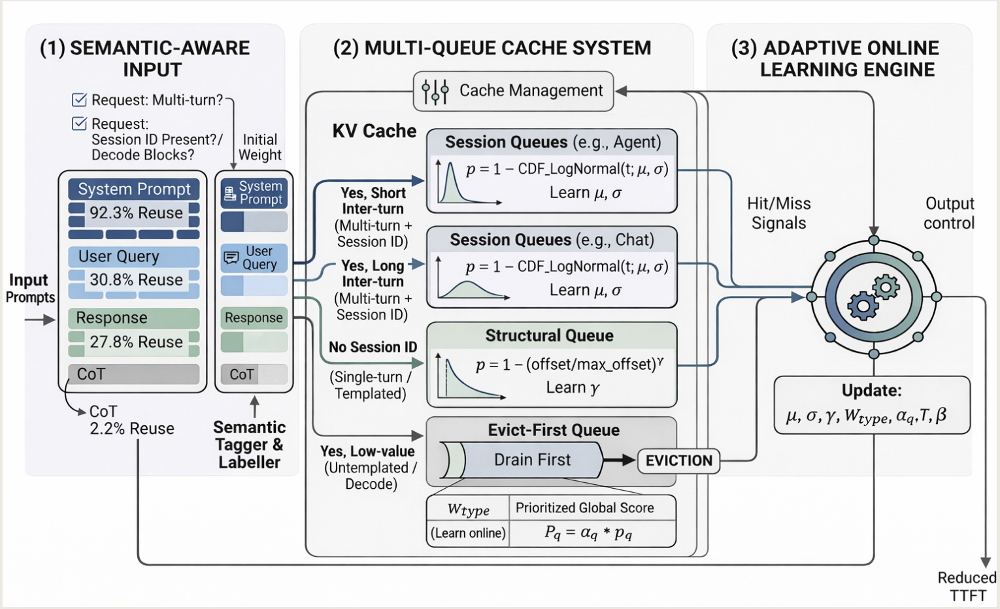

# Not All Tokens Are Worth Caching: Learning Semantic-Aware Eviction for LLM Prefix Caches

!!! abstract

    [**SAECache**](https://arxiv.org/abs/2605.18825) 是一种面向 LLM 推理的**前缀缓存驱逐策略**。其核心洞察在于：不同的 token 类型具有截然不同的复用价值。SAECache 通过**多队列架构**、**语义感知的 token 加权机制**和**全参数在线学习**，让缓存系统能够细粒度地学习每类 token 的复用价值，从而做出更优的逐出决策。相比 LRU/LPC 等基线，TTFT 降低 **1.4×–2.7×**

    - **作者**: Shaoke Fang, Ziang Li, Jiatong Ji, Wenfei Wu, Qingsong Liu, Ruizhi Pu
    - **机构**: Peking University, FirestAI, Tsinghua University, UMass Amherst, Southeast University

---

### Problem

!!! warning "核心痛点"

    现有的前缀缓存逐出策略（如 vLLM 默认的 LRU、LFU、LPC）都是 **token-agnostic** 的，它们仅基于访问时间或频率来决定逐出顺序，而忽略了 token 的**语义角色**和**异构复用模式**。

具体问题：

1. **Token 复用率差异巨大**：
    - 系统提示（System Prompt）复用率高达 **92.3%**
    - 思维链（Chain-of-Thought）复用率仅 **2.2%**
    - 将这两种 block 视为等价会导致次优的显存分配
2. **单轮请求的结构化复用被忽视**：
    - 单轮请求看似无历史可复用，但共享 prompt 模板（如工具描述）带来显著的结构化复用
    - Decode block 的复用率低于 3.17%，应该优先被逐出
    - Prefill block 的复用率随位置衰减：越靠前的 block（包含系统指令）价值越高
3. **多轮会话的时序分布多样**：
    - Chat 类型：长间隔、重尾分布（P50≈110s, P80≈372s）
    - Agent 类型：短间隔、爆发式（P50≈8.5s, P80≈25s）
    - 两者都服从**对数正态分布**，但参数差异显著
    - 固定参数的策略在工作负载变化时性能严重退化（可达 2.7×）
4. **现有工作的局限**：
    - **LRU**：仅考虑访问时序，忽略语义和复用模式
    - **LFU**：长会话累积高频次，导致已结束的会话残留
    - **LPC**：用外部 embedding 模型预测会话延续概率，但同一会话的所有 block 继承相同的延续信号，缺乏细粒度区分

!!! info "关键观测"

    1. **单轮复用来自模板结构**：跨会话复用 < 0.01%，复用几乎完全来自会话内的模板共享
    2. **多轮复用是会话局部的**：99.28%（ShareGPT）和 99.96%（AgentBank）的复用块来自同一会话
    3. **轮次间隔服从对数正态分布**：每个会话有独特的分布参数，需在线学习
    4. **固定参数脆弱**：用 chat 数据拟合的参数应用到 single-turn 负载会导致 2.7× TTFT 退化

---

### Key Idea

!!! tip "核心创新"

    SAECache 的核心创新在于将**语义感知的 token 级细粒度决策**引入前缀缓存逐出，并通过**全参数在线学习**消除手动调参，使系统能够自适应工作负载变化。

论文的关键设计：

1. **多队列架构（Multi-Queue Architecture）**
    根据复用模式将 KV block 路由到不同的专用队列：
    - **Evict-First Queue**：存储 decode block 和低复用的非模板 prefill block，优先被逐出
    - **Structural Queue**：存储单轮模板化的 prefill block，按位置评分（越早的价值越高）
    - **Chat Queue**：存储多轮对话的 block，建模会话局部的时序复用
    - **Agentic Queue**：存储 Agent 调用的 block，与 Chat 分开建模（请求间隔差异大）
2. **局部优先级评分（Local Priority Scoring）**
    - **多轮队列**：基于学习到的对数正态分布计算生存概率
        - $p_q(b) = 1 - F_{LN}(\Delta t_b; \mu_q, \sigma_q)$，其中 $\Delta t_b$ 是自上次访问以来的时间
    - **结构队列**：基于位置衰减
        - $p_q(b) = 1 - \left(\frac{o_b}{o_{max}}\right)^\gamma$，其中 $\gamma$ 是在线学习的衰减幂次，$o$ 表示偏移量（offset）
3. **语义感知的 Token 加权（Token-Type-Aware Weighting）**
    - 每个 block $b$ 有一个 token 类型权重 $w_{\tau(b)}$，用 block 中间 token 的类型代表整个 block
    - 权重通过**逐出反馈**在线更新：若被逐出的 block 随后被命中，则增加权重
    - 更新规则（指数移动平均，EMA）：
        - $w_{target} = 1.0 + r_{miss} \times 5.0 + r_{reuse} \times 2.0$
            - $r_{miss}$：驱逐后未命中率，反应驱逐的质量
            - $r_{use}$：反映该 Token 类型的内在复用价值
        - $w_{new} = (1-\eta) \times w_{old} + \eta \times w_{target}$，其中 $\eta$ 为学习率
    - 收敛后的权重排序：$w_{sys} > w_{usr} > w_{resp} \approx w_{tool} > w_{cot}$
      （学习器约在 200 步内收敛，具体值为 4.13, 2.00, 1.86, 1.80, 0.77）
4. **队列级自适应权重（Queue Weight Adaptation）**
    - 除 Evict-First 外的每个队列 $q$，计算命中效率 $E_q = H_q / C_q$（命中 token 数 / 容量占比）
    - 队列权重通过**温度缩放**的相对效率更新：$\alpha_q = \beta \times \alpha_q + (1-\beta) \times \left(\frac{E_q}{\bar{E}}\right)^{1/T}$
        - 其中 $\bar{E}$ 表示跨队列的评价效率，$T$ 表示温度参数
    - 多轮主导负载下，多轮队列权重是结构队列的 24 倍；单轮主导下两者接近 1:1
5. **衰减幂次更新 (Decay power update)**
    - 结构队列中，衰减幂次 $\gamma$ 通过观察位置与命中率的关联在线更新。系统将提示词分为位置区间（Bins），计算后半部分与前半部分的平均命中率比值 $\text{ratio}=\frac{\text{back\_avg\_hit\_rate}}{\text{front\_avg\_hit\_rate}}$
    - 估计的幂次为 $\text{estimated\_power}=\frac{1.0}{\text{ratio}+1.0}$ 
    - 较小的 ratio 意味着后续位置复用较弱，从而产生更大的衰减幂次。
6. **多轮会话预测器（Multi-Turn Session Predictor）**
    - 对于无历史的首轮请求，用轻量级三层 MLP（~1M 参数）预测是否会继续多轮
    - 复用 serving 模型 prefill 阶段的最后一层 hidden state，无需额外编码
    - 预测为多轮的请求路由到多轮队列，否则路由到结构队列或 evict-first 队列
7. **最终优先级评分**：$P(b) = \alpha_q \cdot w_{\tau(b)} \cdot p_q(b) / \Delta t_b$
    - 逐出时优先从 evict-first 队列取，否则选择<u>评分最低的 block</u>

---

### Workflow

!!! note "系统流程"

    SAECache 作为 vLLM 的 **drop-in replacement**，替换默认的 LRU Evictor，无需修改调度器或模型执行器

    

1. **请求到达 → KV Block 路由**
    - 对于**多轮后续请求**（已有对话历史）：
        - 根据类型（chat/agentic）路由到对应的多轮队列
    - 对于**首轮请求**（无历史）：
        - 系统会提取服务模型最后一个输入 Token 的隐藏状态（Hidden State），通过一个轻量级 MLP 预测器判断其是否属于多轮会话的开端。
        - 预测为多轮 → 路由到多轮队列（chat/agentic）
        - 预测为单轮且是模板 → 路由到结构队列（structural）
        - 非模板/decode block → 路由到 evict-first 队列
2. **局部优先级计算**
    - **多轮队列**：基于在线学习的对数正态（Log-normal）分布模型。根据 block 自上次访问以来经过的时间 $\Delta t_b$，计算其在当前分布下近期被复用的生存概率。
    - **结构队列**：基于位置衰减模型，根据 block 位置 $o_b$ 和学习的衰减幂次 $\gamma$ 计算位置优先级
3. **综合评分与驱逐决策**
    - **Token 权重**：用 block 中间 token 的类型代表整个 block，查询当前权重 $w_{\tau(b)}$
    - **队列权重**：查询当前队列的 $\alpha_q$
    - **综合评分**：$P(b) = \alpha_q \cdot w_{\tau(b)} \cdot p_q(b) / \Delta t_b$
    - **逐出决策**：先从 **evict-first 队列**逐出；若为空，逐出其余队列中**评分最低**的 block 
4. **在线参数更新**
    - **Token 权重（$w_{\tau(b)}$）**：根据“驱逐后未命中率”和“整体复用率”动态调整。
    - **时序参数（$\mu,\sigma$）：** 针对 Chat 和 Agentic 队列，MLE 利用命中时间间隔在线更新对数正态分布的参数；同时 EMA 因子 $\beta$ 会根据观测方差自适应调整，平衡响应速度与稳定性
    - **位置衰减幂次（$\gamma$）：** 比较结构队列前半部分和后半部分的命中率比值，动态更新参数
    - **队列权重（$\alpha_q$）：** 根据各队列近期的命中效率，通过温度缩放的相对效率公式，自动重新分配缓存空间的优先级（例如在多轮负载下自动提高 Chat 队列权重）。

---

### Results

**实验设置**：

- 模型：Qwen2.5-1.5B-Instruct
- 硬件：NVIDIA A40 GPU
- 数据集：ShareGPT（74% 多轮）、LMSys（33% 多轮）、Chatbot-Arena（12% 多轮）
- 基线：LRU（vLLM 默认）、LPC（NeurIPS 2026）
- 实现：vLLM v0.8.5 (V0 engine) 上的 drop-in replacement

1. **缓存命中率提升**：
    - 在所有 12 个（数据集 × 注入间隔）配置中均取得最高命中率
    - 相比最强基线提升 **4.8–5.9 个百分点**
    - 在多轮比例从 12% 到 74% 的范围内稳定提升

2. **TTFT 延迟降低**：
    - **LMSys**：相比 LRU 降低 4–8%，相比 LPC 降低最高 16%
    - **ShareGPT**：在高压力（间隔 ≤ 0.03s）下匹配最佳基线，低压下差距 < 5%
    - **Chatbot-Arena**：命中率最高但 TTFT 有时略差（12–34%），因为多队列管理开销在小负载下超过收益
    - 整体：**1.4×–2.7× TTFT 提升**（在异构工作负载上）

3. **鲁棒性**：
    - **固定参数 vs 在线学习**：固定参数在工作负载失配时退化 2.7×，在线学习保持稳定（TTFT 0.934s–1.886s）
    - 对超参数 $\alpha, \beta$ 不敏感：30 种配置下 TTFT 均为 3.564s

4. **消融实验**（逐步添加组件）：
    - **+Token-Type Weight Learning**：提升 **23%**
    - **+Log-Normal Timing Learning**：再提升 **14%**
    - **+Position-Decay Learning**：再提升 **12%**
    - **+Queue-Weight Learning**：再提升 **39%**（最大贡献）

5. **预测器开销**：
    - SAECache 预测器：1137 predictions/s，4 MB 内存
    - LPC e5-small：129 predictions/s，472 MB 内存
    - SAECache 快 **8.8×**，内存少 **118×**

6. **收敛的 Token 权重**（平衡负载）：
    - $w_{sys} = 4.13$（从初始 2.0 增长 107%）
    - $w_{usr} = 2.00$
    - $w_{resp} = 1.86, w_{tool} = 1.80$
    - $w_{cot} = 0.77$（最低，符合其 2.2% 的复用率）
