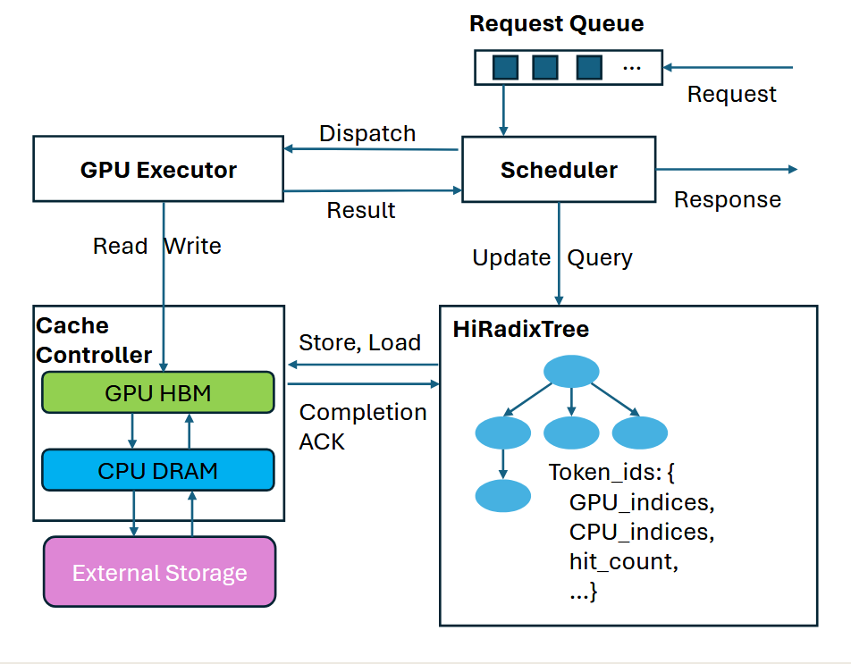
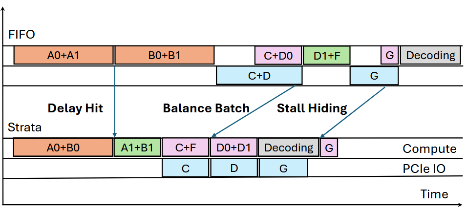

# Strata: Hierarchical Context Caching for Long Context Language Model Serving

!!! abstract

    [**Strata**](https://arxiv.org/abs/2508.18572) 是一个面向**长上下文 LLM serving** 的分层缓存框架。它主要解决两类问题：(1) KV Cache 因 **PagedAttention 小页** 造成的 I/O 碎片化，(2) 调度器**忽略缓存加载延迟**导致的 loading-bound。Strata 引入 **GPU-assisted I/O** 与**解耦的内存布局**解决传输效率，并用 **cache-aware scheduling**平衡计算与 I/O。相比 vLLM+LMCache，TTFT 最高降低 **5×**，相比 TensorRT-LLM 提速 **3.75×**，且不损害短上下文性能。

    - **作者**: Zhiqiang Xie, Ziyi Xu, Mark Zhao, Yuwei An, Vikram Sharma Mailthody, Scott Mahlke, Michael Garland, Christos Kozyrakis
    - **机构**: Stanford University, NVIDIA, Shanghai Jiao Tong University, CU Boulder, CMU, University of Michigan

---

### Problem

**核心痛点**：LLM 上下文窗口不断膨胀，长上下文缓存的存储需求**远超 GPU HBM 容量**。生产系统必须采用分层缓存（GPU - CPU - SSD）存储 KV Cache，但**把大块缓存传回 GPU**成为新的性能瓶颈：

1. **I/O 带宽利用率低**：
    - 由 Little's Law 得到吞吐率 $X = \dfrac{C\cdot S}{L}$：提高数据传输需要<u>高并发、大传输块或低延迟</u>
    - 现有系统采用 **PagedAttention** 和小页大小（如 32 tokens）来提升显存利用率和缓存命中率，但**分页导致数据碎片化**：一个序列的 KV 分散在多个不连续页，单次传输只有几 KB。
    - **增大 page size 的代价**：单页压缩更多 token 能提高 $S$，但会显著**降低缓存命中率**
2. **调度器忽略加载延迟（loading-bound）**：
    - 现有系统假设“加载第 $N+1$ 层缓存可被第 N 层计算重叠隐藏”，或必要时重算。
    - 但长缓存 + 较少新 token 时：缓存加载延迟**超过逐层计算能隐藏的量**，重算又随上下文变长而昂贵，逐层重叠退化为 **PCIe 带宽受限**。
3. **延迟命中（Delay Hit）**：
    - 同一个 Batch 中的多个请求使用**同一段 KV Cache**，但首个 cache miss 仍在 resolve
    - 异步调度器（预先生成下一批）把 cache-miss resolve 窗口拉长到整批执行时间，加剧延迟

---

### Key Idea

!!! tip "核心创新"

    Strata 用两大组件分别解决"传输效率"与"调度决策"两类瓶颈：

    1. **Cache Controller**（数据面，针对 I/O 碎片化）：用 **GPU-assisted I/O** 应对分页传输，并用**解耦内存布局**让各层同时获得最优组织。
    2. **Strata Scheduler**（控制面，针对 loading-bound 与 delay hit）：用三类 cache-aware 调度策略平衡计算与 I/O。

1. **GPU-assisted I/O**
    - **CUDA kernel**：
        - **Kernel 化传输**：摒弃传统 CPU 主导的 cudaMemcpyAsync，启动一个 **CUDA kernel**
        - **高并发**：kernel 能瞬间产生数千个 GPU 线程，每个线程负责将一小块数据从源地址（Host 内存或显存）读取到寄存器，再以流式方式写入目的地。
    - **干扰控制**：
        - **SM 隔离**：GPU thread 会与计算 kernel <u>抢占寄存器/执行周期、还会造成 cache pollution</u>。Strata 只启动**少量的 big CUDA block**，诱导 GPU 硬件调度器把 I/O 线程限制在少数 Streaming Multiprocessors (SMs) 上运行
        - **底层指令优化**：配合特定**底层指令**吗，减少 I/O thread 对 L1/L2 Cache 的污染
2. **Decoupled Memory Layout**
    - **布局矛盾**：
        - **Layer-first**：为了让 GPU 逐层计算时缓存命中率最高，显存中的数据通常按“层优先”排列。但这会导致物理存储上的碎片化，极不利于连续读取。
        - **Page-first**：为了最大化磁盘或 PCIe 带宽，数据应以“页优先”的大块连续形式存在。
    - GPU-assisted I/O 可以在数据搬运的同时完成**布局重组**：
        - GPU I/O 线程在读取数据时，thread 仅加一次 offset 运算，即可将磁盘/内存中的 **Page-first** 布局实时转换为显存中的 **Layer-first** 布局。
3. **Cache-Aware Scheduler**
    1. **Deferral on Delay Hit**
       在扫描请求队列时，Strata 引入了带有状态标记（in-queue, in-flight）的 **Transient Node**
        - 在扫描请求队列时，插入 in-queue 节点；若请求命中已有 transient node，则将其**推迟到下一轮调度**并置于队首，以复用 cache；在执行请求时，把节点标为 in-flight，执行完成后转为普通节点
        - 可以配置阈值（默认为 100 个 token）防止过度延迟
    2. **Balanced Batch Formation**
       系统在构建 Batch 时，会动态平衡 I/O 负载与计算负载：
        - **负载评估**：用 HiRadixTree 预估每个请求的 load/compute 需求
        - **动态准入**：如果加入某请求会导致 Batch 的 aggregate load/compute 比值超过阈值（默认 100），则移入"降权列表"；反之则加入 Batch
        - **Bundle 优先**：优先添加与当前 Batch 存在 **Bundle-hit**（共享同一上下文）的请求
        - **填充策略**：Batch 末尾若未满，则从“降权列表”中按原序提取请求补齐
    3. **Bubble Filling / Stall Hiding**：
        - **Decode 填充**：当主 Batch（通常是 Prefill 阶段）因长上下文加载而阻塞时，调度器会推迟该 Batch，转而发送一个 **Decode Batch**。
        - **资源正交**：Decode 阶段主要占用 HBM 带宽，而上下文加载主要占用 PCIe/磁盘带宽。两者资源争用极小，可以重叠执行，从而填满了原本空闲的“气泡”。

### Workflow

!!! note "系统架构"

    

    Strata 的工作流由两个核心组件驱动：

    - **Cache Controller（数据平面）：** 管理 GPU HBM、CPU DRAM 和 SSD 间的数据传输与布局
    - **Scheduler（控制平面）：** 感知缓存状态，智能地编排请求 batch 以平衡计算与 I/O
    - **HiRadixTree：** 扩展了 SGLang 的 RadixTree，作为页表存储每个 KV Cache 页面的元数据（如 GPU/CPU 索引、命中计数等），是调度器和控制器共享信息的基础。

#### 第一阶段：请求入队与调度决策

当新请求到达时，进入等待队列。在<u>执行当前 GPU 上的 batch</u>同时，Scheduler 持续评估系统资源和排队请求的需求，通过以下策略形成下一个 batch：

-  **延迟命中规避 (Deferral on Delay Hit)：**
    1. 检查 request 是否匹配 HiRadixTree 中的 **transient node**（标记为 in-queue 或 in-flight）
        - 匹配到则说明该 request 需要的 KV Cache 正在被计算或者刚被选中等待计算
    2. 如果匹配到了 transient node，该 request 会被**推迟**到下一轮调度，且置于**队列头部**
    3. 如果没有匹配到 transient node，则正常进入队列等待 scheduler 评估
    - 这避免了重复 prefill 计算，同时保证缓存就绪后能立即执行，不影响首字延迟（TTFT）
- **均衡批次构建 (Balanced Batch Formation)：**
    Scheduler 通过 HiRadixTree 获取每个请求的加载（Load）和计算（Compute）需求。
    1. 遍历等待队列，识别共享相同上下文前缀的请求组（**Bundle Hit**）
        - Bundle Hit 减小了重复 I/O 以及显存占用，平衡了 load 和 compute
    2. 对非 Bundle Hit 请求，按队列顺序尝试加入批次
        - 当加入某请求导致 $\frac{\text{tokens loaded}}{\text{tokens prefilled}} > \text{threshold}$ （即批次变为 Loading-bound）时，**停止添加该类请求**，将其降级到低优先级列表
    3. 如果剩余请求都在低优先级列表且 GPU 还有空间，就从低优先级列表选择 request
- **气泡填充 (Bubble Filling)：**
    - 如果形成的批次仍然是**加载受限**（Loading-bound）的，则插入 **Decoding 请求**
    - **硬件并行原理：** Decoding 占用 HBM 带宽，KV Cache 加载占用 PCIe 带宽，两者物理通道独立，可真正并行执行消除 GPU 气泡

#### 第二阶段：I/O 传输与执行

Batch 确定后，Cache Controller 启动数据传输，与 GPU Executor 紧密同步：

1. **布局解耦传输**
    - Host 端 KV Cache 以 **Page-first** 布局存储，最大化单次传输块大小
    - GPU 端保持 **Layer-first** 布局，适配 LLM 逐层计算
    - **GPU-assisted I/O Kernel** 在传输过程中以极低开销完成 Layout 变换，无需额外内存拷贝
2. **层级同步 (Layer-wise Synchronization)**
    - GPU Executor 执行 Prefill 时，按层与 Cache Controller 同步
    - 仅当某一层所需的 KV Cache 页面已全部就位时，才开始该层计算，实现细粒度的流水线重叠
    - **P-D 共置执行**：Strata 采用 Prefill-Decoding 共置设计，在同一 GPU 上交替执行。Prefill 完成后，请求通过 Continuous Batching 合并到 Decoding 批次中。
3. **干扰控制**：I/O Kernel 仅分配极少量 CUDA Blocks（如 2 个用于加载；1 个用于拷贝），并使用绕过 L1/L2 Cache 的指令，降低对并发计算任务的性能影响

#### 第三阶段：异步缓存管理

在主推理路径执行的同时，Cache Controller 后台维护缓存生命周期：

- **机会性预取**：检测到存储层命中时，异步预取数据到 Host 内存；若请求被调度则终止预取，直接使用已就绪数据。
- **异步备份/驱逐**：请求执行完毕后，其 KV Cache 页面被异步备份到 CPU/SSD 或从 GPU 驱逐，**不阻塞**主推理流程。
- **元数据更新**：HiRadixTree 实时更新节点状态，为下一轮调度提供准确信息。

!!! note "Cache-aware 调度"

    

    > 橙 = 遇到 cache miss 的 prefill batch；
    > 绿 = 设备内命中；紫 = host 内存命中；
    > 蓝 = 数据传输；灰 = decode batch

    - **Delay Hit**：对命中同一未就绪上下文的请求**推迟**，消除冗余 prefill
    - **Balance Batch**：把需要加载的请求（C,F）与足够计算配对，让 C 的加载被重叠；共享上下文的 (D0,D1) 合并打包
    - **Stall Hiding**：G 需长加载时，发一个 decode 批与加载并发，隐藏 I/O stall

---

### Results

**实验设置**：

- 平台H200（8 GPU + NVLink，PCIe 5.0 x16 ≤64 GB/s）；GH200 Grace Hopper（H100 + Grace CPU，NVLink，≥384 GB/s）；1 节点
- 模型 Llama-3.1-8B / Qwen2.5-14B-1M / Llama-3.1-70B
- 数据集 LooGLE（RAG）、NarrativeQA、ReviewMT（多 Agent 长对话）、ShareGPT（短上下文）
- 基线 vLLM-LMCache、TensorRT-HiCache、SGLang-HiCache（含层间重叠 + cudaMemcpyAsync）

1. **长上下文显著领先**（同 TTFT 下吞吐倍数）：
    - Llama-8B（LooGLE）：高于 SGLang-HiCache **3.2×**、vLLM-LMCache **2.6×**、TensorRT-HiCache **1.9×**
    - Qwen-14B：**3.9× / 2.1× / 1.9×**；Llama-70B：**5× / 5× / 3.75×**
    - ReviewMT（decode 更长）：Llama-8B 高于 vLLM-LMCache / TensorRT-HiCache **2.3×**、SGLang-HiCache **1.7×**
2. **带热缓存稳态（NarrativeQA）**：较 vLLM-LMCache，不同模型得 **2.3× / 2.6× / 2.5×**
3. **短上下文不损害**：ShareGPT 上与 SOTA 基线相当（SGLang 内核本身略有劣势）
4. **消融分解**（Qwen-14B，H200）：
    - 单独 Strata-scheduling 提升峰值吞吐 **1.8×**，Strata-IO 提升 **2.3×**；低负载时调度收益更大，高负载时 I/O 子系统成瓶颈、GPU-assisted I/O 更关键
    - **缓解页大小挑选负担**：GPU-assisted I/O 使 Strata 在不同 page size 下都能保持高 I/O 效率；SGLang-HiCache 即使在最优 page size(512) 下也只达 Strata-IO 的 **93%**（因命中率低 2.4%）
5. **不同 cache distance 稳健**：
    - min-cache-distance（完美局部性）：无需分层缓存，Delay Hit 规避收益最大（峰值吞吐 +42%）
    - max-cache-distance：I/O 效率提升 **76% / 95%**（更多缓存命中在 CPU DRAM），再叠加 Balance Batch（+11% / +12%）、Stall Hiding（+8% / +3%）
6. **解耦布局利于磁盘缓存**：page-first 布局加载 8192 tokens 延迟降 **4×**
7. **面向未来硬件（GH200）**：Strata-IO 把持续带宽从 **40 → 150 GB/s**；但只有硬件带宽提升不足以超过 H200 上的 Strata，仍需调度配合——Strata-GH 达到 **near-Oracle** 性能。结论：新互连带宽常被现有软件浪费
