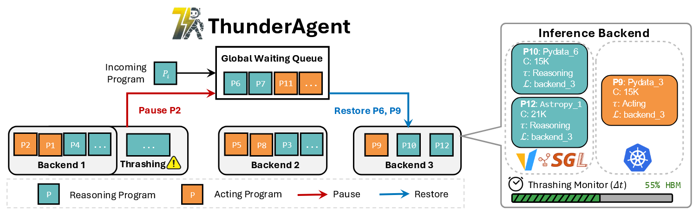

# ThunderAgent: A Simple, Fast and Program-Aware Agentic Inference System

!!! abstract

    [**ThunderAgent**](https://arxiv.org/abs/2602.13692) 使用**程序感知调度器**（state-aware pause + 跨节点动态迁移）+ **工具资源管理器**（hook 垃圾回收 + 异步环境预置），解决现有系统在处理复杂 Agent 任务时，因资源管理不当而导致的性能瓶颈。相比 SOTA，服务吞吐提升 **1.5–3.6×**，RL rollout 提升 **1.8–3.9×**，磁盘内存节省最高 **4.2×**

    - **作者**: Hao Kang, Ziyang Li, Xinyu Yang, Weili Xu, Yinfang Chen, Junxiong Wang, Beidi Chen, Tushar Krishna, Chenfeng Xu, Simran Arora
    - **机构**: Georgia Tech, Individual Researcher, CMU, UIUC, Together AI
    - arXiv: 2602.13692（v2，2026.03）；已被 **ICML 2026 接收为 Spotlight**

---

### Problem

**核心痛点：** 当前的 Agent 推理系统通常把<u>一个独立的推理引擎（vLLM/SGLang）和一个通用的工具编排器（Kubernetes）</u>松散组合在一起。这种设计缺乏对整个 Agent 工作流的全局视角，导致了三个核心问题：

1. **KV Cache Thrashing**
    - 当 Agent 调用外部工具时，会进入等待状态。现有系统无法预知等待时长，为了服务新来的请求，会过早地将 KV Cache 从显存中驱逐。
    - 当工具返回结果后，系统必须 **Re-prefill** 整个对话历史
2. **Cross-Node Memory Imbalance**
    - 在多 GPU 节点的部署中，为了最大化 KV Cache 命中率，现有路由策略（vLLM KV-aware、SGLang prefix-aware）会将同一个 Agent 的所有请求都固定到**同一个节点**上。
    - Agent 上下文快速增长且不可预测，这会导致一些节点显存爆满，而另一些节点却大量空闲
3. **Tool Lifecycle Obliviousness**
    - 推理引擎和工具编排器是分离的，系统不知道工具环境何时被真正需要或何时可以被回收
    - 这导致了两种问题：一是**资源泄漏**，已完成任务的沙箱未被及时清理，最终耗尽磁盘和网络端口；二是**环境准备延迟高**，新任务需要等待漫长的环境初始化过程。

!!! info "与 Agentix / Continuum 的对比"

    - **Autellix/Agentix**：只实现 **GPU-only 的程序级调度**，忽略了 workflow 的**局部性**，在高并发场景工作流会互相抢占资源，引发 KV thrashing。
    - **Continuum**：使用 TTL 机制 pin 住 KV Cache，但**工具时长不可预测时**依旧会发生抖动；且占用一旦超过显存，系统仍会强制驱逐已钉住的 KV Cache。
    - **ThunderAgent**：与其用 TTL 预测不可预测的工具时长，不如用**程序级主动调度**（显式控制活跃程序数量）+ **统一管理工具资源**。

---

### Key Idea

!!! tip "核心创新"

    将 Agent 工作流抽象为 **Agentic Program**，打破推理引擎与工具编排器的壁垒。在资源受限时，对 **GPU KV Cache** 和 **外部工具资源** 进行联合主动调度，以最小化系统总代价。

1. **Agentic Program Abstraction**：$P = \langle ID, c, \mathcal{T}, L, \tau, s\rangle$
    - $c$：上下文 token 数，直接决定活跃时的 KV Cache 显存占用
    - $\mathcal{T}$：需要的工具环境集合（如 Docker 沙箱、API 连接）
    - $L$：节点放置
    - $\tau$：执行阶段，分为 Reasoning (R) 和 Acting (A)
    - $s$：调度状态（Active/Paused/Terminated）
2. **STP（Space-Time Product）**
    - $\text{Cost}_{\text{total}} \approx \underbrace{\text{Cost}_{\text{decode}}+\text{prefill}_{\text{valid}}}_{\text{有效工作}} + \underbrace{\text{Cost}_{\text{recompute}} + \text{Cost}_{\text{unused}} + \text{Cost}_{\text{caching}}}_{\textbf{优化目标：非生产性开销}}$
    - $\text{Cost}_{\text{recompute}}=\int_0^{t_{\text{recompute}}} c_i(t) dt$：由 KV Cache 驱逐导致，与上下文长度呈**二次方关系** ($\propto c^2$)
    - $\text{Cost}_{\text{unused}}$：由跨节点内存分配不均导致
    - $\text{Cost}_{\text{caching}}$：由 Acting 阶段长时间占用显存但无计算导致。
3. **Program-Aware Scheduler**：
    - **State-aware Pausing**：
        - 周期性（$\Delta t$）检测显存占用，到达高位阈值（$\lambda_{max}$）时触达暂停机制
        - **优先暂停处于 acting 的程序**，保留 reasoning 程序的显存以确保计算连续性
    - **Time Decay Mechanism**：
        - 针对工具执行时间的**不可预测性**，引入衰减函数 $f(t)=x^{-t}$ 降低 Acting 程序的权重
          $C_{\text{total}}=\sum_{p\in L,\tau = R}c_p+\sum_{q\in L,\tau = A}c_q \times f(t_q)$
        - 平衡 $\text{Cost}_{\text{caching}}$ 与 $\text{Cost}_{\text{recompute}}$，避免长时间工具调用无限期占用资源
    - **Shortest-First Eviction**
        - 由于 $\text{Cost}_{\text{recompute}} \propto c^2$ ，逐出**最短上下文的程序**重算代价最小
        - 打分函数：$S_{restore}=\frac{1}{c_P}+I(\tau=R)$，$S_{pause}=\frac{1}{c_P}+I(\tau=A)$
    - **Dynamic Migration**：
        - 所有数据并行（DP）节点共享一个**全局等待队列**
        - Paused 程序可被调度至任意有空闲显存的节点
        - 解决了**跨节点内存失衡**和强制绑定节点导致的资源碎片化
4. **Tool Resource Management**
    - **Hook-based GC**
        - 工具资源（沙箱、端口）的生命周期严格绑定程序状态 $s$ 
        - 一旦程序 $s= \text{Terminated}$，立即回收资源，防止磁盘/端口资源泄漏
    - **Async Preparation**
        - 监测全局等待队列，但高优先级程序接近 restore 阈值时，**提前异步初始化**工具环境
        - 将环境准备延迟隐藏在调度等待时间内，降低端到端延迟

---

### Workflow

!!! note "系统流程"

    

    **ThunderAgent 调度器** ⇄ 各 DP Backend：每 $\Delta t$ 轮询各后端状态。

    - **Backend 1** 触发 thrashing → Grid 暂停并回收 acting 程序 **P2** 回全局等待队列，同时释放 reasoning 程序 **P6、P9** → 停止抖动、缓解 Backend 3 的失衡。

1. **Program Identification**
    - 客户端发起一个 Agent 任务时，在 LLM 请求中附加 program_id
    - 程序结束时，客户端发送释放信号（POST /programs/release） 通知系统回收资源
2. **Thrashing Monitor**：调度器以固定时间间隔（$\Delta t$）检查 Backend 的显存占用
    - 若 $\sum_{p\in L} c_p \ge \lambda_{max}\cdot C_{total}$ → 执行 **Pause**
    - 若 $\sum_{p\in L} c_p < \lambda_{min}\cdot C_{total}$ → 执行 **Restore**
3. **Scheduling Policy**
    - 基于打分函数 $S_{restore}/S_{pause}$ 进行优先级排序：
        - **Pause**：优先暂停处于 **Acting** 状态且**上下文较短**的程序（重算代价低）
        - **Restore**：优先恢复 **Reasoning** 状态（计算连续性强）且**上下文较短**的程序
        - **时间衰减**：衰减函数 $f (t)$，长期闲置的 Acting 程序权重会随时间降低，最终被逐出
4. **Dynamic Migration**
    - 被 Pause 的程序进入**全局共享等待队列**
    - 调度器可将其重新分发到**任意有空闲内存**的 Backend
5. **Tool Resource Management**：
    - **Hook-based GC**：一旦程序状态变为 Terminated，立即触发 Teardown 回收资源
    - **Async Preparation**：当全局队列中的高优先级程序即将达到恢复阈值时，后台异步初始化其所需的工具环境（如 Docker），隐藏启动延迟。
6. **Execution Loop**：
    - 程序在 Reasoning 与 Acting 间交替流转，重复上述调度流程，直至任务完成并显式释放。

---

### Results

**实验设置**：模型 GLM-4.6（355B）、Qwen3-235B（FP8 + TP8，8×H100）、ToolOrchestra 用 Qwen3-8B（FP16，1×RTX5090）；工作流：编码（OpenHands/mini-SWEAgent on SWE-bench-Lite）、路由（ToolOrchestra on HLE）、科学发现（OpenHands on ScienceAgentBench）；基线 vLLM、Continuum、vLLM + SGLang Gateway。

1. **服务吞吐大幅提升**：高并发（96 个并行程序）下，相比 vLLM 提升 **1.48–3.58×**，相比 Continuum 提升 **1.17–3.31×**（跨模型与数据集）。
2. **→100% 的 KV 命中率**：工具时长可预测的工作流（a/b/d/e）命中率接近 100%；随机的工具时长（c/f）则**动态权衡命中率与闲置缓存**，通过时间衰减保 GPU 利用率最大化 → 更高吞吐。
3. **高并发鲁棒**：即使并行程序数**超过 GPU 显存上限**，吞吐仍保持稳定；而基线在超出后严重崩塌。无需人工调优就可自动适配最大容量。
4. **RL rollout**：GLM-4.6、2×H100、3 小时——mini-SWEAgent 671.8 步/分 vs vLLM+Gateway 375.4（**1.79×**）；OpenHands 270.8 vs 69.1（**3.92×**）。
5. **消融与资源**：
    - 延迟分解：收益主要来自 prefill/decode 降低；工具资源管理贡献 ~10% 延迟改进并提供 **4.2× 磁盘内存节省**。
    - 参数敏感性：$\Delta t$（检测周期）与 $f(t)=x^{-t}$（衰减底数）在较宽范围内吞吐都稳定，鲁棒性好。
6. **架构对比**：KV cache offloading（LMCache）受 PCIe 带宽限制、PD disaggregation 在 agent 负载下反而加剧抖动——说明**通用架构优化不能替代程序级主动调度**。
