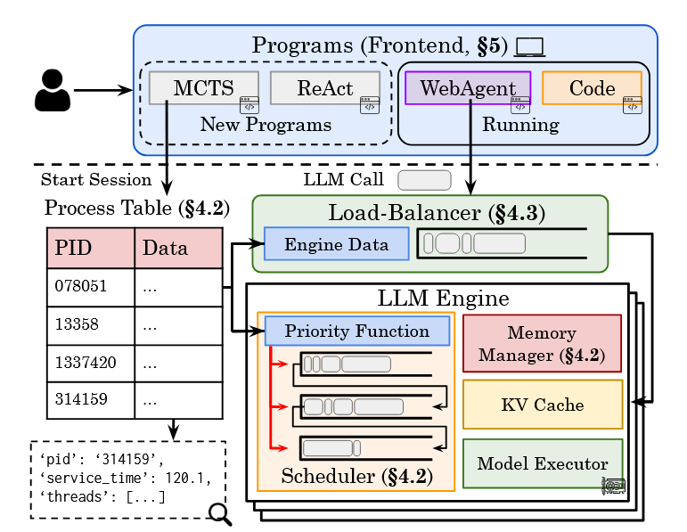
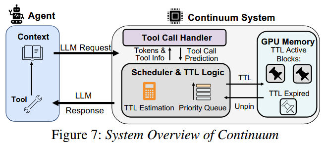
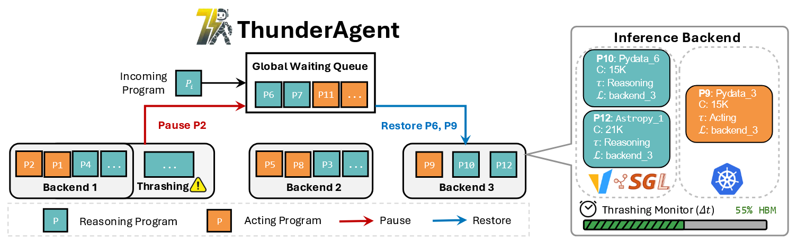
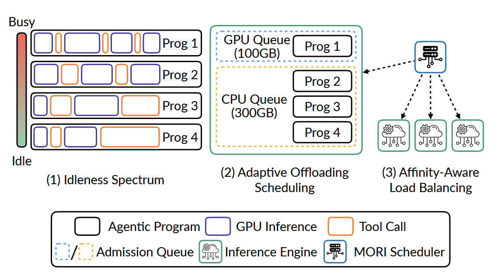
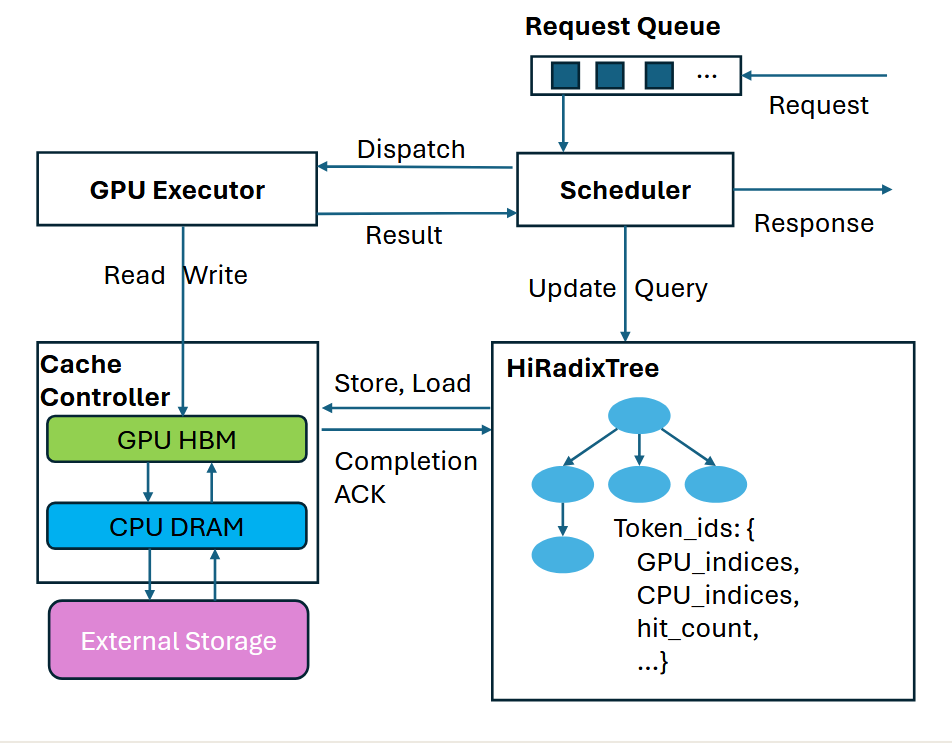
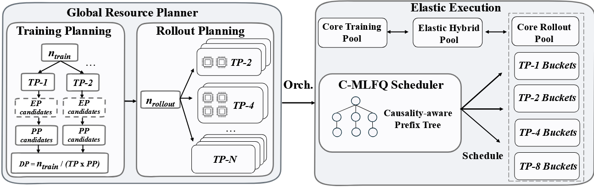
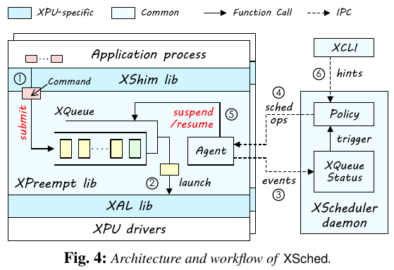

# 论文概览

!!! info

    这里记录了关于 AI Infra 的一些论文，主要讲的是 KV Cache 的管理策略

### [Mooncake](Mooncake.md) (3 Sep 2025)

面向 **Kimi** 的 KVCache-centric 解耦架构。除了把 prefill/decoding 分到不同节点，还把整个集群的 **CPU/DRAM/SSD** 整合成**全局 KVCache 池**，通过 Conductor 在 SLO 约束下最大化复用。提出 **CPP（Chunked Pipeline Parallelism）** 处理长上下文、**Layer-wise Prefill** 隐藏 KVCache 加载延迟、以及**基于预测的 Early Rejection** 应对过载场景。

- KVCache-centric Architecture，Disaggregated Prefill/Decoding，Global KVCache Pool，Conductor
- CPP（CPP），Layer-wise Prefill，Cache-aware Scheduling，Hot-spot Migration
- Early Rejection，System-level Prediction，Messenger（GPUDirect RDMA）

### [Agentix](Agentix.md) (19 Feb 2025)

核心工作是优化**长短不一、错综复杂的任务流**。它通过**程序级调度**（program-level），确保短任务不会被长任务堵死，目标是<u>让所有任务的总等待时间最短，最大化整个系统的吞吐量</u>。

- Global Process Table，PLAS，ATLAS
- Session Start，Load Balancing，Program-Aware Scheduler，Execution & Update，End

### [Continuum](Continuum.md) (4 Nov 2025)

优化需要**频繁调用工具**的场景，核心是**KV Cache 生命周期管理**。它通过预测 tool use 时间，合理设置 KV Cache 的 TTL 保留时间，有效解决了工具调用间隙带来的 prefill 重算问题。

- TTL（Time-to-Live），Utility Model（cost&benefit），memory factor（$\eta$）
- OnRequestArrive，OnRequestFinish，Request Pinning，Schedule & Unpin

### [ThunderAgent](ThunderAgent.md) (14 Feb 2026)

进一步**统一调度 GPU 上的 KV cache 与外部工具资源**。它通过**程序级主动调度**（state-aware pause + 跨节点迁移）解决 KV 抖动，用 **Hook 垃圾回收 + 异步环境准备**管理工具生命周期。

- Agentic Program 抽象，STP 代价模型，Shortest-First Eviction，Dynamic Migration
- Pause / Restore，Thrashing Monitor（$\Delta t$），Hook GC，Async Env Prep

### [MORI](MORI.md) (30 May 2026)

在 ThunderAgent 基础上引入 **GPU → CPU 的分层卸载调度**。它不将程序标记为二元的 busy/idle，而是用**滑动窗口计算连续的空闲度**，边界随硬件容量自适应。是首个同时感知 GPU 和 CPU 两层 KV 位置的亲和性负载均衡器。

- Idleness Spectrum，Windowed Idleness，Sticky Placement，Typed Offloading
- Three-Tier Queue（GPU/CPU/Waiting），Affinity-Aware Load Balancing

### [Strata](Strata.md) (26 Aug 2025)

解决**上层 offloading 加载回 GPU 时**的 I/O 与调度瓶颈。它用 **GPU-assisted I/O** 应对分页 KV 的传输碎片化、用**解耦内存布局**让 GPU 与 CPU/磁盘各用最优组织，并用 **cache-aware scheduling**（延迟命中规避 + 平衡批 + 泡沫填充）把缓存加载延迟隐藏或消除。

- GPU-assisted I/O，Decoupled Layout（layer-first / page-first），Delay Hit，Balanced Batch，Bubble Filling
- HiRadixTree，Cache Controller / Scheduler，Deferral on Delay Hit

### [Libra](Libra.md) (10 Jun 2026)

面向 **Agentic RL Post-Training** 的资源管理系统。它解决 rollout 长尾分布和跨阶段（rollout/training）不平衡问题：用 **C-MLFQ** 调度器基于工具返回因果信号动态路由请求到异构 TP bucket，并用**全局资源规划器 + 弹性混合池**实现非阻塞的跨阶段 GPU 重分配。

- C-MLFQ，Causality-aware Prefix Tree，Global Resource Planner，Elastic Hybrid Pool，Non-blocking Joining
- Heterogeneous Rollout Buckets，Decision Tree Search，Rollout DP，Decoupled Communication Domains

| 系统           | 核心思路                                                         | 优化范围与机制                                                                   |
| :----------- | :----------------------------------------------------------- | :------------------------------------------------------------------------ |
| Mooncake     | **KVCache-centric 解耦架构**, 把整个集群 KV Cache 整合成全局资源池，Conductor 围绕 KV Cache 做调度   | **GPU+CPU+DRAM+SSD 异构池**：用 prefix 命中长度 + KVCache 负荷调度； **创新**：CPP pipeline + Layer-wise Prefill 隐藏加载延迟 + Early Rejection 应对过载 |
| Agentix      | **程序级感知调度**, 引入 PLAS 和 ATLAS 算法，识别 Agent 的完整生命周期          | **GPU-only**，根据累计执行时长调度； **缺陷**：工具调用时 KV Cache 会被驱逐，导致Thrashing        |
| Continuum    | **基于预测的静态缓存** 利用 TTL 机制，在工具调用期间 Pin 住 KV Cache            | 试图保留上下文，**减少 re-prefill**； **缺陷**：无法应对工具调用时间的**长尾分布**（预测不准导致缓存浪费或过早失效） |
| ThunderAgent | **基于成本的主动调度** 放弃预测，引入**时间衰减函数**，主动执行 Pause/Restore 策略     | **全局吞吐量优化**：在“重算成本”与“缓存成本”间做动态权衡，统一管理 GPU 推理和外部工具资源                       |
| MORI         | **分层卸载与相对闲置** 引入 **GPU-CPU** Offloading，利用连续空闲度排名替代二元忙闲分类 | **跨层级资源利用**：将等待期的 KV Cache **卸载至 CPU**，释放 GPU 算力；增加跨副本亲和性路由，解决 PCIe 带宽瓶颈  |

### [XSched](../XSched/XSched.md) (OSDI 2025)

面向 **GPU/NPU/ASIC/FPGA 的通用抢占式调度框架**。以 **XQueue** 统一任务控制，通过 **Lv1 Pending / Lv2 In-flight / Lv3 Running** 三级模型适配不同硬件，再用 **Progressive Command Launching** 平衡异步流水线效率与抢占延迟。重点在设备命令层的执行控制，可为上层优先级、公平份额和 deadline 策略提供机制支持。

- XQueue，Multi-level Hardware Model，Progressive Command Launching
- XShim / XPreempt / XAL / XScheduler，Binary Instrumentation，Heterogeneous Scheduling

