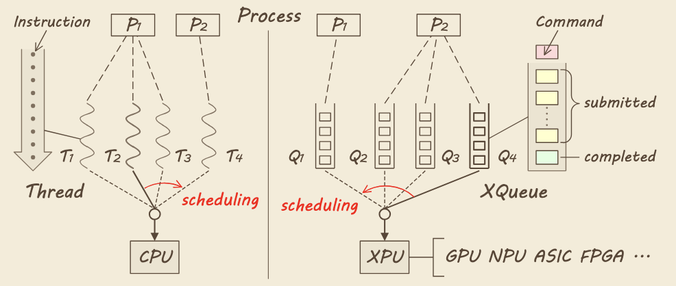
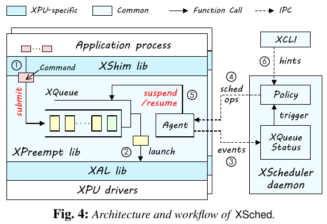
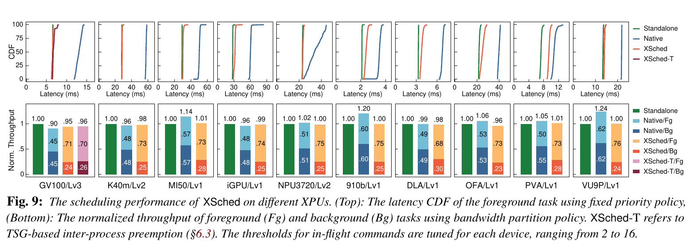
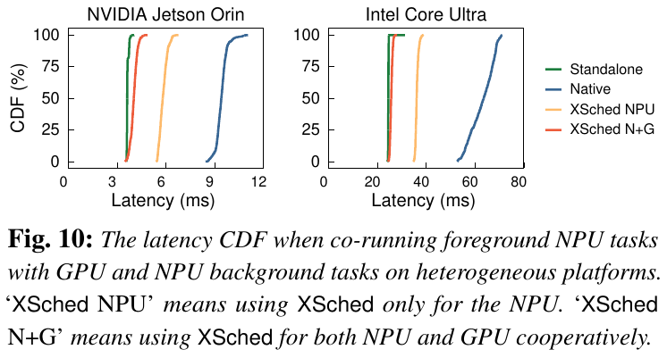
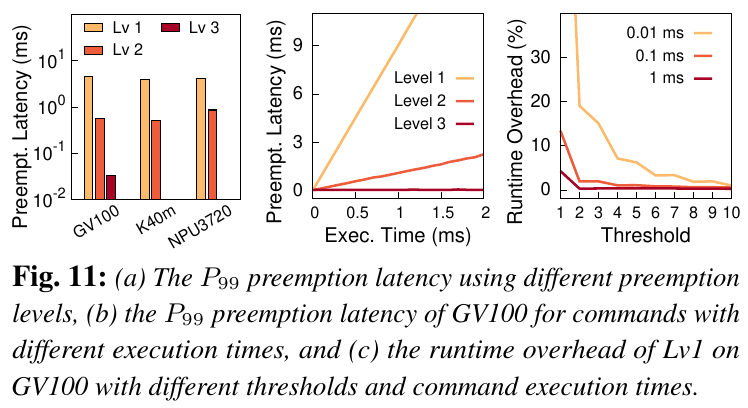
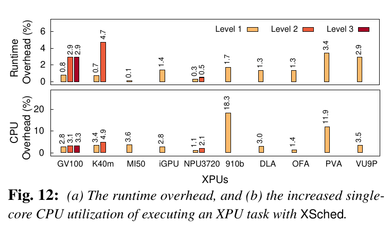
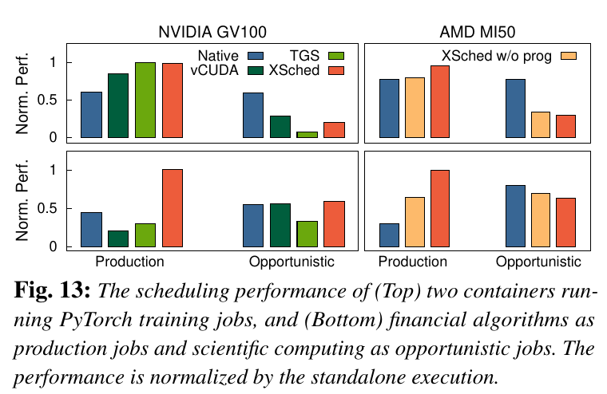
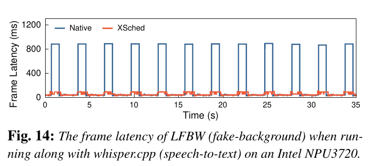
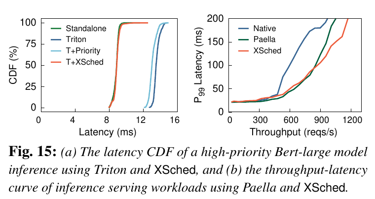

# XSched: Preemptive Scheduling for Diverse XPUs

!!! abstract

    [**XSched**](https://www.usenix.org/conference/osdi25/presentation/shen-weihang) 是一个面向 **GPU、NPU、ASIC 和 FPGA** 的通用抢占式调度框架。它将 XPU 任务抽象为**可抢占命令队列 XQueue**，通过**三级硬件模型**解耦调度策略与设备机制，再用 **Progressive Command Launching** 平衡异步执行效率与抢占延迟。在 7 个软件平台、10 种实验设备上验证了可移植性；视频会议场景中前台任务 P99 帧延迟从 **880 ms 降至 95 ms**，集成到 Triton 后高优先级推理 P99 延迟降低 **30.0%**。

    - **作者**: Weihang Shen, Mingcong Han, Jialong Liu, Rong Chen, Haibo Chen
    - **机构**: 上海交通大学，IPADS
    - **发表**: OSDI 2025
    - **代码**: [XpuOS/xsched](https://github.com/XpuOS/xsched)

---

## Problem

**核心痛点**：XPU 能高效执行单个任务，但多个任务共享设备时，硬件调度器往往无法满足**优先级、公平性和实时性**要求。

1. **硬件调度能力有限**：
    - 许多 XPU 通过 FIFO 硬件队列执行命令，形成非抢占式 **FCFS**；
    - 部分 GPU 的跨进程调度采用简单的时间片 **Round-Robin**

    **造成的问题**：

    - 后台任务提前提交大量命令后，前台紧急任务仍需等待，造成<u>优先级反转和尾延迟升高</u>
    - 固化策略缺少应用优先级、deadline 等信息，也难以随工作负载变化而调整，<u>公平性不足</u>

2. **已有软件方案绑定特定硬件**：
    - 某些方案依赖 GPU kernel 源码/PTX 改写；另一些依赖特定驱动或嵌入式 GPU 的接口。
    - 很难跨 GPU 厂商与架构移植，更难覆盖不可通用编程的 NPU、ASIC。

3. **缺乏统一抽象与能力模型**：
    - 只要求所有硬件共有的最低能力，会浪费先进设备的中断能力。
    - 强制要求细粒度中断，又会排除大量只提供基础命令队列接口的设备。
    - 调度策略与底层机制紧耦合，使得**可移植性（Portability）、统一性（Uniformity）、可演进性（Evolvability）** 难以兼得。

---

## Key Idea

!!! tip "核心创新"

    **向上统一任务抽象，向下分级适配硬件能力。**

    - **XQueue**：像调度 CPU 线程一样，通过 suspend/resume 调度 XPU 任务。
    - **Multi-level Hardware Model**：把抢占划分为 pending、in-flight、running 三个层级。
    - **Progressive Command Launching**：保留异步流水线，但限制已脱离 Host 控制的命令数量

### 1. XQueue

!!! info "XQueue & hwQueue"

    虽然 GPU、NPU、ASIC、FPGA 的硬件架构、Runtime 和驱动不同，但它们通常都采用基于队列的命令执行模型，论文统一称其为 ==Hardware Queue（hwQueue）==

    - 这些队列的基本工作方式类似：
        1. Host CPU 将 Commands 提交给 hwQueue
        2. XPU 根据数据依赖和队列顺序执行 Commands
        3. Host CPU 通过同步接口等待命令执行完成
    - XQueue 保留原生队列的执行语义，但增加了**可抢占性（Preemptibility）**

    | XQueue 接口         | 作用                   |
    | :---------------- | :------------------- |
    | `submit(xq, cmd)` | 将命令提交到 XQueue，等待调度执行 |
    | `wait(xq, cmd)`   | 等待指定命令完成             |
    | `suspend(xq)`     | 暂停队列，阻止任务继续占用设备      |
    | `resume(xq)`      | 恢复队列，继续执行任务          |

<div style="text-align: center"></div>

- **类比 CPU**：
    - CPU 线程承载指令序列，XQueue 承载 XPU 命令序列；
    - 调度器操作线程/队列，而不必理解每个指令/kernel 的内容。
- **多个队列可以并行运行**：
    - 如果硬件支持空间复用，策略可同时恢复多个 XQueue，并非强制串行执行
- **策略与机制解耦**：调度器只需决定暂停和恢复哪些队列，无需各自实现设备抢占

### 2. Multi-level Hardware Model

!!! note "submit & launch"

    - **submit** 将命令交给 Host 端的 XQueue；
    - **launch** 才将命令发入设备的 hwQueue。

    命令一旦 launch，就脱离普通 Host CPU 提交逻辑的直接控制。

| 层级      | 抢占对象          | 核心机制与接口                       | 抢占时仍需等待     |
| :------ | :------------ | :---------------------------- | :---------- |
| **Lv1** | **Pending**   | Pending Commands 继续进入 hwQueue | 所有已发出的命令执行完 |
| **Lv2** | **In-flight** | 停止 hwQueue 中后续命令的执行           | 当前正在运行的命令完成 |
| **Lv3** | **Running**   | 直接暂停正在执行的 Command             | 主要为中断与调度开销  |

- **逐层增强**：高层级依赖低层级；适配新设备只强制要求 Lv1，Lv2/Lv3 按设备能力增加。
- **Lv2 的两种实现路径**：
    - **Stalling-based Deactivation**：
        - 某些 XPU 内部具有 Microcontroller，负责从 hwQueue 中选择和分发命令
        - Host CPU 通过控制**微控制器**，停止从 hwQueue 取出新命令
    - **Flushing-based Deactivation**：
        - 如果 XPU 不支持通过微控制器暂停队列，但允许修改命令代码，可以采用软件方案
        - 其基本思想是：
            1. 修改 Commands，使其能够检测队列是否被停用
            2. 如果队列已停用，让尚未真正执行有效计算的 Commands 提前退出
            3. 记录这些被中止的 Commands
            4. 在 `reactivate()` 时重新发射这些 Commands
- **兼容硬件演进**：同一套策略可以在旧设备使用 Lv1/Lv2，在新设备利用 Lv3

### 3. Progressive Command Launching

**直接方案的矛盾**：<u>异步命令发射与抢占能力存在冲突</u>

- 一次性发出全部命令：CPU 与 XPU 能异步流水执行，但 Lv1 抢占时必须等整条设备队列排空。
- 每发一条命令就同步：可以缩短等待，但破坏 launch/execution 重叠

**XSched 的做法**：每个 XQueue 配置 worker thread、pending command buffer、in-flight command log 和对应 hwQueue

```cpp
void worker_thread(xq) {
    while (true) {
        if (get_inflight_cnt(xq) >= THRESHOLD) {
            mid = get_inflight_middle(xq);
            sync(xq.hwq, mid);
            pop_completed_cmds(xq);
        }

        cmd = pop_pending_cmd(xq);

        while (xq.mode == SUSPENDED)
            pause();

        launch(xq.hwq, cmd);
        push_inflight_cmd(cmd);
    }
}
```

1. 应用提交的命令先进入 **pending buffer**
2. worker 异步 launch 少量命令，在 **in-flight log** 中记录
3. Worker Thread 检查已经发射但尚未完成的 Command 数量
    - 当 in-flight 数量达到阈值时，等待其中约**一半完成**，清理日志后继续发出
4. Suspend 时先阻止 worker 继续 launch，再按设备能力执行 Lv2 deactivate 和 Lv3 interrupt
5. Resume 时 Worker Thread 重新开始工作，继续发射指令

!!! tip "关键权衡"

    阈值越大，流水线越饱满、同步开销越低，但 Lv1 的最坏等待越长。论文主实验按设备调节阈值，范围为 **2–16**；不能将某个固定阈值视为所有设备的最优参数。

---

## Framework

!!! note "系统架构"

    <div style="text-align: center"></div>

    | 组件         | 主要功能                   | 所在位置      |
    | ---------- | ---------------------- | --------- |
    | XShim      | 拦截应用原有的 XPU API，提供透明接入 | 应用进程      |
    | XPreempt   | 实现 XQueue 接口，管理命令提交与抢占 | 应用进程      |
    | XAL        | 将通用硬件模型接口映射到具体 XPU 驱动  | 应用进程      |
    | XScheduler | 全局调度器，决定运行哪些 XQueue    | 独立 Daemon |

### Scheduler

XScheduler 则负责全局协调：
当系统中存在来自不同进程、容器甚至不同 XPU 的多个任务时，应该运行哪些任务？

1. **Event-driven Scheduling**
    - 每个应用进程中的 XPreempt Agent 负责监测 XQueue 状态变化
    - 典型事件包括：
        - 新 Command 提交后，XQueue 从 Idle 变为 Ready
        - 所有 Commands 完成后，XQueue 从 Ready 变为 Idle
    - Agent 将这些事件发送给 XScheduler，XScheduler 收到事件后：
        1. 更新全局 XQueue Status
        2. 执行当前调度策略（Policy）
        3. 确定需要暂停或恢复的 XQueue
        4. 将操作发送回相应的 Agent
2. **Shared-memory IPC**
    - XScheduler 运行在独立进程中，而 XPreempt Agent 位于应用进程中，两者需要跨进程通信
    - 采用 Shared-memory IPC，这样 XScheduler 可以管理不同进程、不同容器中的 XQueue

### Control Plane & Data Plane

| 维度   | Control Plane                     | Data Plane           |
| ---- | --------------------------------- | -------------------- |
| 组件   | XScheduler                        | XPreempt、XAL、Driver  |
| 职责   | 决定运行哪个 XQueue                     | 实际发射和执行 Commands     |
| 信息   | Priority、Status、Scheduling Events | Kernel、Memory Copy 等 |
| 运行方式 | 独立 Daemon                         | 应用进程内                |

调度器只负责**决策和控制**，实际命令提交仍由应用进程中的 XPreempt 完成。这有助于减少命令提交路径上的开销，也能够隔离应用进程内的部分故障。

---

## Implementation

| 等级  | 核心接口                    | 抢占对象                   |
| --- | ----------------------- | ---------------------- |
| Lv1 | launch / sync           | 尚未发射的命令（Pending）       |
| Lv2 | deactivate / reactivate | 已发射但尚未执行的命令（In-flight） |
| Lv3 | interrupt / restore     | 正在执行的命令（Running）       |

### Level 1

Lv1 的实现最简单，因为几乎所有 XPU 都已经提供了两个能力：

1. Launch：向硬件队列提交命令
2. Synchronize：等待命令完成
XSched 只需要把这些平台原生 API 封装成统一的 XAL 接口

!!! question "如何实现 sync(hwq, cmd)"

    Driver 不一定提供直接等待任意指定 Command 的接口，因此作者利用 Event 实现细粒度同步
    例如 CUDA：

    ```
    cuLaunchKernel(..., stream, ...);

    CUevent event;
    cuEventCreate(&event, CU_EVENT_DEFAULT);
    cuEventRecord(event, stream);

    // 等待之前的命令完成
    cuEventSynchronize(event);
    ```

    因此可以通过等待 Event，实现对某条 Command 的同步。
    如果某种 XPU 不支持 Event，也可以退化为同步整个 hwQueue。

### Level 2

!!! abstract "Target"

    Lv2 要实现：

    ```cpp
    deactivate(hwq);
    reactivate(hwq);
    ```

    目标是阻止已经发射到 hwQueue、但尚未执行的 Commands 开始执行。

#### Stalling-based Preemption

这种方法适用于**能够控制硬件命令分发的 XPU**，具备微控制器不代表一定支持 Lv2 抢占；还必须存在相应的固件功能以及软件可访问的控制接口。

#### Flushing-based Preemption

**让尚未真正开始计算的 Kernel 自行检测队列是否被停用，并在停用时提前退出。**

##### 1. Guardian Code

```cpp
void guardian(flag_ptr, hwq_id, cmd_id) {
    if (*flag_ptr == DEACTIVATED) {
        push_aborted_cmd(hwq_id, cmd_id);
        exit_thread();
    }
}
```

每个 Kernel 开始执行时，先检查对应 hwQueue 的状态标志

- flag_ptr 指向 GPU Global Memory 中的标志位
- 每个 hwQueue 对应自己的状态标志，因此可以控制不同队列

##### 2. deactivate()

```cpp
void deactivate(hwq) {
    int *flag_ptr = get_deactivation_flag(hwq);
    *flag_ptr = DEACTIVATED;
}
```

- Host CPU 设置标志位后，开始执行的 Kernel 会在入口处检测到队列已停用，然后主动退出
- 这种方式不需要直接让硬件队列停止出队，而是让已经出队的 Kernel 尽快结束

##### 3. reactivate()

当恢复队列时：

```cpp
void reactivate(hwq) {
    int *flag_ptr = get_deactivation_flag(hwq);
    *flag_ptr = NORMAL;
    while (cmd = pop_aborted_cmd(hwq)) {
        launch(hwq, cmd);
    }
}
```

先清除停用标志，然后重新发射之前被中止的 Commands。

##### 4. Dynamic Binary Instrumentation

之前的相关工作也提出过类似的 Kernel Flushing 方法，但通常需要修改 Kernel 源代码或 PTX。

- 如果应用使用闭源 CUDA Kernel，开发者并不能随意修改其源代码
- 因此，XSched 选择 ==Dynamic Binary Instrumentation（DBI）==

具体流程如下：

1. 使用 NVCC 将 Guardian 编译成 GPU Binary
2. 在进程启动时，将 Guardian 代码加载到 GPU 指令内存
3. 将原始 Kernel 的第一条指令替换为跳转指令 JMP
4. 跳转到 Helper Snippet，加载 Guardian 所需参数
5. 调用 Guardian 检查 hwQueue 状态
6. 如果队列正常，则执行被替换的原始指令，返回 Kernel 后续代码

### Level 3

#### TSG-based Preemption

!!! info

    - NVIDIA GPU 会利用时间片机制调度不同进程的 GPU 工作。硬件通过 Round-Robin 分配时间片。当某个 TSG 的时间片用完时，GPU 可以中断正在执行的 Kernel，并切换到下一个 TSG。

    - 论文利用这一能力实现 Lv3：
        1. 将 Task A 所属 TSG 的 Timeslice 设置为 0
        2. GPU 触发抢占
        3. 运行其他 TSG
        4. 恢复原来的 Timeslice
    - 具体而言：
        - interrupt()：将目标 hwQueue 所属 TSG 的时间片调整为零
        - restore()：将时间片恢复为原值

局限：只能实现==进程间抢占（Inter-process Preemption）==

- 一次 TSG 抢占会影响整个 TSG，而不只是其中某个独立的 XQueue
- 无法通过它独立控制同一 TSG 内的多个 XQueue。
该方法能够同时实现 Lv2 和 Lv3，因为切换 TSG 时，既阻止其剩余命令执行，也中断正在运行的命令

#### Queue-based Preemption

TSG-based 的粒度太粗，因此作者希望直接以 hwQueue 为单位进行抢占。

!!! info "Idea"

    作者通过追踪 CUDA 应用的系统调用，发现了一个特殊的 ==ioctl==，它可以通过写入 GPU 控制寄存器触发中断。这个机制原本用于 Kernel Debugging。当 GPU 收到中断后，会暂停正在运行的 Kernel，进入 GPU Trap Handler，保存执行上下文，检查中断原因

结合 DBI 技术，扩展 GPU Trap Handler，使其能够识别 XSched 触发的中断，当中断发生时：

- 如果是目标 Kernel，则中止它，实现抢占
- 如果不是目标 Kernel，则恢复其上下文，让它继续执行

但 NVIDIA GPU 没有向该方案开放从任意中断位置恢复被中止 Kernel 的接口。因此不能简单地保存 Kernel 的全部状态，然后让它从中断点继续执行。

论文采用的是：

- 只抢占**具有幂等性（Idempotence）的 Kernel**，并在恢复时<u>从头重新运行</u>
    - 一个操作 $f$ 具有幂等性，通常可以理解为重复执行不会改变最终结果：$f (f (x))=f (x)$
    - 但对于 GPU Kernel，论文需要的是 Kernel 被中止后重新执行，不会因先前已经发生的部分写入而产生错误结果
- 论文指出，目前通过人工方式识别幂等 Kernel，并计划结合后续的自动验证技术。

---

## Workflow

### Step1: Command Submission

1. **命令拦截（XShim）**
    - 应用照常调用 CUDA、HIP、Level Zero 等平台 API
    - XShim 拦截原生 XPU API，将命令转发至软件 XQueue，而非直接提交给 hwQueue
    - 如果应用直接调用 XQueue 接口，则无需 XShim
2. **命令缓冲（XPreempt）**
    - `submit(xq, cmd)` 将命令加入 XQueue 的 Pending Command Buffer
    - 每个 XQueue 配有 Worker Thread、Pending Command Buffer、In-flight Command Log，以及对应的 hwQueue
3. **渐进式发射（Progressive Command Launching）**
    - Worker Thread 通过 XAL 的 `launch()` 接口，将 Pending Commands 异步发射至 hwQueue
    - Worker 根据 `THRESHOLD` 限制 In-flight Commands 数量；达到阈值时，通过 `sync()` 等待较早的一部分命令完成，再继续发射
4. **硬件适配（XAL）**
    - XAL 将统一的多级硬件模型接口映射至对应设备的 Driver API
    - Lv1 只需实现 `launch/sync`；Lv2、Lv3 可根据硬件能力提供更细粒度的抢占

### Step2: Scheduling Decision

1. **状态监测（Agent）**
    - XPreempt 内的 Agent 监测 XQueue 状态
    - 例如新命令到达使队列变为 Ready，或所有命令完成使队列变为 Idle
2. **全局状态维护（XScheduler）**
    - Agent 通过共享内存 IPC 向 XScheduler Daemon 上报状态变化
    - XScheduler 维护跨进程的全局 XQueue 信息，包括 Ready/Idle 状态、XPU 设备 ID、进程 ID 等
3. **调度决策（Scheduling Policy）**
    - XScheduler 根据队列状态、调度提示和当前策略，决定哪些 XQueue 应当暂停或恢复
    - 应用通过 `send_hint()`、用户通过 XCLI 提供 Priority、Bandwidth、Deadline 等参数
4. **调度指令下发**
    - XScheduler 将 `suspend/resume` 操作通过 IPC 发送给对应 Agent。
    - Agent 在所属应用进程内调用 XPreempt 接口执行调度操作。

### Step3: Preemption Execution

XPreempt 收到 `suspend(xq)` 后，首先将 XQueue 标记为 `SUSPENDED`，阻止 Worker 继续发射 Pending Commands；随后根据 XAL 支持的最高抢占等级执行相应操作。

### Step4: Resume & Rescheduling

1. **触发重新调度**
    - 当运行中的任务完成、新任务到达，或 BP 策略的时间片到期时，XScheduler 重新执行调度策略
2. **恢复 XQueue**
    - Agent 调用 `resume(xq)`，将 XQueue 状态设置为 `RUNNING`
    - 对 Lv2/Lv3，XPreempt 进一步通过 XAL 恢复硬件队列或被抢占的命令，具体方式取决于硬件实现
3. **继续执行剩余命令**
    - Worker Thread 恢复渐进式发射 Pending Commands
    - 对于 Flushing-based 或部分 Queue-based 抢占，先前中止的命令需要重新发射或重新执行
    - 已完成的命令无需重复执行
4. **完成与同步**
    - XPU 异步执行剩余 Commands
    - 应用通过 `wait(xq, cmd)` 等接口等待执行完成
    - 当 XQueue 不再有待执行工作时，Agent 上报 Idle 状态，XScheduler 据此进行后续调度

---

## Results

### Uniformity

#### 单个 XPU 内部的多任务调度    

- **具体任务**：两个独立进程共享同一个 XPU
    - GPU/NPU 运行 ResNet-152 推理；OFA 运行 Stereo Disparity；PVA 运行 Gaussian Filter；FPGA 运行 Vector Addition
- **运行环境**：
    - 10 种 XPU：NVIDIA GV100/K40m、AMD MI50、Intel Arc iGPU、Intel NPU3720、Ascend 910b、NVIDIA DLA、OFA/PVA、Xilinx VU9P
    - FP 实验中前台按峰值吞吐的 20% 周期提交，后台持续满速提交
    - BP 实验中两者均满速提交，目标份额为 75% : 25%
- **性能结果**：
    - **Fig. 9（Top）：Fixed Priority**
        - Native：P99 延迟为 Standalone 的 1.60～2.19 倍
        - XSched：P99 延迟仅为 Standalone 的 1.02～1.30 倍
        - XSched 相比 Native 最多降低约 2.11 倍的 P99 延迟
        - 结论：<u>同一种 Fixed Priority 策略可以在不同 XPU 上复用，并有效保护前台任务的延迟</u>
    - **Fig. 9（Bottom）：Bandwidth Partition**
        - 基本实现 **75% : 25%** 的目标吞吐份额，总吞吐平均开销为 **1.5%**
        - 这里的份额指设备服务时间，并非直接限制显存带宽

<div style="text-align: center"></div>

#### GPU 和 NPU 的协同调度

!!! info "Motivation"

    - GPU 和 NPU 虽然有独立的计算单元，但在同一个 SoC 上可能共享：
        - Memory Bandwidth（内存带宽）
        - Power Budget（功耗预算）
    - 因此，即使 NPU 内部已经实现优先级调度，GPU 上的后台任务仍可能干扰 NPU 的前台任务

- **具体任务**：
    - 前台和后台进程在 NPU 上运行推理
    - 同时另一个后台进程在集成 GPU 上运行消耗内存带宽的任务
- **运行环境**：
    - NVIDIA Jetson Orin 与 Intel Core Ultra 9 185H AI PC
    - NPU 分别为 NVIDIA DLA 与 Intel NPU3720
    - 比较原生调度、仅调度 NPU（XSched NPU）、同时调度 GPU/NPU（XSched N+G）
- **性能结果**：
    - 仅调度 NPU 时，两个平台的前台 P99 仍为独占运行的 **1.67× / 1.55×**。
    - 协同调度 GPU/NPU 后，降至 **1.18× / 1.09×**；相对原生调度最高改善 **2.63×**

<div style="text-align: center"></div>

### Evolvability

#### 不同抢占登机的切换延迟

- **具体任务**：
    - 持续发射 Commands，在执行过程中触发抢占，测量 P99 抢占延迟
    - 改变单个 Command 的执行时间，观察抢占延迟是否随之增长
- **运行环境**：
    - NVIDIA GV100、K40m、Intel NPU3720，分别测试设备支持的抢占等级
    - Fig. 11(a)：单个 Command 执行时间 $T=0.5\text{ ms}$，In-flight 阈值为 8
    - Fig. 11(b)：在 GV100 上改变单个 Command 的执行时间
- **性能结果**：
    - **Fig. 11（a）：不同抢占等级**
        - Lv1：P99 抢占延迟约 **8T（4 ms）**，需要等待已经发出的 Commands 执行完
        - Lv2：降至约 **1T（0.5 ms）**，只需等待当前运行的 Command 完成
        - GV100 Lv3：进一步降至 **32 μs**
    - **Fig. 11（b）：Command 执行时间的影响**
        - Lv1/Lv2 的抢占延迟随 Command 执行时间增长
        - Lv3 的抢占延迟基本不受 Command 执行时间影响
    - 结论：<u>同一个 XQueue 抽象可以利用不同设备的抢占能力；更高等级进一步降低抢占延迟，无需改写上层调度策略</u>

<div style="text-align: center"></div>

### Scheduling Overhead

#### 渐进式发射的参数权衡

- **具体任务**：改变 In-flight Command 数量，测量渐进式发射带来的运行开销
- **运行环境**：
    - NVIDIA GV100
    - Fig. 11(c)：比较单个 Command 执行时间为 **0.01 / 0.1 / 1 ms** 时，不同 In-flight 阈值的开销
- **性能结果**：
    - 阈值增大后，运行开销下降；该实验中阈值大于 10 时，开销低于 **1%**
    - Command 越短，频繁同步和流水线停顿占比越高，开销越明显
    - 结论：<u>增大阈值可以提高流水线效率，但会延长 Lv1 的抢占等待，需要根据任务权衡</u>

#### 运行开销与 CPU 开销

- **具体任务**：
    - 单独运行一个 XPU 任务，排除其他任务的资源竞争
    - 测量接入 XSched 后新增的执行时间和 CPU 占用
- **运行环境**：
    - 使用 Uniformity 实验中的 10 种 XPU 及对应任务
    - 以 Native 下的单任务运行为基线，测试各设备支持的 Lv1/Lv2/Lv3
- **性能结果**：
    - **Fig. 12(a)：Runtime Overhead**
        - Lv1：全部测试设备的运行开销低于 **3.4%**
        - GV100/K40m：Lv2 的 Guardian 插桩使开销较 Lv1 分别增加约 **2.1 / 4.0 个百分点**
        - NPU3720：硬件辅助 Lv2 不带来额外运行开销
    - **Fig. 12(b)：CPU Overhead**
        - 大部分设备新增 CPU 占用小于单核利用率的 **5%**
        - 910b/PVA 分别为 **18.3% / 11.9%**，主要因为驱动在同步时采用自旋等待
- 结论：<u>XSched 的基础运行开销较低，但具体成本取决于抢占实现、设备访存延迟和驱动同步方式</u>

<div style="text-align: center"></div>

### Case Studies

#### 云端生产任务与后台任务共置

- **具体任务**：两个容器共享一张 GPU
    - Production Job（Pjob）：生产任务，要求尽量维持独占运行时的性能
    - Opportunistic Job（Ojob）：后台机会任务，利用生产任务剩余的 GPU 资源
    - 两类负载：
        - 负载一：两个 PyTorch 训练任务共置
        - 负载二：Black-Scholes 金融计算作为 Pjob、CFD 科学计算作为 Ojob
- **运行环境**：
    - 分别在 NVIDIA GV100、AMD MI50 进行单卡实验
    - 比较 Native、vCUDA、TGS 与 XSched；性能相对 Standalone 归一化
    - XSched 使用 Fixed Priority，Pjob 优先于 Ojob
    - GV100 可使用 Lv2 抢占；MI50 仅实现 Lv1，并比较关闭 Progressive Launching 的情况
- **性能结果**：
    - **Fig. 13（Left）：NVIDIA GV100**
        - 训练共置时，TGS 的 Ojob 仅利用 **7.3%** 的 GPU，XSched 达到 **20.0%**，提升 **2.74×**
        - 金融计算场景中，TGS 使 Pjob 性能下降 **70.0%**；XSched 将性能下降控制在约 **1.0%**
    - **Fig. 13（Right）：AMD MI50**
        - 即使仅有 Lv1，训练/金融计算 Pjob 的性能下降也分别控制在 **4.1% / 0.4%**
        - 关闭 Progressive Launching 后，频繁同步降低执行效率
- 结论：<u>XSched 可以在保护生产任务的同时利用空闲资源；Lv2 减轻已发出命令的阻塞，渐进式发射则让仅支持 Lv1 的设备仍保持效率</u>

<div style="text-align: center"></div>

#### AI PC 视频会议

- **具体任务**：
    - LFBW：以 **25 FPS** 处理视频，执行背景虚化
    - whisper.cpp：每 **3 秒**转写一次音频
    - 目标：降低视频卡顿，同时保证转写在周期内完成、不丢内容
- **运行环境**：
    - 两个应用共享 AI PC 上的 **Intel NPU3720**
    - 比较 Native FCFS 与 XSched
    - 先尝试 Fixed Priority；由于持续优先处理视频会使转写错过周期，最终改用 **Laxity-based Policy**，根据任务剩余时间裕量协调执行
- **性能结果**：
    - **Fig. 14：背景虚化的帧延迟**
        - Native：一次转写占用约 **0.8 s**，导致视频周期性阻塞，P99 帧延迟达到 **880 ms**
        - XSched：P99 帧延迟降至 **95 ms**，改善 **9.26×**，同时保证转写不丢内容
- 结论：<u>抢占机制允许策略根据应用需求调整；使用时间裕量调度，可同时兼顾视频响应与语音转写期限</u>

<div style="text-align: center"></div>

#### 多模型推理服务

- **具体任务**：
    - Triton：运行两个 BERT-large 模型，高优先级客户端以 **10 req/s** 提交请求，低优先级客户端持续提交
    - Paella 对比：沿用其多模型推理负载，改变请求吞吐，测量 P99 推理延迟
- **运行环境**：
    - 均运行在单张 **NVIDIA GV100** 上
    - Triton：改动 **10 行代码**传递优先级提示，使用 XSched Fixed Priority；比较 Standalone、原版 Triton、仅配置 Triton 优先级、Triton + XSched
    - Paella 对比：在其 CUDA-MS 基线中改动 **15 行代码**接入 XSched，采用 **K-EDF（K=16）**；请求到达采用论文中 $\sigma=2.0$ 的对数正态分布配置
- **性能结果**：
    - **Fig. 15（a）：Triton 高优先级推理**
        - 原版 Triton：P99 为 Standalone 的 **1.53×**
        - 仅配置 Triton 优先级：仍为 **1.51×**
        - Triton + XSched：降至 **1.07×**，相对原版 Triton 降低 **30.0%**
    - **Fig. 15（b）：与 Paella 比较**
        - 低吞吐时，两者 P99 延迟接近
        - **1,000 req/s** 时，XSched 的 P99 延迟相比 Paella 改善约 **1.3×**
- 结论：<u>把服务层优先级传递到设备执行层，可以减少已发出 GPU 命令造成的阻塞；通用调度框架也能达到接近专用 GPU 推理调度系统的性能</u>

<div style="text-align: center"></div>

---

### Limitations & Takeaways

- **命令式卸载前提**：面向 Host 发命令、XPU 被动执行的模式；自主运行任务的 DPU/FPGA 需要将调度机制集成到其控制单元。
- **单命令大任务**：若整个推理被封装为一个不可分的命令，例如某些 NPU 推理或 CUDA graph，Lv1/Lv2 无法在内部快速切换，需要 Lv3 或先拆分命令。
- **显存管理未覆盖**：假设设备内存足以容纳所有任务数据，未实现显存超额分配与随任务切换的数据换入换出。
- **不构成强制隔离边界**：恶意应用可绕过用户态 XShim/XQueue；需要结合 API remoting 等机制确保所有命令受控。
- **高级能力依赖具体平台**：部分 GPU Lv3 接口未公开，可能随驱动变化；分级模型提供回退路径，但回退后抢占延迟也会增加。
